# Panduan Operasional Penyelenggaraan Event & Pendaftaran Turnamen Basket ActStation

Dokumen ini memuat panduan komprehensif alur operasional turnamen dari pembuatan event oleh panitia eksternal, konfigurasi kategori dinamis, pendaftaran peserta berbasis Digital Document Vault, simulasi pengujian oleh staf internal, manajemen kurasi berkas & tiket, hingga pencairan dana bertahap melalui sistem Rekening Bersama (Escrow Platform).

> 💡 **Akses Cepat Tampilan Visual Browser**: Panduan lengkap ini dapat dibuka langsung di peramban web pada: **[http://localhost:7000/panduan-event](http://localhost:7000/panduan-event)**.
> Seluruh berkas tangkapan layar (PNG 1600x1000) tersimpan di `./docs/screenshots/` dan `./public/docs/screenshots/`.

---

## Studi Kasus Spesifikasi Event

- **Nama Event**: *Piala Kemerdekaan Basket Jabar 2026*
- **Cabang Olahraga**: Basketball (`sport_categories.id = 1`)
- **Struktur Kategori (5 Kategori — Kuota Masing-Masing 8 Tim)**:
  1. **Instansi / Dinas Putra (KU 35++)**: Format 5x5, Usia Senior 35+ tahun.
     - *Alur Registrasi*: `screening_first` (Kurasi Berkas Dulu -> Lolos Verifikasi -> Bayar -> Sah).
     - *Syarat Dokumen*: BPJS Ketenagakerjaan (`bpjs_tk`), Screenshot Profil JMO Aktif Bekerja (`jmo_screenshot`), ID Card Pegawai/NIP (`employee_card`), KTP (`id_card`), Surat Tugas/Mandat Instansi (`recommendation_letter`).
  2. **Pelajar SMP Putra**: Format 5x5, Usia Remaja (13–15 tahun).
     - *Alur Registrasi*: `screening_first`.
     - *Syarat Dokumen*: Kartu Pelajar (`student_card`), Biodata Raport Aktif/NISN (`report_card`), Akta Kelahiran (`birth_certificate`), Kartu Keluarga (`family_card`), Pasfoto (`photo`), Surat Izin Kepala Sekolah (`recommendation_letter`).
  3. **Pelajar SMP Putri**: Format 5x5, Usia Remaja (13–15 tahun).
     - *Alur Registrasi*: `screening_first`.
     - *Syarat Dokumen*: Identik dengan SMP Putra.
  4. **Pelajar SMA Putra**: Format 5x5, Usia Taruna (16–18 tahun).
     - *Alur Registrasi*: `screening_first`.
     - *Syarat Dokumen*: Identik dengan kategori pelajar.
  5. **Pelajar SMA Putri**: Format 5x5, Usia Taruna (16–18 tahun).
     - *Alur Registrasi*: `screening_first`.
     - *Syarat Dokumen*: Identik dengan kategori pelajar.

---

## 1. Onboarding Penyelenggara Eksternal & Just-In-Time KYC

Penyelenggara turnamen mendaftar melalui portal publik tanpa hambatan administratif di awal.

```
[Tamu / User Baru] ──> Registrasi (/register) ──> Role Default: 'member'
                             │
                             ▼ Klik Tombol "+ Buat Event"
                  [Cek Role: Belum Ada Role 'organizer']
                             │
                             ▼
                  Redirect ke /panel/organizer/apply
                  - Isi NIK & Unggah Foto KTP PIC (Disk Privat 'local')
                  - Isi Rekening Payout Escrow (Nama Wajib Sama dengan KTP)
                  - Kontak Darurat WhatsApp PIC
                             │
                             ▼ Submit Form
                  [Role Upgrade Otomatis: 'organizer']
                             │
                             ▼
                  [Form Buat Turnamen Terbuka]
```

1. **Registrasi Akun Publik (`/register`)**:
   - Pendaftar memasukkan Nama Lengkap, Email, Nomor WhatsApp aktif (format `08...` otomatis ternormalisasi ke E.164 `+62...`), dan Password.
   - Akun aktif dengan role awal `member`.
2. **Just-In-Time KYC Penyelenggara (`/panel/organizer/apply`)**:
   - Saat pengguna menekan tombol **"+ Buat Event"**, sistem memicu verifikasi PIC:
     - NIK KTP dan Foto KTP (disimpan di disk privat `local`).
     - Rekening Bank Penampungan Escrow (BCA, Mandiri, BRI, BNI, BJB, CIMB Niaga). Nama pemilik rekening bank wajib identik dengan KTP PIC untuk kepastian legalitas pencairan dana.
     - Kontak WhatsApp Darurat PIC.
   - Setelah disimpan, sistem meng-upgrade role menjadi `organizer`.

---

## 2. Pembuatan Draf Event & Konfigurasi 5 Kategori

### 2.1 Form Pembuatan Turnamen (`/panel/organizer/events/create`)
- **Judul Event**: *Piala Kemerdekaan Basket Jabar 2026*.
- **Lokasi Venue**: Wajib memilih dari master data gelanggang terdaftar (`venues`), misal *GOR C-Tra Arena Bandung*.
- **Waktu Pelaksanaan**: Tentukan `starts_at` dan `ends_at`.
- **Batas Waktu Pendaftaran**: Tentukan `registration_deadline`.
- **Biaya Registrasi**: Rp 1.000.000 per tim.
- **Izin Gelanggang**: Unggah surat bukti sewa / izin penggunaan GOR (`venue_approval_doc`).
- **Opsi Transfer Manual**: Centang jika panitia ingin mengizinkan pembayaran transfer langsung di luar Payment Gateway.

### 2.2 Workspace Overview Penyelenggara (`/panel/organizer/events/{id}/manage`)
Setelah draf turnamen tersimpan, panitia diarahkan ke dasbor kendali operasional turnamen:

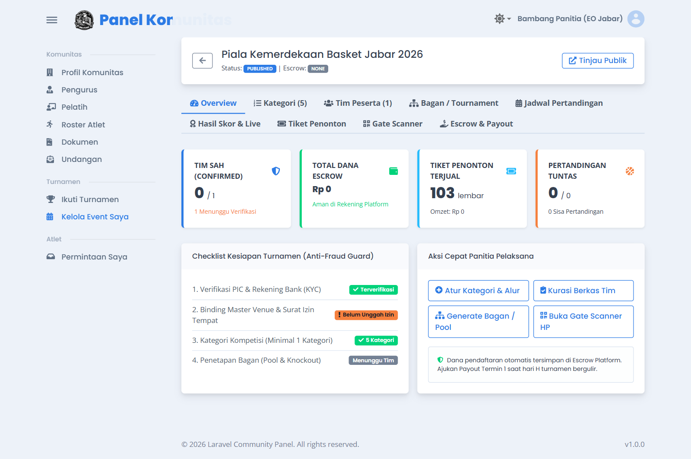

Dasbor menyajikan:
- 4 Kartu Statistik Cepat: Tim Sah (`Confirmed`), Total Dana Tertampung di Escrow Platform, Tiket Penonton Terjual, dan Jumlah Pertandingan Tuntas.
- Checklist Kesiapan Turnamen (Anti-Fraud Guard).
- Tab navigasi operasional: Overview, Kategori, Tim Peserta, Bagan/Tournament, Jadwal Pertandingan, Hasil Skor, Tiket Penonton, Gate Scanner, dan Escrow Payout.

### 2.3 Konfigurasi Kategori & Preset Syarat Dokumen (`/panel/organizer/events/{id}/categories`)
Panitia menambahkan 5 kategori kompetisi menggunakan tombol **"Tambah Kategori"**:

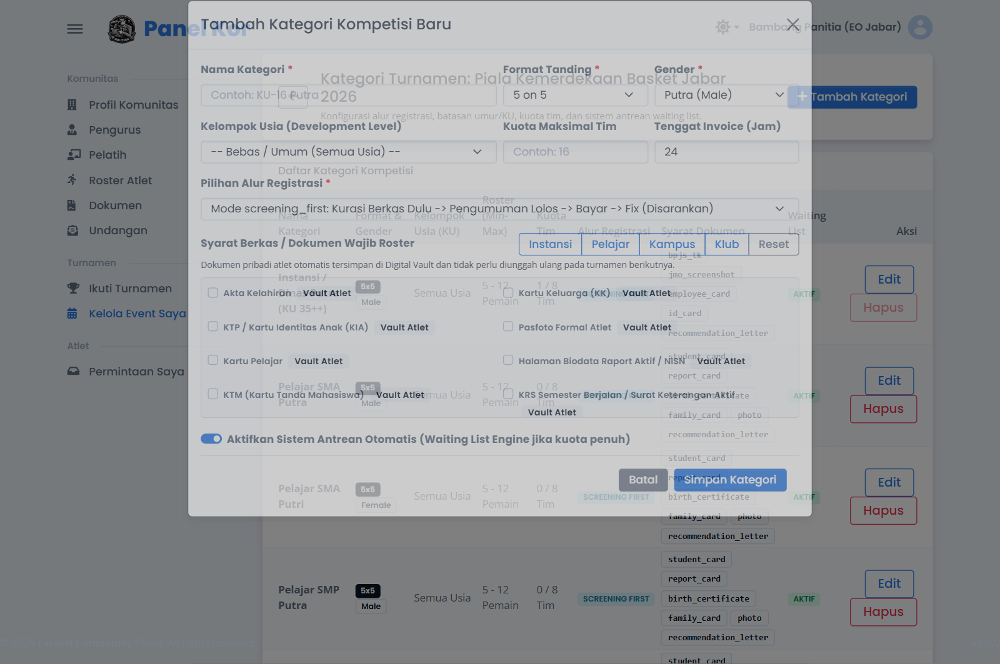

Fitur unggulan pada modal kategori:
- **Preset 1-Klik**:
  - Tombol **`[Instansi]`**: Otomatis mencentang `employee_card`, `bpjs_tk`, `jmo_screenshot`, `id_card`, dan `recommendation_letter`.
  - Tombol **`[Pelajar]`**: Otomatis mencentang `student_card`, `report_card`, `birth_certificate`, `family_card`, `photo`, dan `recommendation_letter`.
- **Pilihan Alur Dinamis (`registration_flow`)**:
  - Pilih **`screening_first`**: Kurasi berkas terlebih dahulu oleh panitia; tim yang lolos baru diterbitkan invoice tagihan pembayaran.
- **Sistem Antrean Waiting List**:
  - Kuota disetel **8 Tim**. Centang *Aktifkan Waiting List*; pendaftar ke-9 dst otomatis berstatus `waiting_list`.

Setelah 5 kategori tersusun, panitia menekan tombol **"Ajukan Publikasi Event"** di tab Overview untuk mengajukan moderasi draf ke sistem (`pending_approval`).

---

## 3. Publikasi Event & Tampilan Portal Publik

Setelah status event disetujui (`published`), turnamen seketika tampil di portal publik:

### 3.1 Katalog Turnamen Publik (`/events`)
Semua kalangan suporter, manajer klub, dan atlet dapat menjelajahi daftar turnamen:

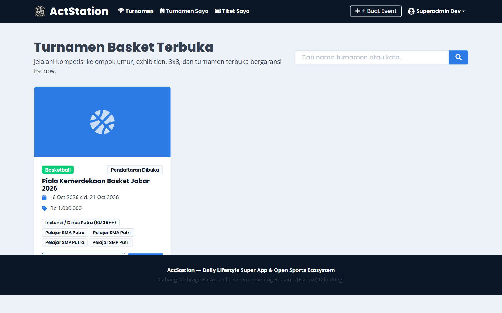

### 3.2 Detail Event & Warning Banner Transparansi Legalitas (`/events/{slug}`)
Halaman detail menyajikan informasi lengkap venue, tab bagan, jadwal, hasil skor, dan tiket masuk:

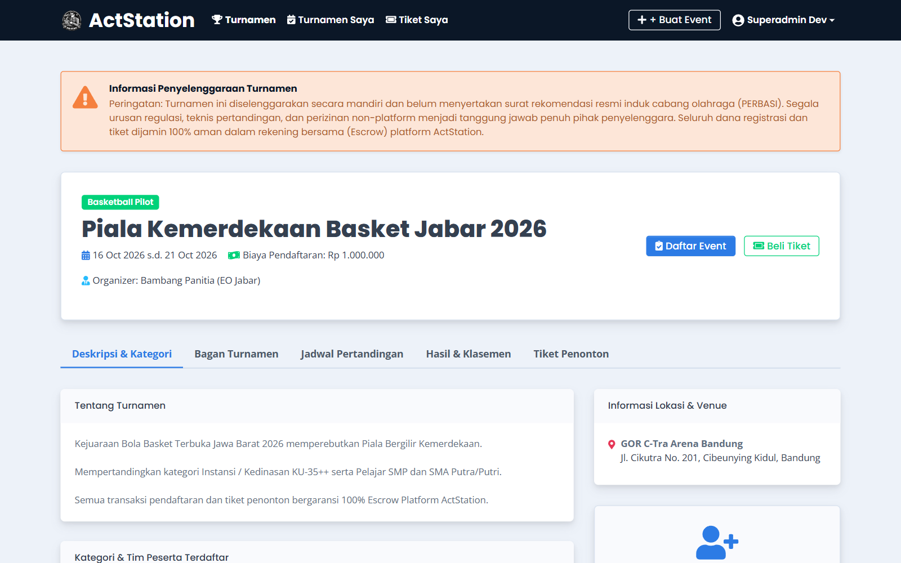

*Catatan Perlindungan Konsumen*: Karena turnamen diselenggarakan secara mandiri oleh EO, halaman publik secara otomatis menyematkan banner peringatan edukatif resmi mengenai tanggung jawab teknis pertandingan, serta mengonfirmasi bahwa seluruh dana peserta dilindungi 100% oleh rekening bersama (Escrow) platform.

---

## 4. Alur Pendaftaran Tim Berbasis Digital Document Vault

Alur pendaftaran menerapkan prinsip **One-Time Upload, Lifetime Reusable**:

```
[Official/Manajer Masuk] ──> /panel/events/{slug}/register
                                    │
                       Pilih Kategori (Instansi / Pelajar)
                                    │
                 Penyusunan Roster (Centang 5-12 Atlet)
                                    │
                    Cek Status Digital Document Vault:
                   ┌─────────────────────────────────┐
                   │  Dokumen Sudah Ada di Akun User?│
                   └──────────────┬──────────────────┘
                         Sudah    │    Belum Ada
                    ┌─────────────┴─────────────┐
                    ▼                           ▼
             Badge [Vault OK]            Muncul Kotak Upload
           Otomatis Terverifikasi        Unggah 1 Kali -> Masuk
           (Tanpa Upload Ulang)          Vault Permanen Seumur Hidup
```

### 4.1 Form Pendaftaran Roster & Indikator Digital Vault (`/panel/events/{slug}/register`)
Manajer komunitas atau guru olahraga mendaftarkan timnya:

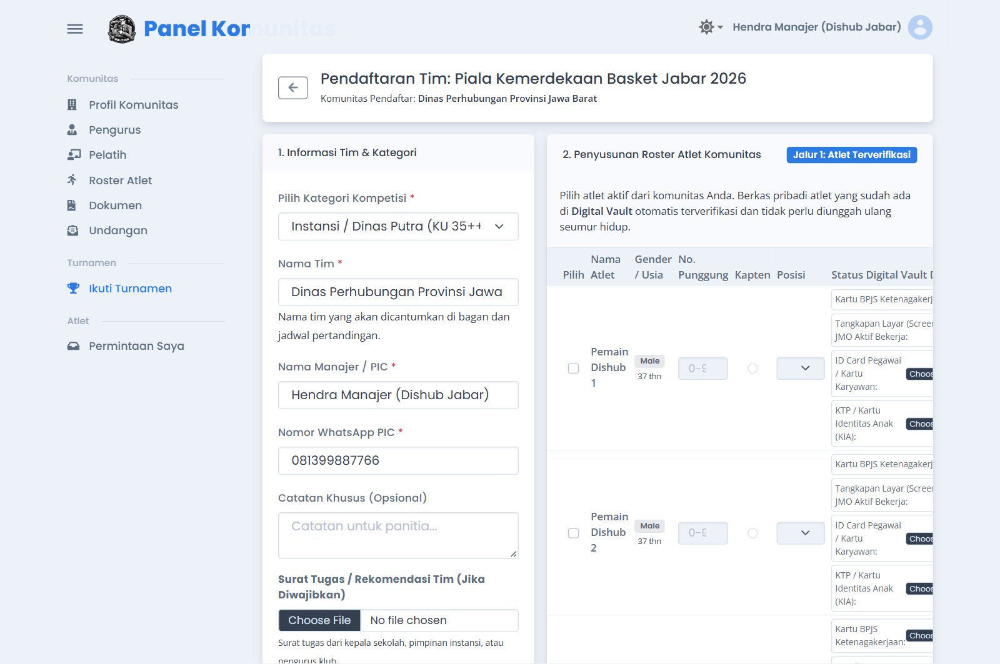

Mekanisme verifikasi berkas:
1. Manajer memilih kategori (misal: *Instansi / Dinas Putra KU 35++*).
2. Sistem menampilkan daftar atlet binaan aktif komunitas.
3. Kolom **Status Digital Vault Dokumen**:
   - **Atlet yang Sudah Memiliki Dokumen**: Menampilkan badge hijau **`[Vault OK]`**. Dokumen BPJS, JMO, KTP, atau Akta yang pernah diunggah di turnamen terdahulu **tidak perlu diunggah ulang**.
   - **Atlet Baru**: Sistem menyediakan kotak input file. Begitu diunggah dan pendaftaran disubmit, berkas otomatis tersimpan permanen di vault akun `User` atlet tersebut.
4. Manajer mengunggah Surat Tugas / Surat Mandat resmi instansi atau sekolah (`team_document`).

### 4.2 Status Pendaftaran Tim (`/panel/registrations/{id}/roster`)
Setelah form disubmit, tim berstatus `registered` (menunggu kurasi berkas oleh panitia):

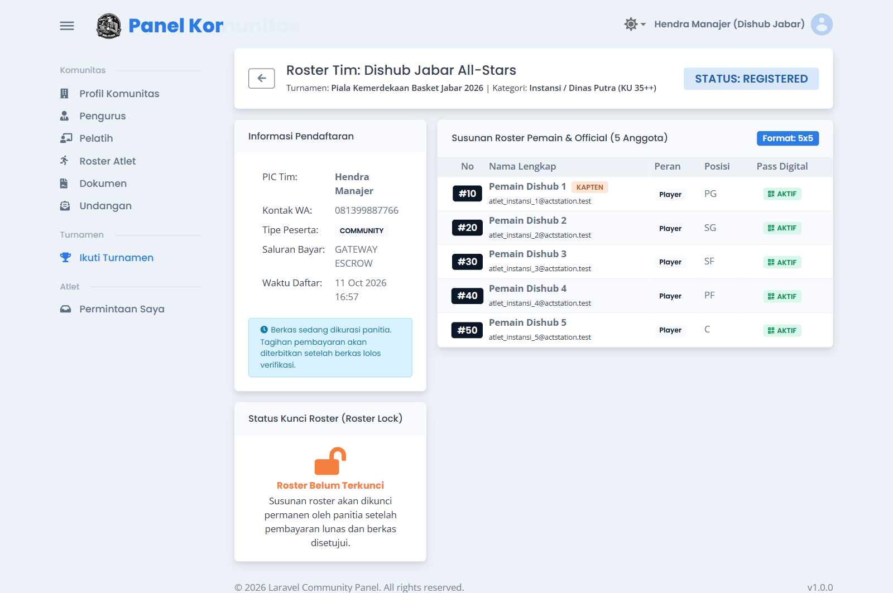

Pada tahap ini, tombol pembayaran pada halaman peserta **sengaja dikunci**, dan sistem menampilkan pemberitahuan:
> *"Berkas sedang dikurasi panitia. Tagihan pembayaran akan diterbitkan setelah berkas lolos verifikasi."*
Hal ini membebaskan panitia dari risiko pengembalian dana (*refund*) jika tim tidak lolos seleksi berkas.

---

## 5. Kurasi Berkas oleh Panitia & Penerbitan Tagihan Pembayaran

Panitia membuka menu kurasi peserta di `/panel/organizer/events/{id}/teams`:

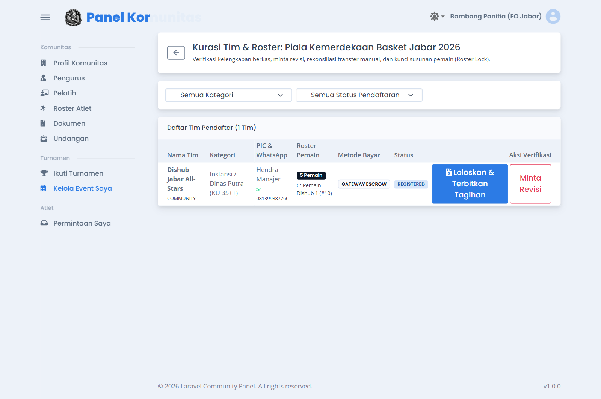

1. **Pemeriksaan Dokumen Roster**:
   - Panitia memeriksa kesesuaian berkas BPJS/JMO (untuk instansi) atau Kartu Pelajar/Raport (untuk pelajar).
   - Jika ada berkas buram atau salah: Panitia menekan tombol **"Minta Revisi"**. Status tim menjadi `revision_needed`, manajer menerima instruksi perbaikan tanpa kehilangan slot antrean.
2. **Lolos Kurasi & Penerbitan Tagihan**:
   - Jika berkas lengkap: Panitia menekan tombol **`[Loloskan & Terbitkan Tagihan]`**.
   - Status tim seketika beralih menjadi `pending_payment`.
   - Sistem menerbitkan invoice resmi dengan batas tenggat waktu (`payment_time_limit_hours`, misal 24 jam).
3. **Pembayaran oleh Peserta**:
   - Manajer tim membuka `/panel/registrations/{id}/checkout`. Tombol bayar telah aktif:
     - **Saluran 1 (Payment Gateway Escrow)**: Pembayaran otomatis via QRIS / Virtual Account. Status tim seketika menjadi `confirmed`.
     - **Saluran 2 (Transfer Manual Panitia)**: Peserta wajib mencentang klausul pelepasan tanggung jawab hukum (*Mandatory Legal Waiver Checkbox*) sebelum nomor rekening panitia ditampilkan. Sistem mencatat forensik IP dan User-Agent. Peserta mengunggah struk transfer, lalu panitia menekan **"Verifikasi Lunas"**. Status tim menjadi `confirmed`.
4. **Roster Lock**:
   - Begitu berstatus `confirmed`, komposisi nama pemain, posisi, dan nomor punggung terkunci paten.

---

## 6. Skenario Simulasi: Staf Internal Mendaftar sebagai Peserta

Untuk memastikan operasional sistem berjalan sempurna sebelum pendaftaran dibuka luas, staf operasional internal dapat melakukan simulasi pengujian end-to-end:

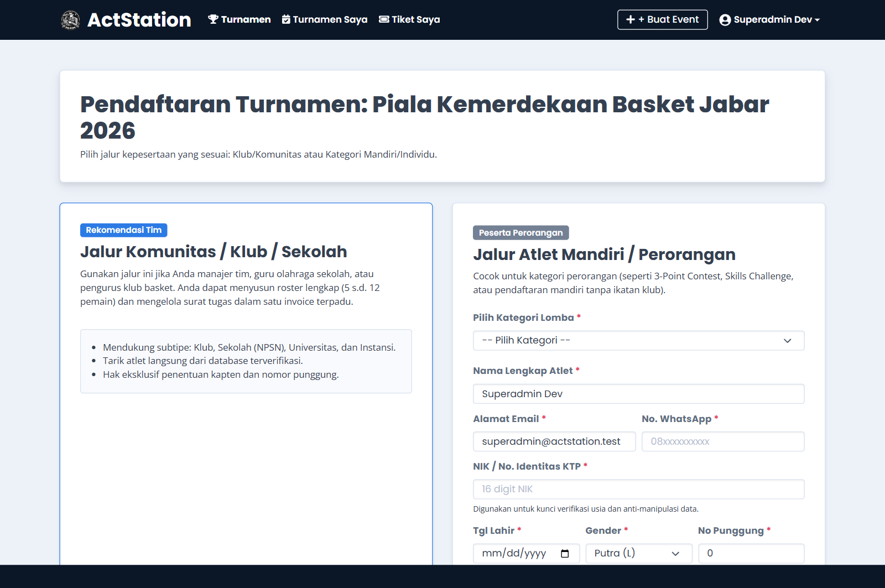

Manfaat simulasi staf internal:
1. **Validasi Form**: Menguji apakah form pendaftaran perorangan / instansi merespons dengan benar.
2. **Pengujian Digital Document Vault**: Memastikan deteksi dokumen vault berfungsi dan pesan validasi dokumen muncul akurat jika berkas belum lengkap.
3. **Pemeriksaan Kasir Escrow**: Memastikan invoice pembayaran dan nomor Virtual Account / QRIS simulasi terbit sesuai nominal kategori.

---

## 7. Penjualan Tiket Suporter & Gate Scanner Pintu Masuk GOR

Turnamen basket didukung modul ticketing terintegrasi untuk penonton dan suporter:

### 7.1 Pembelian Tiket Penonton (`/events/{slug}/tickets`)
Penonton dan suporter sekolah membeli tiket masuk langsung dari HP:

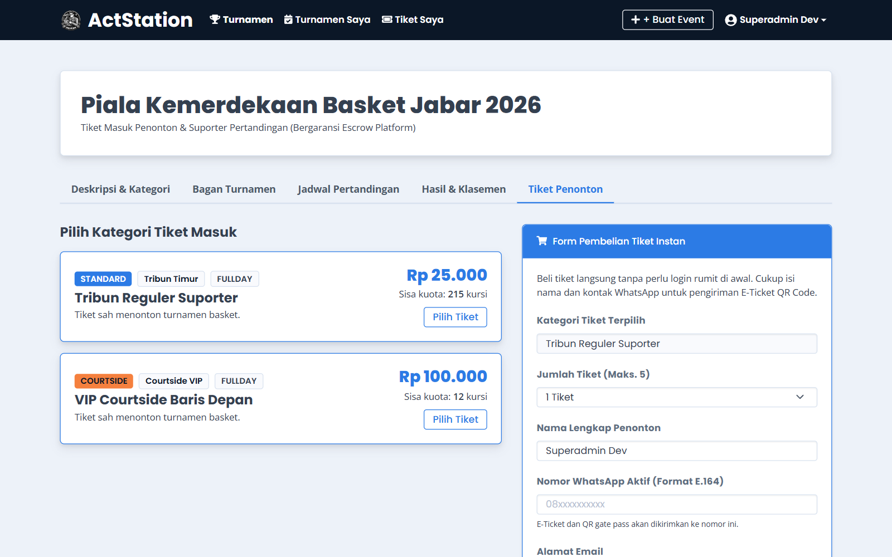

- **Zero-Friction Checkout**: Penonton cukup mengisi Nama, Email, dan Nomor WhatsApp. Dilarang meminta NIK.
- Sistem otomatis melakukan auto-provisioning akun `member` di latar belakang.
- Begitu pembayaran lunas, E-Ticket digital ber-QR Code terbit di `/my-tickets`.

### 7.2 Gate Scanner Kamera Smartphone Panitia (`/panel/organizer/events/{id}/gate-scanner`)
Kru penjaga pintu masuk GOR memindai tiket suporter di gerbang masuk:

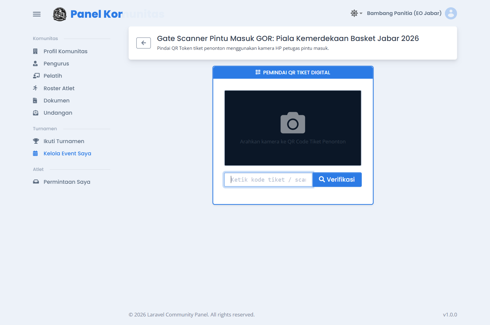

- **Layar Hijau**: Tiket sah. Muncul petunjuk zona: *"SAH! Arahkan penonton ke PINTU TRIBUN TIMUR"*. Tiket otomatis berstatus `used`.
- **Layar Merah**: Akses ditolak (jika tiket sudah pernah discan sebelumnya atau salah tanggal pertandingan).

---

## 8. Eksekusi Pertandingan: Bagan, Jadwal, & Live Score

1. **Bagan Pertandingan (`/panel/organizer/events/{id}/tournament`)**:
   - Setelah 8 tim berstatus `confirmed`, panitia memilih kategori:
     - Klik **"Generate Pool Stage"** -> Terbentuk Pool A (4 tim) dan Pool B (4 tim) secara round-robin.
     - Klik **"Generate Knockout Bracket"** -> Terbentuk bagan babak gugur (Semifinal, Final, dan Perebutan Juara 3).
2. **Jadwal Pertandingan Otomatis (`/panel/organizer/events/{id}/scheduling`)**:
   - Panitia menekan tombol **"Hitung Jadwal Otomatis (Auto-Recalculate)"**.
   - Algoritma `ScheduleCalculator` menyusun jam main seluruh pertandingan per lapangan secara berurutan, memastikan jeda istirahat tim terpenuhi, dan menghormati jeda waktu sholat.
3. **Pencatatan Skor & Live Standings (`/panel/organizer/events/{id}/results`)**:
   - Petugas meja mencatat skor pertandingan. Penonton memantau live score di `/events/{slug}/results`.
   - Klik **"Finalize Game"**: Klasemen grup terupdate otomatis dan tim pemenang otomatis maju ke bagan babak gugur berikutnya.

---

## 9. Siklus Pencairan Dana Escrow (Multi-Termin)

Hasil pembayaran biaya pendaftaran tim dan penjualan tiket masuk penonton tersimpan aman di rekening bersama platform dan dicairkan bertahap:

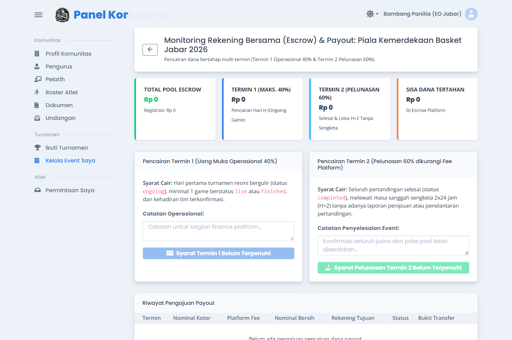

```
[Dana Escrow Tertampung] ──> [Termin 1: 40%] ──> [Termin 2: 60% dikurangi 5% Fee]
 (Biaya Registrasi & Tiket)   (Hari H: Game Live)   (Event Selesai + H+2 Bebas Sengketa)
```

1. **Pencairan Termin 1 (Uang Muka Operasional 40%)**:
   - **Syarat Cair**: Hari pertama pertandingan bergulir (status event `ongoing`), minimal 1 pertandingan berstatus `live` atau `finished`, dan kehadiran tim terkonfirmasi di lapangan.
   - Panitia menekan tombol **"Ajukan Payout Termin 1"** di `/panel/organizer/events/{id}/payouts`.
   - Admin platform di `/admin/escrow/payouts` memverifikasi dan mentransfer dana ke rekening bank PIC panitia.
2. **Pencairan Termin 2 (Pelunasan 60% dikurangi 5% Platform Fee)**:
   - **Syarat Cair**: Seluruh partai final selesai (status event `completed`), melewati masa sanggah sengketa selama 2x24 jam (H+2) tanpa adanya laporan penipuan atau penelantaran turnamen.
   - Panitia mengajukan Termin 2.
   - Admin platform mentransfer sisa dana 60% setelah dipotong platform fee 5%. Status payout beralih menjadi `settled`.
   - Seluruh siklus penyelenggaraan turnamen tuntas dengan akuntabilitas hukum dan finansial 100%.
