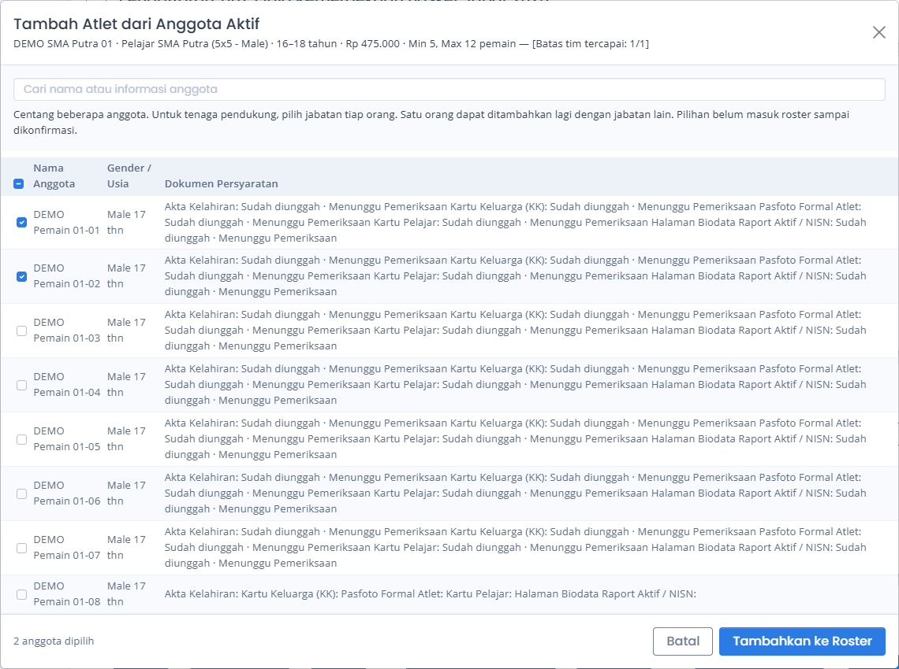
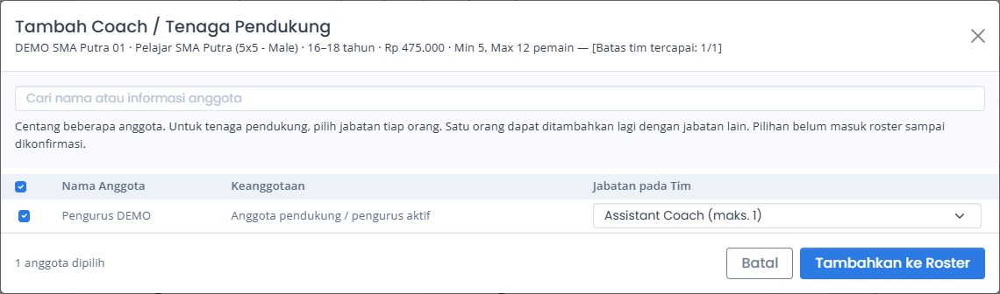
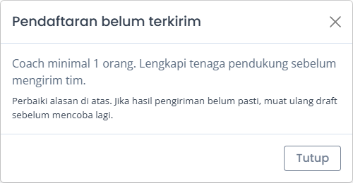
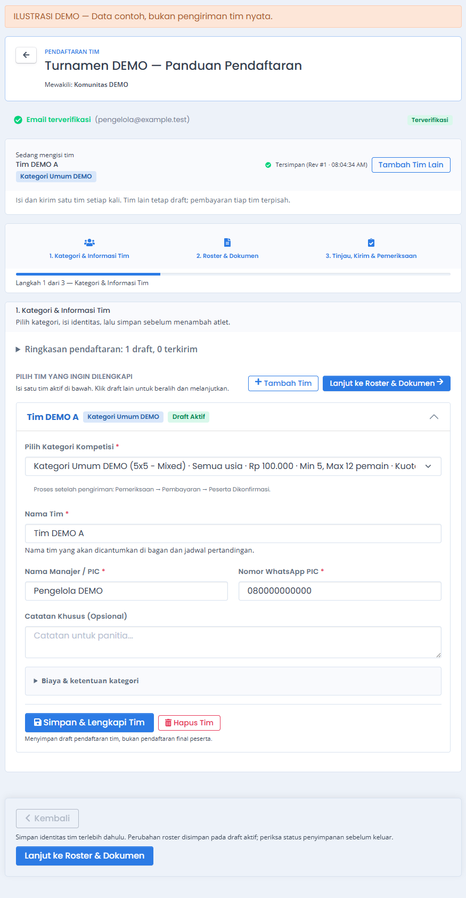
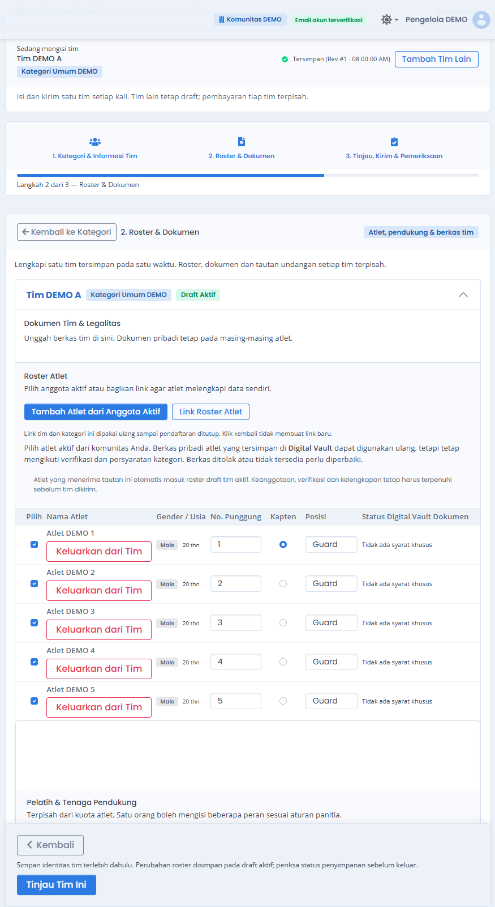
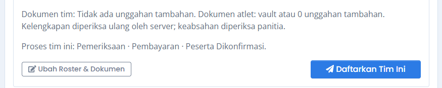
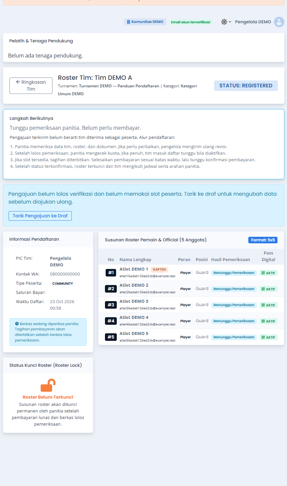
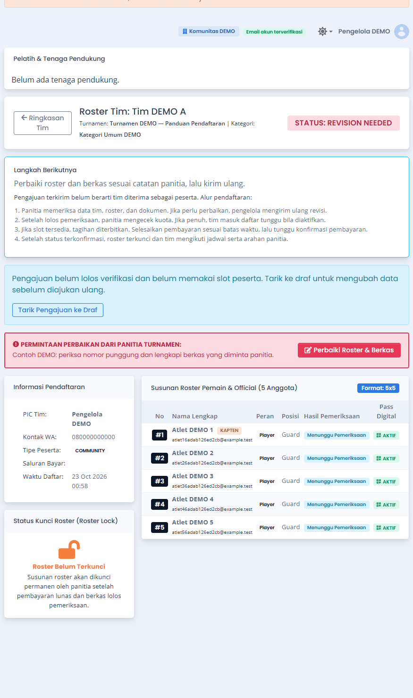
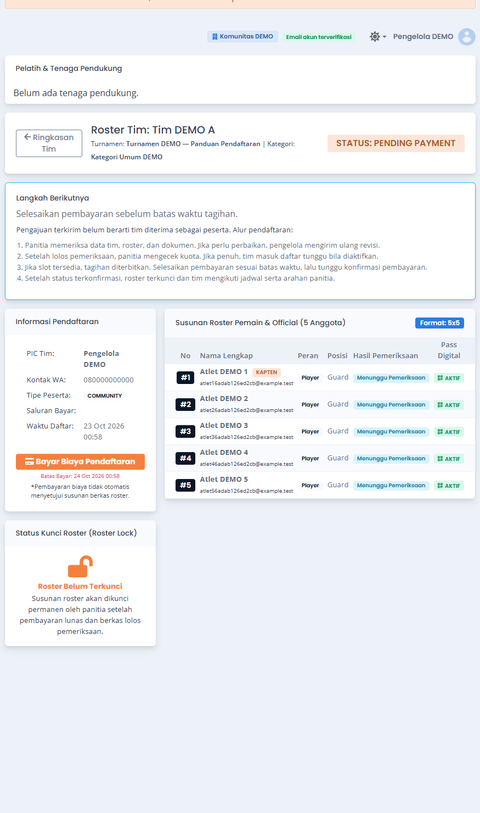
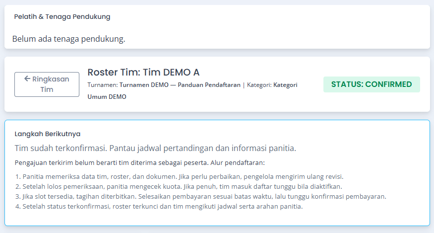

# Panduan Event & Pendaftaran Tim ActStation

Halaman pengguna: http://localhost:7000/panduan-event. Berlaku lintas cabang olahraga; basket hanya contoh. Syarat usia, gender, kuota, biaya, dokumen dan alur mengikuti konfigurasi event/kategori aktif, bukan angka pada ilustrasi.

## 1. Akun dan komunitas

- Pilih komunitas yang diwakili sebelum membuka `/panel/events`.
- Form komunitas: `/panel/community/create`. Sub-tipe dan legalitas sesuai entitas; bank/perusahaan memakai Instansi/Lembaga — Perusahaan.
- Atlet, tenaga pendukung dan pengurus merupakan hubungan berbeda. Pendukung tidak otomatis mendapat hak pengurus.
- Akun/keanggotaan aktif, consent, usia/gender, legalitas komunitas, dokumen, kapasitas dan konflik roster tetap diperiksa.
- Verifikasi wilayah tetap tersedia sebagai informasi/fitur induk cabor, bukan syarat roster atau pendaftaran. Jangan mengubah status lama menjadi verified.
- Berkas tersedia di vault bukan otomatis terverifikasi. Akses dokumen tetap privat dan pemeriksaan kategori tetap berlaku; tidak ada janji penyimpanan permanen seumur hidup.

## 2. Penyelenggara

1. Ajukan di `/panel/organizer/apply`; pending dan menunggu review admin. Role organizer tidak langsung diberikan saat submit. Ikuti persyaratan form aktif.
2. Setelah disetujui, buat event di `/panel/organizer/events/create`: cabor, venue, jadwal dan tenggat.
3. Kelola workspace `/panel/organizer/events/{event}/manage`, termasuk dokumen dinamis rekomendasi induk cabor, izin tempat/keramaian dan technical handbook sesuai kebutuhan.
4. Atur kategori: format, umur/gender, min/max atlet, kapasitas, batas tim per entitas, biaya, alur dan dokumen.
5. Konfigurasi sub-tipe eksplisit: SMP/SMA/universitas khusus entitas akademik sesuai jenjang; sekolah dapat ikut kategori umum jika diizinkan. Nama kategori/development level bukan pengganti allowlist sub-tipe.
6. Aktifkan jabatan tenaga pendukung beserta min/max. Kuota terpisah dari atlet; beberapa jabatan per orang boleh sesuai aturan. Aturan personel menjadi snapshot saat submit.
7. Ajukan publikasi dan ikuti moderasi admin.

## 3. Wizard pendaftaran peserta

Buka `/panel/events/{slug}/register` sebagai pengurus berwenang pada komunitas aktif.

### Langkah 1 — Kategori & Informasi Tim

- Pilih kategori yang sesuai sub-tipe/jenjang komunitas. Sekolah mengikuti master jenjang/NPSN, bukan nama.
- Isi informasi tim; klik Simpan & Daftarkan Tim untuk draf pertama, atau Simpan & Lengkapi Tim untuk draf tersimpan. Tunggu indikator Tersimpan. Ini bukan pengiriman final.
- Lanjutkan draf dari Pendaftaran Sedang Berjalan di /panel/events. Default masa simpan draf baru 7 hari; periksa batas yang tampil.
- Accordion tim untuk pindah konteks draft dalam halaman yang sama. Periksa nama tim aktif sebelum mengubah data.
- Konflik revisi: muat ulang, jangan menimpa server atau mengedit tim sama di banyak tab.

### Langkah 2 — Roster & Dokumen

- Tambah Atlet dari Anggota Aktif membuka modal tabel: cari, pilih banyak, pilih semua baris terlihat.
- Tambahkan ke Roster menerapkan pilihan. Batal/close tidak mengubah roster.
- Isi nomor punggung, kapten, posisi dan berkas sesuai kategori.
- Jika muncul Belum ada atlet di roster tim ini, klik Undang Atlet ke Tim Ini atau pilih anggota aktif. Daftar anggota tersedia belum berarti roster terpilih. Panduan undangan di bawah berlaku khusus tim/kategori aktif.
- Tambah Coach / Tenaga Pendukung dari Anggota Aktif menyediakan checkbox dan dropdown jabatan allowed event. Tambah peran lain orang sama sesuai batas jabatan.
- Dokumen tim/legalitas terpisah dari dokumen atlet. Berkas tersedia dapat dipakai sesuai akses dan kebutuhan, bukan otomatis disetujui.
- Roster/dokumen draf tersimpan disimpan otomatis; tunggu indikator simpan sebelum berpindah. Keluarkan dari Tim hanya menghapus pilihan tim, bukan keanggotaan/vault.

Ilustrasi diambil dari render UI aplikasi dengan data DEMO, tanpa mengirim tim. Pilihan masih staging. Angka kuota/biaya contoh bukan aturan umum. PNG panel modal utuh setelah animasi selesai; halaman web menyediakan link ukuran penuh.

### Link roster

#### Atlet

1. Pilih tim/kategori aktif pada wizard, klik Undang Atlet ke Tim Ini atau Link Roster Atlet, lalu Salin Link. Gunakan link khusus tim, bukan link keanggotaan global; link tim lain tidak boleh dipakai.
2. Kirim lewat WhatsApp pribadi. Membuat link tidak mengirim otomatis; membuka link belum memasukkan atlet.
3. Atlet memakai akun sendiri. Ikuti Periksa Kesesuaian Kategori untuk email, tanggal lahir dan gender; usia mengikuti tanggal mulai event. Pemilik akun lama login, bukan membuat akun ganda.
4. Lengkapi data yang diminta, identitas institusi sesuai kategori (NISN/NIM atau NIK), nomor punggung dan posisi. Data valid tersimpan dipakai kembali. Berikan consent sendiri lalu kirim sampai berhasil; akun baru tidak otomatis terverifikasi email.
5. Atlet masuk roster draf tujuan setelah formulir berhasil. Pengurus kembali ke wizard dan klik Setujui Keanggotaan bila tersedia setelah pemeriksaan. Atlet tidak perlu consent ulang untuk pengajuan sama. Keanggotaan aktif tetap diperlukan sebelum pengiriman final.
6. Atlet melengkapi berkas lewat Turnamen Saya; pengurus memeriksa roster sebelum final. Masuk draf bukan peserta resmi.

Contoh pesan: Silakan buka link ini untuk bergabung ke roster tim kami. Login/daftar dengan akunmu sendiri, lengkapi formulir sampai berhasil, lalu kabari saya. Setelah itu, lengkapi berkas di Turnamen Saya. Tempel link khusus tim setelah pesan.

#### Pelatih dan tenaga olahraga

1. Pengurus memakai Link Roster Pelatih & Tenaga Pendukung, terpisah dari undangan atlet. Peran mengikuti event.
2. Penerima guest mengisi email lalu Periksa Akun. Email terdaftar memakai Masuk & Lanjutkan dan kembali ke undangan; email baru mengisi akun/peran/consent di halaman sama. Pemeriksaan belum membuat akun, pendaftaran tidak otomatis memverifikasi email.
3. Pendukung/pengurus aktif dapat bergabung sesuai peran/kuota. Orang baru mengajukan keanggotaan pending, belum masuk roster; pengurus menyetujui di `/panel/coaches`.
4. Setelah aktif, penerima kembali ke link lalu berikan consent dan Gabung Roster. Pastikan Sudah masuk roster draft ini. Approval keanggotaan bukan auto-roster atau hak pengurus.

Tenaga pendukung bukan panitia event dan tidak memakai kuota atlet; tidak dikenai batas usia/gender atlet. Satu akun dapat merangkap pengurus, atlet dan official bila syarat masing-masing serta peraturan turnamen mengizinkan. Pengurus tidak otomatis menjadi atlet; keanggotaan atlet, consent dan kelayakan kategori tetap wajib. Jangan publikasikan token/link undangan atau dokumen privat.

#### Berkas atlet di Turnamen Saya

- Login sebagai atlet, buka `/my-events` (Turnamen Saya), pilih tim/turnamen terkait. Atlet yang sudah masuk roster draf dapat unggah meski keanggotaan masih pending.
- Pasfoto JPG/JPEG/PNG, bukan PDF; berkas lain PDF/JPG/JPEG/PNG. Maksimal 2 MB per berkas. Unggahan gagal tidak mengganti berkas lama.
- Pasfoto mengisi foto profil publik hanya jika masih kosong; foto existing tidak ditimpa dan dokumen sumber tetap privat. Tersedia/pending bukan terverifikasi, ditolak perlu diganti.

### Langkah 3 — Tinjau, Kirim & Pemeriksaan

1. Tinjau tim, kategori, atlet, pendukung dan dokumen. Draft bukan pendaftaran terkirim.
2. Klik Daftarkan Tim Ini dan baca modal konfirmasi sebelum pengiriman. Batal/menutup modal tidak mengirim. Setelah setuju, tunggu server; modal sukses hanya setelah konfirmasi server. Lihat Ringkasan Tim menampilkan proses selanjutnya.
3. Gagal validasi: baca alasan, perbaiki. Sesi habis: login ulang.
4. Koneksi putus: hasil pengiriman belum pasti. Muat ulang draft untuk memeriksa status sebelum mencoba lagi; tidak retry otomatis.

## 4. Pemeriksaan, revisi dan pembayaran

- Panitia memeriksa `/panel/organizer/events/{event}/teams`. Tim mengikuti status aktual, bukan asumsi email/pembayaran.
- Buka Roster Tim setelah pengiriman. Kartu Langkah Berikutnya menjelaskan tindakan berdasarkan status.
- `screening_first`: berkas dulu; pengajuan belum memakai slot peserta. Saat lolos, panitia mengecek kuota lalu menerbitkan tagihan jika berbayar. Gratis tidak memiliki pembayaran. Waiting list belum mengambil slot.
- Sebelum lolos, pengurus aktif dapat Tarik Pengajuan ke Draf jika belum ada transaksi/verifikasi pembayaran/pool/jadwal. Data tim, roster dan berkas dipulihkan; vault atlet tetap. Draf baru default 7 hari, tautan lama tidak hidup kembali. Edit lalu kirim ulang. Setelah lolos, hubungi panitia.
- Bukti pembayaran terkirim: tunggu verifikasi, jangan membayar ulang. Batas bayar lewat: hubungi panitia.
- `payment_first`: tagihan saat pendaftaran; bayar tidak menggantikan pemeriksaan.
- `by_invitation`: perlu otorisasi undangan, pembayaran jika berlaku.
- Gratis tetap diperiksa; waiting list bukan peserta sah.
- Revisi mengikuti catatan dan bagian yang diizinkan, lalu dikirim kembali.
- Nominal/metode/tenggat mengikuti invoice. Transfer manual bila tersedia memerlukan persetujuan risiko, bukti dan konfirmasi.
- `confirmed` mengunci perubahan roster biasa. Bayar saja belum memenuhi seluruh syarat.
- Email hanya notifikasi tambahan. Proses kirim diterima bukan bukti masuk inbox; status panel menjadi acuan.
- Transfer manual langsung ke penyelenggara tidak masuk perhitungan escrow platform. Pencairan memerlukan pemeriksaan/proses admin, bukan transfer otomatis. Bendahara panitia hanya mengonfirmasi bukti sesuai izin, bukan mengubah rekening atau mencairkan dana.
- Dana, biaya platform, pencairan dan sengketa mengikuti metode/kebijakan aktif. Tidak menjanjikan semua transfer masuk escrow, pencairan otomatis atau proteksi mutlak 100%.

### Screenshot alur tim terbaru

Ilustrasi DEMO dari view aplikasi saat ini; tidak merekam transaksi berhasil atau memuat data pengguna nyata.

## 5. Kepanitiaan dan operasional

Pemilik mengatur preset atau akses khusus; penerima link memberi consent dan menunggu approval. Hak hanya event terkait, bukan role organizer/admin global. Akses dapat mencakup tim, pemeriksaan, konfirmasi pembayaran, dokumen, jadwal dan hasil. Pengelolaan akses, rekening/payout, perubahan event dan penghapusan peserta tetap dibatasi pihak berwenang.

Bagan, jadwal dan hasil mengikuti format kategori/cabor serta kesiapan peserta. Jika tiket tersedia, ikuti checkout/status bayar; petugas gate memakai hasil scanner dan menolak penggunaan ulang QR.

## 6. Kendala umum dan ilustrasi

- Kategori hilang: cek komunitas aktif, sub-tipe/jenjang, kapasitas dan syarat; hubungi pengurus/penyelenggara.
- Anggota hilang: cek akun/keanggotaan, kelayakan dan apakah sudah dipilih. Pendukung perlu hubungan pendukung/pengurus, bukan sekadar atlet.
- Berkas ada tetapi belum lengkap: cek jenis, akses dan status pemeriksaan.
- Screenshot modal: tunggu font/CSS dan animasi selesai, pastikan scroll nol untuk screenshot viewport, crop panel modal utuh tanpa backdrop. Jangan meregangkan gambar; buka PNG asli untuk membaca.
- Ilustrasi baru tersimpan di `docs/screenshots/` dan `public/docs/screenshots/`: `12_bulk_atlet.png`, `13_bulk_pendukung.png`, `14_hasil_validasi.png`.
- Screenshot lama 01–11 tidak digunakan panduan ini karena tidak mewakili alur terkini. Ilustrasi baru berasal dari render DEMO read-only dengan request mutasi tidak dijalankan; pesan validasi merupakan contoh komponen UI, bukan bukti transaksi.
- Latihan memakai lingkungan pengujian dan data DEMO. Jangan membayar, mengirim tim nyata atau membuka dokumen privat demi dokumentasi.
