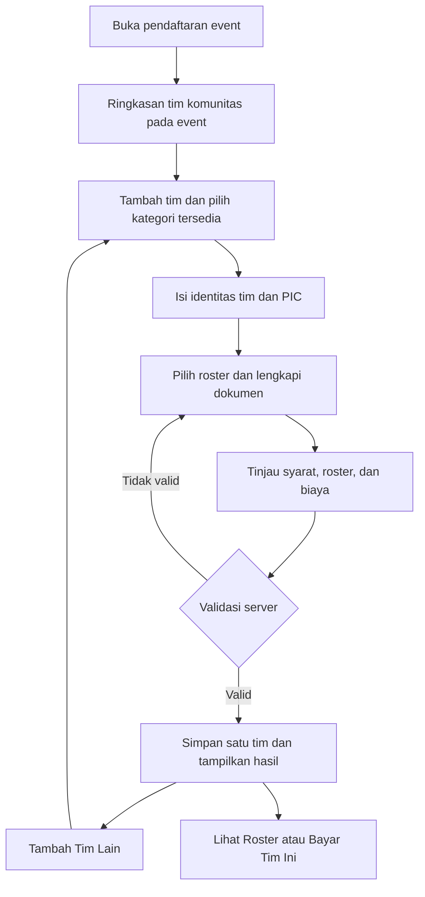

# Product Requirement Document (PRD) — Fitur Eksternal ActStation

## Pilihan kategori sesuai komunitas aktif

Kategori khusus SMP/SMA/perguruan tinggi hanya ditawarkan kepada entitas akademik sesuai jenjang/sub-tipe. Sekolah masih boleh mengikuti kategori umum yang mengizinkannya; aturan institusi/klub/komunitas umum lainnya tetap. Syarat berdasar konfigurasi kategori, bukan teks nama. Klub tidak dapat melewati batas kategori akademik walaupun flag lama allow_club aktif. Backend create/update draft dan final submission menolak kategori tidak sesuai, bukan hanya menyembunyikan opsi. Tidak ada kategori cocok menampilkan penjelasan untuk komunitas aktif; data lama tidak dihapus.

Bank Mandiri dikoreksi ke Instansi/Lembaga jenis Perusahaan (institution/corporate) atas permintaan pengguna. Tiga kategori pelajar event Piala Kemerdekaan yang sebelumnya terbuka diselaraskan ke school_smp (Putra/Putri) dan school_sma (Putri); SMA Putra memang sudah dibatasi. Read-only render akun Cindy pada konteks Bank Mandiri kini hanya menampilkan Instansi / Dinas Putra (KU 35++). Sekolah memakai master jenjang NPSN; perubahan tidak menebak nama, mengubah status verifikasi atau mengirim tim. Full suite725 PHP/4940 assertions dan build/Pint/Blade/diff lulus; login browser UAT belum.


## Modal hasil pendaftaran langkah 3

Klik Daftarkan Tim Ini menampilkan modal Falcon untuk kegagalan validasi client, offline/konflik/penyimpanan, serta flash sukses/error dan error validasi server setelah redirect normal. Pesan server di-escape; tidak membuat keberhasilan palsu sebelum server mengonfirmasi. Draft identity/cache dan guard submit ganda tetap. Modal sukses menjelaskan pengiriman tidak sama dengan persetujuan dan status lanjut mengikuti kategori. Modal gagal menjelaskan perbaikan serta pemeriksaan status server sebelum retry bila hasil tidak pasti. Perbaikan lanjutan: pengiriman final sekarang POST FormData dengan Accept JSON, tidak mengandalkan native redirect. Controller mengembalikan participant_id/status/message/redirect_url setelah transaksi; modal sukses hanya jika participant_id dikonfirmasi. Validation 422 menampilkan detail; 401/419, server error dan koneksi terputus menampilkan modal gagal/belum pasti. Tidak otomatis retry. Draft/cache tidak dibuang sebelum keberhasilan server; tombol ganda dijaga, ringkasan dibuka melalui CTA modal. Native redirect dipertahankan untuk caller non-JSON. Tes server render sukses/error escaping dan Node offline-modal lulus. Target baru d59e2eb8-ee59-4784-8475-0f1dcd896f41 tidak dikirim nyata untuk QA.

## Modal tabel bulk anggota aktif

Dua tombol tambah langkah 2 membuka modal Falcon tabel bulk (referensi lokal modules/tables/bulk-select.html), bukan memperluas daftar inline. Mendukung pencarian, pilih semua baris terlihat, checkbox banyak orang, jumlah dipilih, tombol Batal dan Tambahkan ke Roster. Atlet menampilkan nama/gender-usia/ringkasan dokumen dari data yang memang sudah diizinkan. Coach/pendukung satu baris per orang dengan dropdown jabatan allowed event; untuk orang sama pada peran lain buka tambah lagi. Pilihan bersifat staging sampai konfirmasi; batal/close tidak mengubah roster/autosave. Batas atlet dan per-role max diperiksa batch sebelum mutasi sehingga tidak menambah sebagian; draft/category modal dipin dan stale apply ditolak. Form canonical tidak digandakan/nested, selected roster tetap terlihat; revisi standalone tidak berubah.

Audit bulk lanjutan: apply ditolak saat save/hydration aktif; nomor punggung default batch memilih angka kosong 0–99 agar tidak duplikat (tetap bisa diedit). Multi-role orang sama disengaja, bukan kebocoran; tidak menghapus peran lama ketika menambah peran lain. Dua regresi tambahan lulus. Verifikasi akhir: 723 PHP/4917 assertions full suite, 128 Node, Pint/Blade/build/diff lulus. Browser fixture sintetis memakai modul produksi + Bootstrap lokal membuktikan dua atlet bulk ditambah sekaligus/satu autosave dan modal gagal/sukses terlihat; bukan UAT login akun nyata. Tidak mengirim draft nyata.

## Roster langkah 2 — penyederhanaan & link tenaga pendukung

Permintaan: tampilan elegan sederhana informatif, dua tombol tambah dari anggota aktif (atlet serta coach/tenaga pendukung), hapus tombol Muat Kandidat dan Kelola Keanggotaan Umum, pertahankan autosave dan switch tim in-place. Link tenaga pendukung baru boleh menerima orang baru: login/daftar, consent, pilih peran allowed event; keanggotaan CommunityCoach pending dahulu, pengurus komunitas menyetujui di /panel/coaches. Setelah disetujui pengguna kembali ke link dan eksplisit Gabung Roster. Keanggotaan pending tidak masuk roster/kuota atlet; tanpa hak pengurus/RBAC. Link terikat draft/category/lifecycle, reuse, maksimum peran dan duplikat dicek. Terintegrasi: tombol tambah atlet selalu terlihat (disabled bila tidak tersedia), pemilih pendukung dengan count per peran, link terpisah, selected entries tetap terlihat, kandidat dimuat otomatis saat hydrate/picker/focus. Tombol Muat Kandidat dan Kelola Keanggotaan Umum dihapus. Refresh options menambahkan anggota disetujui dengan DOM textContent dan revision konflik tetap dijaga; hasil link async beda draft diabaikan. Full suite sebelum modal 721 PHP/4887 assertions lulus; final focused 4/55 assertions dan Node 122 lulus; build/Pint/Blade/diff lulus. Render target f36915e0-87c9-46ae-b8e6-8570f130f00d read-only membuktikan tombol baru, link, tanpa tombol lama, draft tidak berubah; empat peran event aktif ditemukan. UAT browser login belum.

## Panitia event & akses menu — checkpoint implementasi

Fitur diminta pada Workspace Organizer `/panel/organizer/events/{event}/manage`. Tab Panitia & Hak Akses membuka `/panel/organizer/events/{event}/committee`. Owner menambah jabatan bawaan secara eksplisit, atau membuat jabatan custom dengan deskripsi tugas dan checkbox akses. Preset Ketua, Sekretaris, Bendahara, Verifikator, Bidang Pertandingan, Dokumentasi tetap bisa diedit; Dokumentasi/custom bawaan tanpa akses kelola. UI wajib menjelaskan setiap menu dan tindakan, dampak perubahan untuk anggota approved, serta batas sensitif dokumen/pembayaran tanpa hak rekening/payout. Tidak menyamakan jabatan panitia event dengan pelatih/tenaga pendukung tim.

Link undangan per jabatan dapat disalin/dicabut. Pengguna login/daftar, meninjau tugas/akses lalu memberi consent; status pending sampai owner/superadmin menyetujui. Penerima tidak mendapat role organizer/admin. Kepanitiaan Saya `/panel/organizer/committee` tersedia untuk anggota, hanya menampilkan pengajuan sendiri dan tautan menu sesuai akses. Akses nonaktif jika jabatan nonaktif/keanggotaan diakhiri. Terintegrasi dan diuji: 719 PHP/4846 assertions full suite; 7 tes focused/98 assertions untuk hak, batas event, consent/replay, link revoke/expiry, inactive account, preset, view/privacy. Build/Pint/Blade/diff lulus. Render runtime event1 dengan akun admin@gmail.com read-only lulus; default/panitia nyata belum dibuat otomatis. Buka tab Panitia & Hak Akses lalu Tambahkan Jabatan Bawaan atau jabatan custom. Browser UAT autentikasi belum: browser baru masih login, tidak ada saved credentials. Link 14 hari shared per jabatan; ditolak/berakhir tidak hidup kembali dari link yang sama. Bila satu orang beberapa jabatan, akses gabungan semua jabatan approved aktif. Tidak ada email keluar.

## Modul Event Organizer, Registrasi Komunitas/Individu, dan Proteksi Anti-Penipuan (Escrow)

- **Versi**: 1.0.0
- **Tanggal Rilis Dokumen**: 2026-10-10
- **Status**: Draft (Menunggu Konfirmasi User)
- **Catatan perubahan kategori (2026-10-13)**: spesifikasi saja; implementasi ditahan sampai revisi lanjutan dan instruksi eksekusi terpisah. Perilaku aplikasi saat ini belum mengikuti seluruh ketentuan harga/umur/jendela alur kategori ini.
- **Ruang Lingkup Pilot**: Cabang Olahraga Basketball (Sport Category ID: 1)
- **Target Platform**: Web Blade/Falcon (VILT base), Panel Eksternal (`/panel/*`), Portal Publik (`/*`), API v1 Sanctum (`/api/v1/*`)

---

## 1. Ringkasan Eksekutif & Problem Statement

### 1.1 Latar Belakang & Visi Ekspansi Eksternal
ActStation berevolusi dari platform operasional internal asosiasi bola basket menjadi platform ekosistem olahraga terbuka. Pembukaan fitur ke ranah eksternal memungkinkan:
1. **Event Organizer (EO) Eksternal, Pengcab/Pengda, dan Komunitas** menyelenggarakan turnamen, kompetisi kelompok umur, dan exhibition game secara mandiri.
2. **Klub dan Komunitas Basket Terverifikasi** mendaftarkan roster atlet binaan langsung dari database anggota tanpa duplikasi input data.
3. **Peserta Umum dan Atlet Mandiri** mendaftar pada kategori perorangan (kontes 3-point, skills challenge, 1-on-1) serta membeli tiket pertandingan.

### 1.2 Analisis Risiko Penipuan (Fraud Landscape Turnamen Amatir)
Di ranah kompetisi olahraga amatir, terdapat sejumlah celah penipuan yang kerap merugikan peserta dan sponsor:
- **Turnamen Fiktif (Ghost Event)**: Penyelenggara membuka pendaftaran, mengumpulkan biaya registrasi jutaan rupiah per tim ke rekening pribadi, lalu menghilang atau membatalkan turnamen tanpa pengembalian dana.
- **Venue Bodong / Izin Palsu**: Event dipublikasikan tanpa ada reservasi riil atau izin resmi dari pengelola gelanggang/GOR.
- **Pencurian / Manipulasi Identitas Atlet**: Pemalsuan umur (pencurian umur pada KU-12, KU-14, KU-16, KU-18) dan pendaftaran atlet ilegal lintas klub yang memicu sengketa.
- **Sengketa Hadiah & Payout Macet**: Hadiah pembinaan tidak dicairkan pasca kejuaraan selesai.

### 1.3 Strategi Uji Coba Terfokus: Pilot Cabang Olahraga Basketball
Untuk memitigasi risiko kegagalan operasional, pembukaan fitur eksternal diterapkan secara **terfokus pada Cabang Olahraga Basketball** (`sport_categories.id = 1`) dengan memanfaatkan:
- 4 Kelompok Umur Standar (`development_levels`):
  * Usia Dini (0–12 tahun)
  * Remaja (13–16 tahun)
  * Taruna (17–23 tahun)
  * Senior (24+ tahun)
- Validasi anggota aktif dengan akun aktif dari modul `Community`; status verifikasi wilayah atlet hanya informasi, bukan syarat ikut event.
- Venue berstandar lapangan basket (`venue_courts.surface` kayu parquet/interlock/vinyl, ring basket standar FIBA/PERBASI).

### 1.4 Prinsip Desain & Batasan Arsitektural (Database & Code Laws)
1. **Single Connection Database**: Semua transaksi berjalan di koneksi database tunggal `db_actstation`. Tidak ada koneksi database eksternal runtime.
2. **Identitas Pengguna Terpusat**: Seluruh aktor sistem (panitia, pelatih, manajer, pemain) adalah record tunggal di tabel `users`.
3. **Spatie RBAC Guard Web**: Hak akses dikontrol via permissions resmi Spatie dengan kolom `roles.panel_access = 'external'` atau `'both'`.
4. **Isolasi Modular & Kontrak Service**: Antar modul (`Event`, `Community`, `Payment`, `Ticketing`, `MasterData`) berkomunikasi melalui Interface/Contract (`Payable`, `RosterProvider`, `CommunityLookup`, `DevelopmentLevelLookup`) dan Domain Events (`PaymentSucceeded`, `PaymentRefunded`).

---

## 2. User Persona Eksternal

| Persona | Role Code (`roles.name`) | Panel Access | Deskripsi & Tanggung Jawab Utama |
|---|---|---|---|
| **Event Organizer** | `organizer` | `external` | Entitas EO, yayasan olahraga, atau pengurus kompetisi. Membuat draf event, mengajukan moderasi, mengunggah izin venue, mengelola jadwal pertandingan, dan mengajukan payout escrow. |
| **Community Manager** | `community_manager` | `external` | Manajer/official klub basket terdaftar. Mendaftarkan tim ke event, menyusun komposisi roster dari atlet aktif komunitas, dan melakukan pembayaran invoice tim. |
| **Athlete** | `athlete` | `external` | Atlet basket terdaftar. Melihat riwayat keterlibatan turnamen, validasi keikutsertaan roster, dan jadwal bertanding. |
| **Participant / Member** | `participant` / `member` | `external` | Peserta umum non-klub yang mendaftar kategori perorangan (misal 3-Point Contest), atau penonton yang membeli tiket pass pertandingan. |
| **Internal Admin & Verifikator** | `admin` / `superadmin` | `internal` / `both` | Tim internal ActStation yang memoderasi kelayakan event, memeriksa legalitas venue & KYC EO, serta mengeksekusi pelepasan dana payout escrow. |

### 2.1 Alur Onboarding Pengguna Baru: Registrasi -> Jelajah Penuh -> Just-In-Time KYC

```
[Tamu / User Baru]
       │
       ▼ 1. Registrasi Akun (GET/POST /register)
  - Nama Lengkap, Email
  - No HP (Wajib Nomor WhatsApp Aktif, format E.164)
  - Password
       │
       ▼ 2. Auto-Login & Assign Role: 'member'
  ┌─────────────────────────────────────────────────────────────┐
  │           AKSES PENUH KE SELURUH PORTAL EKSTERNAL           │
  │  - Jelajah Event (/events), Jadwal, Bagan Turnamen, Hasil    │
  │  - Pembelian Tiket Nonton & Pendaftaran Mandiri (/tickets)  │
  │  - Baca Berita, Pengumuman, Galeri, Direktori Komunitas     │
  │  - Tanpa Hambatan Form / Tanpa Syarat KTP di Awal          │
  └──────────────────────────────┬──────────────────────────────┘
                                 │
                                 ▼ 3. User Klik Tombol "+ Buat Event"
                         [Cek Role User]
                                ╱ ╲
                       Role    ╱   ╲   Role
                  'organizer' ╱     ╲  'member'
                             ▼       ▼
                [Langsung Buka]   [JUST-IN-TIME KYC]
               Form Buat Event    Redirect ke /panel/organizer/apply:
                                  - NIK & Foto KTP PIC (disk privat 'local')
                                  - Rekening Bank Escrow (Payout)
                                  - Kontak WhatsApp Darurat PIC
                                           │
                                           ▼ Admin Review di /admin
                                  [Role Upgrade: 'organizer']
                                           │
                                           ▼
                                  [Form Buat Event Terbuka]
```

1. **Registrasi Akun Publik (`/register`)**:
   - Input nomor telepon **wajib nomor WhatsApp aktif** (digunakan untuk notifikasi pendaftaran, e-ticket, dan koordinasi darurat PIC).
   - Sistem otomatis membuat user di tabel `users`, meng-assign role `member` (`panel_access = 'external'`), dan login session `web`.
2. **Akses Penuh Tanpa Blokir**:
   - User baru bebas menjelajahi seluruh konten eksternal tanpa dipaksa mengisi dokumen identitas berlebih di awal.
3. **Just-In-Time KYC**:
   - Pengisian berkas KTP dan rekening bank HANYA dipicu saat user berniat menyelenggarakan event sendiri dengan menekan tombol `+ Buat Event`.
   - Navigasi panel, termasuk `/panel/my-requests`, menampilkan **Ajukan Penyelenggara Event** untuk pengguna non-organizer (atlet/member/pengurus komunitas) menuju `/panel/organizer/apply`. Tidak perlu akun kedua dan klik menu tidak mengubah role. Organizer mendapat **Buat Event** serta **Kelola Event Saya**; pemeriksaan KYC dan izin rute tetap berlaku.
   - [x] Perbaikan menu lintas-role diterapkan pada `layouts/partials/panel-sidebar.blade.php`; regresi empat kasus di `OrganizerNavigationTest.php` (athlete, member, community_manager, organizer). Verifikasi gabungan navigasi/KYC: 23 passed / 238 assertions; Pint passed dan cache view dibersihkan. Full suite: 307/309 passed, dua kegagalan ekspektasi redirect login dari perubahan onboarding komunitas terdahulu (`AdminAuthTest`, `AdminSecurityRegressionTest`), bukan menu organizer; tidak mengubah kebijakan login dalam perbaikan menu ini.
   - **Keputusan Athlete Workspace & Navigasi Personal**:
     * Entry sidebar personal ("Turnamen Saya", "Komunitas Saya", permintaan saya) dapat diakses langsung oleh pengguna perorangan (`athlete`, `member`) tanpa memerlukan role resmi (`organizer` atau `community_manager`).
     * Ringkasan event mendatang (*upcoming*) dari draft roster pengguna dihitung sebagai pendaftaran berjalan (*ongoing registration*), BUKAN peserta terkonfirmasi (*confirmed participant*).
     * **Turnamen Saya** mendaftar keikutsertaan draft pendaftaran milik user sendiri (*own draft memberships*) dan partisipasi resmi (*official participations*). Menampilkan checklist dokumen wajib per kategori yang diikuti; unggah berkas privat dibatasi hanya untuk dokumen milik atlet sendiri (*private uploads only self*), tanpa akses ke berkas atlet lain atau pengelolaan tim.
     * **Komunitas Saya** merupakan tampilan *read-only* keanggotaan komunitas milik user sendiri yang berstatus pending atau active tanpa tanggal keluar (`left_at is null`), bukan akses manajer/pengurus. Atlet aktif dapat membuka detail komunitas hanya baca untuk daftar atlet/pengurus/pelatih serta riwayat keanggotaan tersimpan; identitas/kontak/dokumen privat tidak ditampilkan.
     * **Link Roster Tim stabil**: satu tautan existing digunakan ulang per draft tim/kategori, termasuk setelah refresh; klik tidak membuat undangan baru atau mereset kuota. Masa simpan draft mengikuti batas terawal penutupan kategori, deadline event, atau mulai event yang tersedia. Link tunduk lifecycle draft, penutupan pendaftaran, revocation dan kuota bersama; link tim berbeda tetap terpisah. Implementasi/acceptance rinci di `PRD_FlowRegister.md` §4.3; 79 tes PHP/560 assertions dan 114 tes Node lulus, full suite timeout 180 detik.
     * **Guard undangan kategori**: gender wajib sesuai kategori pada guest/join, termasuk POST palsu; gender dan tanggal lahir existing tidak diubah melalui undangan. Usia eksplisit dihitung pada tanggal mulai event, fallback jenjang mengikuti validator roster existing. Basket memakai dropdown lima posisi pada form undangan, dengan whitelist server. Kegagalan tidak membuat akun/membership/roster atau memakai kuota; approval/dokumen tetap terpisah. Verifikasi 96 tes/729 assertions dan render read-only link kategori Putri lulus; rincian di `PRD_FlowRegister.md` §11.1.
     * **Anggota aktif menerima roster tanpa biodata ulang**: `/invite/{token}` memakai biodata akun dan NISN/NIM membership komunitas target atau NIK pribadi yang sudah tersimpan bila valid terhadap kategori. GET tetap read-only; tampil konfirmasi **Gabung Roster Tim** dengan consent/CSRF, POST langsung menambahkan ke roster draft target. Tidak membuat membership/histori pendidikan baru, tidak mengubah profil, tidak mengubah status wilayah atau meloloskan pemeriksaan dokumen, replay tidak menambah revision/kuota lagi. Data belum lengkap/tidak sesuai tetap memakai form dan validasi existing. `InvitationService::savedRosterDetails`, `InvitationController::show`, `public/invite.blade.php`; regresi 75 tests PHP/686 assertions dan 13 tests Node lulus, Pint/build lulus (warning optional fontaine). Akun kasus diperiksa read-only: shortcut tersedia, wilayah masih pending; penerimaan akun nyata belum dijalankan. Full suite: 675/676 passed, 4.338 assertions; satu fixture lama `CommunityPanelTest` tidak mengirim tempat/tanggal lahir wajib (baris 440), bukan jalur anggota existing. Render controller memakai akun kasus read-only menampilkan shortcut tanpa form biodata dan tanpa perubahan roster; bukan browser UAT.
     * **Perbaikan calon existing tanpa roster**: `RegistrationDraftService::addCandidate` tidak lagi berhenti bila baris candidate sudah ada; POST penerimaan yang valid menyelaraskan `payload.members`, menaikkan revision hanya jika benar-benar menambah roster, dan tidak memakai kuota undangan lagi. GET tetap read-only dan kandidat yang dikeluarkan tidak dianggap anggota roster. Re-entry tidak boleh melampaui kapasitas yang sudah diisi atlet lain; guard menghitung selected/candidate lain. Regresi reproduksi awal 2 gagal (roster tetap 0), setelah perbaikan integrasi 97 tests/839 assertions lulus, 19 tests Node/Pint lulus. Kasus pengguna dipulihkan melalui service setelah penerimaan sebelumnya: draft `a9e4b0c3-163a-4efd-8cb1-dfb146df602a` roster 0 menjadi 1, revision 7 menjadi 8; read-back controller show/candidates milik pengurus memuat atlet, profil dan kuota tidak berubah. Browser fixture memakai modul yang benar-benar disajikan menampilkan satu baris pending terpilih/terlihat tanpa autosave; bukan UAT sesi pengurus. Verifikasi wilayah tetap pending. Full suite belum diulang untuk patch ini; hasil full suite pada butir sebelumnya bersifat historis.
     * **Preview usia undangan**: usia akun sendiri saat tanggal mulai event ditampilkan di bawah syarat kategori. Guest/profil kosong mendapat preview saat mengisi tanggal lahir; profil existing tetap sumber otoritatif. Preview tidak menggantikan validasi server. Tes PHP/Node serta HTTP read-only lulus; rincian di `PRD_FlowRegister.md` §11.1.
     * Fitur Digital Athlete Pass berstatus *implementation in progress*, tanpa klaim penyelesaian fiktif (*no pass claims*).

---
## 3. Mekanisme Anti-Penipuan (Anti-Fraud & Escrow Platform)

Sistem ActStation menerapkan arsitektur **Zero-Trust Event Hosting** untuk menjamin keamanan dana peserta dan integritas kompetisi.

```
+---------------------------------------------------------------------------------------------------+
|                                      ALUR MODERASI & PROTEKSI ESCROW                               |
+---------------------------------------------------------------------------------------------------+
  [Organizer]              [ActStation Platform]              [Internal Admin]           [Community/Peserta]
       |                            |                                |                            |
       |-- 1. Lengkapi KYC -------->|                                |                            |
       |   (KTP, NPWP, Bank, Rek)   |-- 2. Audit Profil PIC -------->|                            |
       |                            |<-- 3. Akun Terverifikasi ------|                            |
       |                            |                                |                            |
       |-- 4. Buat Draft Event ---->| (Wajib pilih master venue)     |                            |
       |   + Upload Bukti Sewa      |                                |                            |
       |-- 5. Submit for Review --->| [Status: pending_approval]     |                            |
       |                            |                                |                            |
       |                            |-- 6. Notifikasi Review ------->|                            |
       |                            |   (Cek Venue, Kontak, Kuota)   |                            |
       |                            |<-- 7. Approve Event -----------|                            |
       |                            | [Status: published]            |                            |
       |                            |                                |                            |
       |                            |================================|== Pendaftaran Dibuka =====>|
       |                            |                                |<-- 8. Bayar Registrasi ----|
       |                            | [ESCROW POOL TERTAMPUNG]       |   (Masuk Rekening Platform)|
       |                            |                                |                            |
       |                            |-- 9. Game Dimulai (Hari H) --->|                            |
       |                            | [Status Event: ongoing]        |                            |
       |<- 10. Payout Termin 1 -----| (40% Operasional Venue)        |                            |
       |                            |                                |                            |
       |                            |-- 11. Event Selesai ---------->|                            |
       |                            | [Status: completed]            |                            |
       |                            | Masa Tunggu Sengketa (H+2)     |                            |
       |<- 12. Payout Termin 2 -----| (60% Pelunasan Tanpa Dispute)  |                            |
+---------------------------------------------------------------------------------------------------+
```

### 3.1 Legalitas Penyelenggara: Klasifikasi Tipe Organizer (Individu vs Organisasi)

#### Revisi onboarding berbasis entitas — checkpoint pelaksanaan

- [x] Keputusan pengguna: pengajuan penyelenggara harus **menunggu review admin**; akses pembuatan event baru aktif setelah disetujui. Kelengkapan upload bukan bukti keaslian dan tidak boleh otomatis menghasilkan `verified` atau role organizer.
- [x] Audit awal: implementasi lama `OrganizerKycService::apply()` langsung menetapkan `verified` dan assign role; guard GET create memakai kondisi `&&` yang dapat dilewati rekening terisi. Revisi harus mengamankan GET create **dan** POST store, serta alur lain yang bergantung KYC, bukan hanya menyembunyikan menu.
- [x] Riset awal ERP: komunitas memakai subtipe sekolah, universitas, instansi dan perkumpulan bebas; `public-community-registration/preparation.blade.php:25–33` menjelaskan instansi sebagai perusahaan/kantor pemerintah dan SK Keterangan Instansi **opsional**. Itu aturan pendaftaran komunitas ERP, bukan aturan pengajuan organizer ActStation.
- [x] Riset ERP membedakan pengurus federasi dan klub: `public-club-registration/dpc-renewal-preparation.blade.php:6` mewajibkan SK Kepengurusan DPC/Pengkab/Pengkot (PDF 5 MB); `renewal-preparation.blade.php:6` mewajibkan dua berkas klub (SK Pengkab/Pengkot dan SK/akta Kemenkumham, PDF 2 MB). Jangan menerapkan dua berkas klub tersebut kepada semua instansi.
- [x] Audit final struktur tersedia: `CommunityLookup`/`CommunitySummary` mendukung pengurus aktif dan subtype, vault polymorphic sudah tersedia; audit awal belum memiliki admin review KYC; kini tersedia `/admin/organizers-kyc`. Jangan menyalin status ERP `pending_verification` ke enum ActStation yang hanya memiliki `pending`.
- [x] Kontrak bersama peserta/organizer: profil entitas menjadi sumber klasifikasi; kategori kompetisi mengatur entitas yang diizinkan (dapat beberapa) dan persyaratan tambahan; pendaftaran membaca profil server-side, bukan mempercayai input hidden `community_subtype`.
- [x] Pemisahan berkas: User = identitas PIC/atlet; Community = legalitas entitas (SK/akta); EventParticipant = mandat tim/SPTJM per pendaftaran; Event = izin/rekomendasi event. Legalitas terverifikasi boleh direferensikan ulang dengan ownership dan status aktual, tidak mengharuskan upload identik berulang.
- [x] KYC organizer/payout hanya untuk penyelenggara. Peserta tidak wajib KYC organizer atau rekening payout; tetap lolos kelayakan kategori, roster dan dokumen peserta.
- [x] Aturan keanggotaan diperjelas pengguna: atlet satu klub aktif, tetapi dapat beberapa komunitas non-klub sekaligus. ActStation memakai batas klub per cabor sesuai PRD internal; keanggotaan klub dan komunitas tidak saling menggugurkan.
- [x] Pisahkan keanggotaan dari roster kompetisi: walau anggota beberapa komunitas, atlet tetap hanya satu tim dalam kategori event sama (`RosterValidator`). Kategori berbeda memakai aturan kategori; jangan otomatis melarang seluruh event tanpa kebijakan eksplisit. Bug guard keanggotaan diperbaiki dan diverifikasi pada PRD.md G.5.
- [x] Form pilih jenis penyelenggara lalu data entitas/PIC/alamat/bank dan dokumen wajib sesuai jenis; data klub/komunitas hanya dapat dipakai pengurus aktif yang berwenang. Multi-cabor; tidak ada koneksi DB ERP.
- [x] Penyimpanan pengajuan pending, upload privat, halaman review approve/reject admin dengan izin eksplisit, serta catatan revisi dan pengajuan ulang.
- [x] Tests izin/ownership/berkas/flow pending dan regresi/build; checkpoint internal pada PRD.md.

Status: implementasi lokal selesai dan integrasi setelah audit terverifikasi (382 tests / 2.326 assertions). Perubahan kebijakan review ini menggantikan auto-verification pada implementasi KYC terdahulu, bukan mengklaim audit dokumen sudah terjadi.

Checkpoint pemisahan jenjang sekolah kategori:
- [x] Koreksi pengguna: tiga pilihan **SD/MI**, **SMP/MTs**, **SMA/SMK**; jangan gabungkan seluruh sekolah, jangan pisahkan SMA dan SMK menjadi dua checkbox.
- [x] Kontrak `EntityRequirements::CATEGORY_SUBTYPES` memiliki school_sd/school_smp/school_sma; profil Community tetap subtype school. CommunitySummary meneruskan school_level dari master NPSN, bukan nama sekolah atau input pemohon. Lookup regression 1 test / 3 assertions passed.
- [x] Event terhubung: tiga checkbox SD/MI, SMP/MTs, SMA/SMK tanpa token teknis pada label; request, model, filter form dan RegistrationGuard memakai school_level lookup. Unknown ditolak untuk kategori spesifik. Legacy school ditandai “Semua Jenjang; aturan lama” hanya pada kategori existing agar batas lama tidak berubah diam-diam; organizer dapat menggantinya jika kategori belum punya peserta. Tidak backfill/memecah kategori existing.
- [x] Parent integrasi: fokus sekolah+workspace 15 tests / 143 assertions passed; full 398 tests / 2.449 assertions passed; Pint, npm build, Blade cache dan git diff --check passed. Regression lama yang melarang school_sd diperbarui untuk menolak token unknown; penolakan sumber palsu tetap diuji.

Checkpoint eksekusi entitas bersama:
- [x] Lingkup dikonfirmasi pengguna: revisi aplikasi lokal, bukan deployment hosting.
- [x] Kontrak writer ditetapkan: `communities.institution_type` nullable (`federation`, `government`, `corporate`, `foundation`, `association`); `CommunitySummary` memuat detail itu. Label/matriks legalitas terpusat pada `App\Contracts\EntityRequirements`, tidak ada role atau taxonomy organizer duplikat.
- [x] Kategori kompetisi dirancang dengan `allowed_community_subtypes`, `allowed_institution_types`, `required_entity_documents` nullable JSON; jika opsi baru tidak diisi, aturan `community_subtype` lama dipertahankan. Klub tetap dikendalikan `allow_club`, bukan boleh menyelinap lewat `allow_community`.
- [x] Organizer memakai mode `individual`/`entity`; mode entity mereferensikan komunitas terverifikasi milik pengurus aktif. Legalitas dari vault Community; dokumen KYC/PIC/mandat organizer privat. Keputusan admin baru memberi verified/role organizer; GET dan POST pembuatan event serta payout tidak boleh bypass.
- [x] Workstream Community diterapkan: `EntityRequirements`, `CommunitySummary.institution_type/is_active`, lookup legalitas scoped, form klasifikasi instansi dan matriks upload, guard klub-ke-klub. Parent memverifikasi 16 tests / 64 assertions untuk klasifikasi+membership; seluruh data lama tidak direklasifikasi. Migrasi `2026_10_13_174829_add_institution_type_to_communities_table` Ran pada runtime/test.
- [x] Workstream peserta ditulis: tiga JSON kategori, filtering kategori berdasarkan profil, legalitas terverifikasi dan upload mandat per kode. Migrasi `2026_10_13_174409_add_entity_eligibility_fields_to_event_categories_table` Ran pada kedua DB.
- [x] Integrasi peserta diperkeras: label/whitelist hanya kontrak canonical, pengosongan checkbox eksplisit, input array invalid422, file mandat nonaktif disabled. Parent menambah regression tidak boleh meminjam identitas pengurus lain ketika konteks pemohon hilang; menghapus fallback raw `community_officials` dari RegistrationGuard. Jalur admin tanpa konteks pemohon tidak boleh melompati dokumen wajib.
- [x] Workstream organizer ditulis: pending dan upload privat, admin `/admin/organizers-kyc`, mode individu/entitas tanpa subtype ganda, gate create/payout. Migrasi `2026_10_13_180000_add_organizer_kyc_review_fields_to_users_table` Ran pada kedua DB.
- [x] Hardening organizer: parent memeriksa service approve/reject dengan fresh lock, validasi seluruh wajib berkas privat/non-rejected/aktual ada, legalitas dan pengurus aktif; nested MIME dan input array fail422. Parent focused suites KYC: 37 tests / 317 assertions lolos sebelum tambahan UI.
- [x] Perbaikan UI review/apply: detail instansi memakai label canonical, status entitas tidak lagi selalu verified, download alias legalitas memakai canonical code. Regression UI + download scoped 1 test / 8 assertions lolos. `npm run build` dan `php artisan view:cache` lolos; build hanya warning optional fontaine.
- [x] Integrasi akhir terverifikasi parent: full `php artisan test --compact` 368 passed / 2.255 assertions; Pint --dirty, Node region reset/stale postcode check, npm build dan Blade cache lolos. Dua ekspektasi login lama diselaraskan onboarding komunitas; test juga memastikan akun eksternal tetap 403 pada admin dashboard. Data approved lama tidak di-reset atau ditebak subtype barunya.
- [x] Audit UI independen diterima: 11 temuan ditelusuri; sebagian severity “fatal/bypass” merupakan ketidaksesuaian UI, bukan bypass server (middleware/validator tetap menolak). Label severity laporan bukan bukti eksploitasi.
- [x] Copy panduan auto-role dan klaim Vault verified seumur hidup dibuang; panduan menyebut pending, dokumen PIC, legalitas entitas dan rekening organisasi.
- [x] Penutupan UI: form pending memakai disabled fieldset/submit; berkas reusable menampilkan status/download dan required sesuai mode; mandat entitas tersembunyi/disabled pada individu, toggle berjalan sejak load. Admin menampilkan alasan persyaratan belum terpenuhi dari validator service yang sama sebelum approve. Checkbox sumber/whitelist disabled+hidden preserve termasuk legacy null; tombol roster visibility/invite/workspace mengikuti permission. Parent Node `organizer-apply-toggle.cjs` PASS.
- [x] Penutupan Community: pending/verified classification terkunci pada UI/server; berkas verified tidak bisa dihapus langsung, upload/hapus legalitas wajib diblokir selama review/verified, opsional nonverified tetap bisa dikelola. Admin harus reject/revoke dahulu untuk revisi; approval Community memeriksa fresh pending row lock dan legalitas. Tombol verify hanya pending dengan checklist dokumen.
- [x] Verifikasi akhir setelah audit fixes: parent full suite 382 passed / 2.326 assertions; focused audit suites 32 passed / 167 assertions; Pint, kedua Node checks, npm build, Blade cache, git diff --check lolos. Warning fontaine opsional tetap nonblocking. PHP feature tests memakai autentikasi fixture, bukan klaim walkthrough browser akun produksi. Implementasi lokal selesai; tidak commit/push/deploy.

##### Fase awal: dokumen organizer opsional

- [x] Pengguna menyetujui menyembunyikan Section 5 `Dokumen Verifikasi Penyelenggara (Privat)` sekaligus menjadikan upload organizer opsional, bukan menghapus review admin. Section tidak dirender (bukan hanya CSS) pada `/panel/organizer/apply`. Foto KTP PIC pada bagian identitas tetap tersedia sebagai upload opsional; data identitas/alamat/bank tetap divalidasi.
- [x] Pengajuan tanpa upload tetap pending, GET/POST create tidak dapat bypass; admin bisa menyetujui tanpa mandatory organizer files pada fase awal. Legalitas Community dan ownership pengurus tetap wajib untuk mode entity; persyaratan peserta tidak diubah.
- [x] Berkas lama tidak dihapus dan download tetap privat; optional upload tetap memakai MIME/size rules. Admin mendapat pemberitahuan bahwa upload belum diwajibkan, bukan bukti keaslian identitas.
- [x] Mode ketat bisa dipulihkan melalui `ORGANIZER_PRIVATE_DOCUMENTS_REQUIRED=true` lalu refresh config; satu konfigurasi memulihkan UI dan syarat submit/approve. Default false.
- [x] Review read-only independen diterima setelah implementasi: tidak menemukan blocker tambahan pada scope fase awal; daftar penyimpanan optional upload terpisah dari syarat mandatory, guard legalitas entitas dan keputusan admin tetap dipertahankan.
- [x] Parent: 387 tests / 2.375 assertions passed setelah RED–GREEN pada `OrganizerEarlyAccessTest`; strict review/UI suites mengaktifkan konfigurasi true agar proteksi tetap diuji. Pint, kedua Node checks, build dan Blade cache lolos.

##### Rincian Instansi/Organisasi dan matriks berkas — referensi riset; implementasi canonical mengikuti EntityRequirements

Koreksi arah dari pengguna: klasifikasi entitas harus dipakai bersama saat menjadi **peserta maupun penyelenggara**, bukan disimpan hanya sebagai subjenis pengajuan organizer. Instansi/organisasi terdaftar tetap memakai `communities.subtype = institution` dengan detail klasifikasi tersendiri (federasi, kedinasan, corporate, yayasan/perkumpulan berbadan hukum, asosiasi lain) tanpa mengganti nilai lama diam-diam. Pengajuan organizer mereferensikan entitas dan kewenangan PIC; peserta mereferensikan entitas yang sama melalui `event_participants.community_id`. Individu tetap pengguna, bukan dipaksa menjadi komunitas. Matriks di bawah berlaku sebagai kebutuhan legalitas entitas; tambahan dokumen organizer/peserta mengikuti konteksnya. Implementasi organizer-only diganti kontrak bersama; klasifikasi, kategori dan pengajuan kini memakai sumber entitas yang sama.

| Subjenis | Contoh penjelas UI | Berkas legalitas khusus yang diusulkan |
|---|---|---|
| Pengurus Federasi / Cabang Olahraga | PERBASI KBB (Kabupaten Bandung Barat), PBSI kabupaten/kota, pengurus cabor tingkat provinsi | SK Kepengurusan yang masih berlaku beserta lampiran susunan pengurus; nomor, penerbit dan masa bakti dicatat untuk review |
| Kedinasan / Instansi Pemerintah | Dinas Pemuda dan Olahraga, dinas pendidikan, kecamatan | Surat tugas/keputusan pembentukan panitia dari pejabat berwenang; tidak otomatis diminta akta notaris atau NIB |
| Corporate / Perusahaan | PT/CV, BUMN/BUMD, panitia olahraga perusahaan | Bukti identitas/legalitas perusahaan yang sesuai bentuknya, serta surat penunjukan PIC; NIB diminta untuk entitas usaha yang sesuai, bukan dipaksakan pada dinas/federasi |
| Yayasan / Perkumpulan Berbadan Hukum | Yayasan olahraga, perkumpulan berbadan hukum | Akta dan bukti pengesahan/pendaftaran sesuai bentuk hukum, serta surat penunjukan PIC |
| Organisasi / Asosiasi Lain | Organisasi kepemudaan, asosiasi profesi | SK/akta atau bukti pendirian yang sesuai, serta mandat PIC; tidak memakai unggahan bebas sebagai pengganti semua syarat |

Berkas umum usulan: identitas PIC, bukti kepemilikan rekening tujuan, surat kuasa/tugas bila PIC bertindak mewakili entitas, dan pernyataan tanggung jawab. NPWP pribadi bukan otomatis NPWP entitas. Rekening entitas tidak wajib bernama sama dengan KTP PIC; admin memeriksa kesesuaian pemilik rekening dengan entitas/mandat yang sah. Persyaratan izin venue, rekomendasi cabor untuk suatu turnamen, dan izin penyelenggaraan berada pada dokumen **event**, tidak dicampur dengan SK organisasi saat onboarding.

Provenansi: kode ERP lokal pada path yang tercatat di checkpoint; halaman resmi https://perbasi.or.id menyebut SK kepengurusan dan surat pengajuan untuk layanan akses website Pengurus Kota/Kabupaten (bukan peraturan universal organizer); https://oss.go.id/en menyebut NIB sebagai identitas resmi pelaku usaha. Matriks ActStation di atas merupakan kebijakan produk usulan untuk review, bukan klaim seluruh dokumen diwajibkan hukum untuk semua entitas. Contoh nama tidak berarti pengurus/perusahaan contoh telah terdaftar atau terverifikasi.

Untuk menjamin akuntabilitas hukum dan keamanan dana pendaftaran di rekening escrow, ActStation mengklasifikasikan penyelenggara menjadi 4 kategori dengan syarat kelengkapan berkas yang terukur:

#### A. Individu / Panitia Mandiri (Tarkam / Komunitas Lepas)
1. **Identitas PIC**: NIK, Foto KTP, dan Swafoto memegang KTP (disimpan di disk privat `local`).
2. **Rekening Payout**: Nama pemilik rekening bank **wajib sama persis** dengan nama pada KTP PIC.
3. **Kontak Resmi**: Nomor WhatsApp aktif PIC (format E.164).
4. **Surat Pernyataan**: Surat Pernyataan Tanggung Jawab Mutlak (SPTJM) mandiri format standar platform.

#### B. Organisasi Berbadan Hukum (PT / CV / Yayasan / EO Profesional)
1. **Legalitas Badan Hukum**: Nomor Induk Berusaha (NIB) dari OSS / Akta Pendirian Notaris & SK Kemenkumham / NPWP Badan.
2. **Surat Kuasa / Tugas**: Surat penunjukan resmi dari pimpinan/direktur kepada PIC pemegang akun di ActStation.
3. **Rekening Payout**: Wajib rekening giro/tabungan resmi atas nama Badan Usaha / Yayasan (bukan rekening pribadi staf).
4. **Identitas PIC**: KTP & Nomor WhatsApp resmi PIC pelaksana.

#### C. Institusi Pendidikan (Sekolah / Universitas)
1. **Identitas Lembaga**: NPSN terdaftar (tersinkronisasi dengan master data `schools` ActStation) atau SK Rektorat/Dekanat untuk Perguruan Tinggi.
2. **Surat Tugas / Izin**: Surat persetujuan kegiatan & penunjukan panitia dari Kepala Sekolah atau Wakil Rektor Bidang Kemahasiswaan.
3. **Rekening Payout**: Rekening resmi sekolah/universitas atau rekening panitia resmi institusi.
4. **Identitas PIC**: KTP Guru Pembina / Dosen Pendamping / Ketua Panitia Mahasiswa.

#### D. Komunitas / Klub Olahraga Terdaftar di ActStation (Modul Community)
1. **Fast-Track Verification**: Jika klub/komunitas telah berstatus `communities.status = 'verified'` di Modul G ActStation, penyelenggara **tidak perlu mengunggah ulang dokumen legalitas dasar**.
2. **Otorisasi**: Pembuat event wajib tercatat sebagai pengurus aktif (`community_officials.ended_at IS NULL`).
3. **Surat Tugas**: Surat penunjukan panitia pelaksana yang ditandatangani Ketua Komunitas terdaftar.
4. **Rekening Payout**: Rekening penampungan yang telah divalidasi pada profil komunitas.

*(Catatan Privasi & Keamanan: Seluruh berkas identitas PII disimpan pada disk privat `local`, dilarang tampil di view publik, tidak di-log, dan terdaftar pada konstanta redaksi `ActivityLog`).*
*(Catatan Notifikasi: Seluruh alur notifikasi OTP verifikasi kontak dan notifikasi perubahan status KYC dikirimkan via integrasi webhook otomasi n8n — lihat `PRD_NOTIFICATIONS.md`).*
### 3.2 Filosofi Moderasi Platform vs Otoritas Induk Cabang Olahraga

**Batasan Kewenangan**:
Platform ActStation **bukan lembaga otoritas cabang olahraga** dan tidak mengambil alih kewenangan yuridis teknis induk cabang olahraga (misal PERBASI untuk Basketball). Penyelenggaraan event amatir/komunitas memiliki spektrum legalitas yang bervariasi (dari turnamen resmi berizin pengda hingga turnamen tarkam/komunitas mandiri).

Peran platform ActStation berfokus pada 3 pilar:
1. **Kelengkapan Dokumen Administratif**: Memastikan PIC terverifikasi (KYC), rekening penampungan sah, dan bukti izin/sewa tempat venue tersedia.
2. **Transparansi Legalitas & Warning Badge pada Tampilan Publik**:
   - **Badge Resmi (Official Sanctioned)**: Diberikan jika penyelenggara melampirkan surat rekomendasi / izin resmi dari induk cabor / Pengcab / Pengda terkait (`sanction_letter_doc`).
   - **Notice / Warning Banner**: Jika event diselenggarakan secara mandiri tanpa rekomendasi resmi induk cabor (PERBASI), halaman publik event **WAJIB** menampilkan banner peringatan edukatif yang mencolok:
     > *"⚠️ Peringatan: Turnamen ini diselenggarakan secara mandiri dan belum menyertakan surat rekomendasi resmi induk cabang olahraga (PERBASI). Segala urusan regulasi, teknis pertandingan, dan perizinan non-platform menjadi tanggung jawab penuh pihak penyelenggara."*
3. **Proteksi Finansial 100% (Escrow Platform)**: Menjamin biaya pendaftaran peserta aman di rekening platform ActStation dan tidak dibawa kabur panitia fiktif.

### 3.3 State Machine Moderasi Event
Status siklus hidup event (`events.status`):
- `draft`: Event sedang disusun oleh organizer di panel organizer. Belum tampil di publik.
- `pending_approval`: Organizer telah melengkapi parameter wajib, memilih venue terdaftar, dan mengajukan publikasi.
- `published`: Disetujui oleh admin internal. Pendaftaran dibuka untuk komunitas dan peserta umum.
- `ongoing`: Pertandingan resmi hari pertama bergulir.
- `completed`: Turnamen rampung, hasil juara terkunci.
- `cancelled`: Dibatalkan oleh panitia atau dibatalkan paksa oleh admin karena pelanggaran.
- `archived`: Data historis turnamen diarsipkan.
### 3.3 Sistem Rekening Bersama / Escrow Platform ActStation & Termin Payout
Semua pembayaran biaya pendaftaran **per kategori** (`event_categories.registration_fee`) dan tiket masuk (`ticket_categories`/`ticket_price`) wajib diproses melalui payment gateway terpusat ActStation (BCA Virtual Account, Mandiri VA, BRI VA, QRIS, GoPay). Dana **tidak pernah masuk langsung ke rekening organizer** pada jalur escrow; pengecualian transfer manual mengikuti §4.7.

#### Kebijakan Pencairan Dana (Payout Schedule):
Dana registrasi ditahan di dalam escrow pool platform dan dicairkan bertahap:
1. **Termin 1 (Uang Muka Operasional - Maksimal 40%)**:
   - Syarat cair: Hari pertama turnamen resmi dimulai (`events.status = 'ongoing'`), minimal 1 game telah berstatus `in_progress` atau `finished`, dan verifikator lapangan mengonfirmasi kehadiran tim.
2. **Termin 2 (Pelunasan 60% dikurangi Platform Fee)**:
   - Syarat cair: Event berstatus `completed`, seluruh game tuntas, dan melewati masa sanggah sengketa selama 2x24 jam (H+2) tanpa adanya laporan penipuan atau penelantaran pertandingan.
3. **Platform Fee**: ActStation memotong biaya administrasi platform (misal 3% s.d. 5% dari total perolehan registrasi) saat pelunasan Termin 2.

### 3.4 Binding Venue Terverifikasi (Geo-Location & Bukti Sewa)
Untuk mencegah venue fiktif:
1. Penyelenggara **wajib memilih venue dari master data terdaftar** (`venues` table).
2. Jika venue belum ada di master data, organizer wajib mengajukan pendaftaran venue baru dengan menyertakan:
   - Titik koordinat latitude/longitude valid.
   - Alamat lengkap dan kota/kabupaten.
   - Kontak pengelola gelanggang/gedung olahraga.
3. Saat mengajukan event review, organizer wajib mengunggah **Surat Izin Tempat / Bukti Sewa Lapangan** (`venue_approval_doc`).

### 3.5 Kebijakan Sengketa (Dispute), Pembatalan, dan Refund Otomatis
1. **Event Dibatalkan oleh Penyelenggara**:
   - Jika event dibatalkan saat status `published` atau `pending_approval`, seluruh dana yang terkumpul di escrow otomatis diproses untuk refund kepada peserta via `RefundService` dan event `PaymentRefunded`.
2. **Pelanggaran / Fraud Suspend**:
   - Admin internal berhak melakukan freeze escrow sewaktu-waktu jika ditemukan laporan valid kecurangan, manipulasi bagan, atau fasilitas yang tidak sesuai komitmen.

### 3.6 Roadmap Integrasi Sharing API Cabor Basketball (STATUS: TUNDA / DEFERRED)

**Keputusan Arsitektur**:
Integrasi Sharing API dengan sistem eksternal ERP PERBASI Jabar (`http://localhost:8000/`) **DITUNDA (DEFERRED)** dan tidak dimasukkan ke dalam ruang lingkup pengerjaan saat ini. Platform ActStation memprioritaskan pematangan alur event creation, registrasi roster tim, dan mekanisme escrow secara mandiri & general terlebih dahulu.

Rencana integrasi masa mendatang (Next Phase):
1. Verifikasi otomatis nomor surat rekomendasi cabor ke API PERBASI (`/api/v1/events/verify-sanction`).
2. Pengecekan otomatis lisensi wasit & petugas meja aktif (`/api/v1/officials/active`).
3. Pertukaran data identitas klub & atlet binaan via kolom `external_ref`.
---
## 4. Alur Pendaftaran Event (Event Registration Flow)

### 4.1 Ragam Entitas Peserta (Adaptasi Ekosistem PERBASI)

Pendaftaran event di ActStation dirancang fleksibel untuk mendukung **5 jenis entitas peserta**, selaras dengan skema entitas di aplikasi PERBASI:

| # | Tipe Entitas (`subtype`) | Contoh Peserta | Basis Legalitas / Referensi | Mekanisme Input Atlet / Roster |
|---|---|---|---|---|
| 1 | **Klub Basket Resmi (`club`)** | Klub Binaan Pengcab / Klub Liga Amatir | Surat Rekomendasi Klub / Terdaftar di Pengda | Tarik dari atlet binaan terverifikasi (`community_athletes`) |
| 2 | **Sekolah (`school`)** | SMA 1 Bogor, SMP 2 Bandung (DBL, O2SN, Cup) | **NPSN Sekolah** (Tervalidasi master data `schools` Kemendikdasmen) | Input NISN / NIK siswa + upload Surat Izin Kepsek |
| 3 | **Kampus / Universitas (`university`)** | Tim Basket UI, UKM Basket ITB (LIMA) | SK Kemahasiswaan / KTM Mahasiswa | Input NIM / NIK mahasiswa + upload Kartu Tanda Mahasiswa |
| 4 | **Instansi / Korporasi (`institution`)** | Tim Bank BJB, Tim PLN, Telkom (Turnamen BUMN) | NIP / Surat Tugas Perusahaan | Input NIP Karyawan / ID Card Pegawai |
| 5 | **Komunitas Bebas / Mandiri (`free_association`)** | Komunitas Hobi, Tim 3x3 Streetball, Tarkam | KTP PIC & WhatsApp Pemain | Input langsung NIK/No WA masing-masing pemain |

---

### 4.2 Onboarding User Baru Saat Mendaftar Event (Seamless Wizard)

Jika pengguna baru (`role: member`) membuka detail event di `/events/{slug}` dan menekan tombol **"Daftar Event"**:

```
[User Baru Buka /events/{slug} -> Klik "Daftar Event"]
                         │
            Sudah Punya Entitas/Klub?
                     ╱       ╲
               Sudah╱         ╲Belum
                   ▼           ▼
      [Pilih Komunitas]     [QUICK-SETUP ENTITAS (WIZARD)]
       dari Dropdown         1. Pilih Subtipe (Sekolah / Kampus / Klub / Instansi / Bebas)
                             2. Masukkan Nama Tim / Sekolah (Autocomplete NPSN jika sekolah)
                             3. Masukkan Kontak Manajer/PIC (Nama & WhatsApp)
                                       │
                                       ▼
                            Otomatis Terbentuk di Tabel:
                            - `communities` (status 'pending' / 'verified' by default untuk pendaftaran)
                            - `community_officials` (User menjadi Manajer Tim)
                                       │
                                       ▼
                         [Lanjut ke Pemilihan Kategori]
```

Dengan alur ini, guru olahraga, manajer UKM kampus, atau kapten tim komunitas bebas **tidak perlu tersesat membuat komunitas secara terpisah di menu lain**. Pendaftaran entitas terjadi mulus di dalam form pendaftaran event.

---

### 4.3 Penyusunan Roster Tim, Real Users, & Jangkar Identitas NIK

Seluruh anggota tim yang didaftarkan (pemain, pelatih kepala, asisten, manajer, tim medis) **wajib menjadi *real user* terdaftar di tabel `users`**.

#### A. Mengapa Wajib Real User?
1. **Digital Athlete Pass / QR Code Check-In**: Setiap pemain memegang kartu pass digital di HP masing-masing untuk pemindaian saat verifikasi fisik di pintu masuk GOR.
2. **Akses Jadwal & Notifikasi Personal**: Atlet dapat memantau jadwal pertandingan timnya secara *real-time* di `/my-events`.
3. **Portofolio & Rekam Jejak Atlet Seumur Hidup**: Statistik skor, menit bermain, dan keikutsertaan turnamen melekat permanen pada akun atlet.

#### B. Jangkar Identitas Tunggal: NIK (`identity_number`) sebagai Anti-Duplicate & Anti-Pencurian Umur
Untuk mencegah penipuan turnamen (1 orang membuat banyak akun, pemalsuan tanggal lahir / pencurian umur pada Kelompok Umur, atau atlet bermain ganda di tim berbeda):
1. **NIK (`identity_number`) sebagai Kunci Dedup Unik**:
   - Setiap input personil wajib menyertakan **NIK** (Nomor Induk Kependudukan / No Paspor untuk atlet asing).
   - Sistem mencocokkan `users.identity_number`. Jika NIK sudah ada di database, sistem **otomatis menautkan akun pengguna yang sudah ada** (`user_id`), bukan membuat user baru.
   - Tanggal lahir (`birth_date`) yang sah dikunci berdasarkan verifikasi NIK/KTP pertama kali, sehingga atlet tidak bisa memanipulasi tanggal lahir untuk masuk ke kategori umur yang lebih muda.
2. **Perlindungan Data Pribadi (PII Protection)**:
   - Kolom `identity_number` bersifat konfidensial: **DILARANG** ditampilkan di tampilan publik/website, **DILARANG** dimasukkan ke dalam log aplikasi, dan terdaftar pada daftar redaksi `ActivityLog`. Hanya digunakan untuk pencocokan integritas sistem (*system identity matching*).

#### C. Model Hibrida 3 Jalur Pengisian Roster (Mempermudah PIC)
PIC pendaftar memiliki 3 opsi fleksibel untuk memasukkan personil tim tanpa hambatan:

1. **Jalur 1: Centang Atlet Klub Terdaftar (Untuk Klub Resmi)**:
   - Sistem menampilkan daftar atlet binaan aktif klub (`community_athletes` yang `status = active`, `left_at IS NULL`, dan akun aktif; semua status wilayah diperbolehkan).
   - Manajer cukup mencentang atlet yang dipilih, memasukkan nomor punggung, dan menandai 1 kapten. Selesai dalam hitungan detik.
2. **Jalur 2: Input Cepat PIC / Import Excel (Untuk Sekolah & Instansi)**:
   - Manajer/guru olahraga menginput Nama Lengkap, Nomor WhatsApp, NIK, Tanggal Lahir, dan Gender.
   - Jika nomor WhatsApp/NIK sudah terdaftar: Profil atlet langsung ditarik otomatis (*auto-complete*).
   - Jika belum terdaftar: Sistem melakukan **Auto-Provisioning Real User** (menciptakan baris baru di `users` dengan role `athlete`), dan mengirimkan notifikasi aktivasi akun via WhatsApp melalui n8n.
   - Disediakan pula fitur unduh/unggah template Excel roster untuk pengisian massal 12–15 pemain sekaligus.
3. **Jalur 3: Sebar Tautan Roster via WhatsApp (Untuk Komunitas Bebas / Mahasiswa)**:
   - PIC menekan tombol *"Salin Tautan Roster Tim"* (`/roster/join/{token}`).
   - Tautan disebar ke grup WhatsApp tim. Masing-masing pemain membuka tautan, login/daftar dengan NIK & No WhatsApp, lalu memilih nomor punggung.
   - PIC memegang hak kurasi akhir: menyetujui, mencoret, atau menunjuk kapten tim.

#### D. Pembagian Otoritas Tegas: PIC vs Anggota Roster
Tindakan krusial turnamen dikunci hanya untuk PIC pendaftar demi kepastian operasional panitia:

| Aksi / Fitur | PIC / Manajer Tim | Pemain / Pelatih (Anggota Roster) |
|---|:---:|:---:|
| **Bayar Biaya Pendaftaran (Invoice Checkout)** | **Bisa (Hak Eksklusif PIC)** | Ditolak |
| **Menambah / Menghapus Anggota Roster** | **Bisa (Hak Eksklusif PIC)** | Ditolak |
| **Menentukan Nomor Punggung & Kapten Tim** | **Bisa (Hak Eksklusif PIC)** | Ditolak |
| **Menentukan Peran (Head Coach / Medis / Pemain)**| **Bisa (Hak Eksklusif PIC)** | Ditolak |
| **Kunci Roster (Final Submission ke Panitia)** | **Bisa (Hak Eksklusif PIC)** | Ditolak |
| **Mengajukan Dispensasi Pergantian Pemain Cedera** | **Bisa (Hak Eksklusif PIC)** | Ditolak |
| **Melihat Jadwal Pertandingan Tim Sendiri** | Bisa | **Bisa (Real-Time di HP)** |
| **Memegang Digital Athlete Pass / QR Check-In** | Bisa | **Bisa (QR Card Mandiri; status: implementation in progress, no pass claims)** |

*(Catatan Digital Athlete Pass: implementasi sedang berjalan / implementation in progress; tidak ada klaim penyelesaian pass sebelum integrasi dan pengujian tuntas).*
| **Melengkapi Bio & Foto Profil Sendiri** | Bisa | **Bisa (Mandiri)** |

#### E. Struktur Peran & Atribut Pertandingan (`event_participant_members`)
1. **Official Tim**:
   - `team_role = 'manager'` (Manajer Tim, PIC administratif)
   - `team_role = 'head_coach'` (Pelatih Kepala)
   - `team_role = 'assistant_coach'` (Asisten Pelatih)
   - `team_role = 'official_team'` (Petugas Medis / Kitman / Fisioterapis)
2. **Pemain / Atlet (`team_role = 'player'`)**:
   - **Nomor Punggung (`jersey_number`)**: Wajib diisi angka 0 s.d. 99 dan **unik dalam 1 tim**.
   - **Kapten Tim (`is_captain`)**: Tepat 1 pemain ditandai sebagai kapten (`true`).
   - **Posisi Bermain (`position`)**: Guard (PG/SG), Forward (SF/PF), Center (C).

---

### 4.4 Tabel Komparasi Keselarasan Database: ActStation vs PERBASI ERP

Untuk memastikan integrasi dan sharing API di masa mendatang berjalan *plug-and-play* tanpa friksi konversi data, skema database ActStation dirancang **hampir 100% identik dengan skema PERBASI**:

#### A. Tabel Pendaftar Event (`event_participants`)
| Field di PERBASI (`http://localhost:8000/`) | Field di ActStation (`http://localhost:7000/`) | Tipe Data & Relasi | Catatan Keselarasan |
|---|---|---|---|
| `id` | `id` | BIGINT UNSIGNED PK | Identik |
| `event_id` | `event_id` | FK `events.id` | Identik |
| `event_category_id` | `event_category_id` | FK `event_categories.id` | Identik |
| `team_name` | `team_name` | VARCHAR(255) | Identik |
| `status` | `status` | ENUM | Status tahapan pendaftaran (`registered`, `confirmed`, `cancelled`) |
| `community_id` | `community_id` | FK `communities.id` | Identik |
| `club_id` | *(Dipetakan ke `community_id` tipe club)* | FK | Di ActStation seluruh klub & komunitas disatukan di tabel `communities` |
| `created_by` | `user_id` | FK `users.id` | Identik (User PIC pendaftar) |
| `logo` | `logo` | VARCHAR(255) | Logo tim |
| `contact_person` | `contact_person` | VARCHAR(255) | Nama PIC tim |
| `contact_phone` | `contact_phone` | VARCHAR(20) | No WhatsApp PIC tim |
| - | `registrant_type` | ENUM('community','individual') | Fitur ActStation untuk mendukung kategori non-tim (3-Point contest) |

#### B. Tabel Anggota Roster (`event_participant_members`)
| Field di PERBASI (`http://localhost:8000/`) | Field di ActStation (`http://localhost:7000/`) | Tipe Data & Constraint | Catatan Keselarasan |
|---|---|---|---|
| `id` | `id` | BIGINT UNSIGNED PK | Identik |
| `event_participant_id` | `event_participant_id` | FK `event_participants.id` | Identik |
| `user_id` | `user_id` | FK `users.id` | Identik (Profil pengguna pemain) |
| `team_role` | `team_role` | VARCHAR(50) / ENUM | Nilai identik: `manager`, `head_coach`, `assistant_coach`, `player`, `official_team` |
| `jersey_number` | `jersey_number` | SMALLINT | Nomor punggung (0–99), unik per tim |
| `is_captain` | `is_captain` | BOOLEAN | Identik (Tepat 1 kapten tim) |
| `position` | `position` | VARCHAR(50) | Identik (PG, SG, SF, PF, C) |
| `epm_participant_user_unique` | `epm_participant_user_unique` | UNIQUE (`event_participant_id`, `user_id`) | **Nama Constraint Identik** |
| - | `epm_participant_jersey_unique` | UNIQUE (`event_participant_id`, `jersey_number`) | Proteksi tambahan ActStation agar no punggung tidak kembar |

#### C. Tabel Komunitas & Entitas (`communities`)
| Field di PERBASI (`http://localhost:8000/`) | Field di ActStation (`http://localhost:7000/`) | Tipe Data | Catatan Keselarasan |
|---|---|---|---|
| `name` | `name` | VARCHAR(255) | Identik |
| `slug` | `slug` | VARCHAR(255) UNIQUE | Identik |
| `subtype` | `subtype` | ENUM | Identik (`school`, `university`, `institution`, `club`, `free_association`) |
| `province_id`, `city_id` | `province_id`, `city_id` | VARCHAR(10) | Identik (Ref master wilayah kode Kemendagri) |
| `subdistrict_id`, `village_id` | `subdistrict_id`, `village_id` | VARCHAR(15) | Identik |
| `contact_person`, `contact_phone` | `contact_person`, `contact_phone` | VARCHAR | Identik |
| `status` | `status` | ENUM | Identik (`draft`, `pending`, `verified`, `rejected`) |
| - | `external_ref` | VARCHAR(64) UNIQUE | **Kunci Sharing API**: Menyimpan ID klub/komunitas di DB PERBASI |
| - | `npsn` | VARCHAR(20) UNIQUE | Mendukung validasi otomatis data sekolah |

---

### 4.5 Alur Registrasi Dinamis per Kategori (ActStation vs PERBASI)

Checkpoint dokumen per atlet/per tim dan entitas:
- [x] Pengguna meminta pemisahan eksplisit Per Atlet (User vault) dan Per Tim (EventParticipant pendaftaran, sekali oleh PIC), bukan satu dokumen tim diminta tiap pemain.
- [x] Koreksi: surat sekolah hanya entitas sekolah; instansi tidak wajib surat sekolah. `DocumentType.applicable_entities` mengendalikan penerapan pada entitas aktual server-side. Kategori campuran dapat memuat syarat berbeda; setiap pendaftar hanya memenuhi berkas yang berlaku untuk entitasnya.
- [x] Kontrak existing scope/applicable_entities dipakai; tidak menambah JSON scope override. Master tim ditambah additive school_team_letter, team_assignment_letter, team_mandate_letter; recommendation_letter lama dipertahankan. Helper appliesToEntity sekolah jenjang map broad school; null/empty berlaku universal legacy. Master/helper tests 2 / 20 assertions passed.
- [x] UI ditulis: dua kelompok Per Atlet/Per Tim, chip entitas berlaku, origin filter dan unified upload per teamcode; surat sekolah tidak dirender bagi instansi. Modal kurasi menampilkan evidence scoped. Parent unit/focused passed.
- [x] Agent integrasi selesai: Node mengeksekusi JavaScript produksi dari Blade, required/disabled input upload dinamis, dan coverage unduh organizer/admin/foreign owner/event mismatch. Agent focused 31 tests /186 assertions passed. Parent rerun 4 Node scope tests + organizer toggle + region cascade passed; git diff --check dan sintaks controller passed. Full suite menunggu migrasi kategori task berikutnya.
- [x] Backend scoped submission/moderation + local/private upload + cleanuprollback diterapkan. Parent focused metadata/participant/unit 28 tests /156 assertions passed. Parent full setelah memperbaiki fixture entitas dan bocor Model::unguard unit: 423 tests /2.608 assertions passed. Ini checkpoint sebelum final agent memperkuat coverage JavaScript/download, bukan final buildverifikasi.
- [x] Audit read-only: metadata master scope/applicability mutable dapat mengubah persyaratan lama; evidence privat membutuhkan rute unduh scoped, bukan tautan storage publik.
- [x] Master freeze/delete protection parent focused/full passed; label/deskripsi tetap editable, scope/code/applicability tipe dipakai terkunci.
- [x] Workspace kurasi menampilkan bukti Per Tim/Per Atlet, scoped download event+participant+owner dan required code; file baru local/private. Legacy public disk fallback dipertahankan, bukan dimigrasikan. Metadata inactive yang masih direferensikan tetap terlihat.

### Email langsung tanpa workerLaravel (revisi berjalan)

Pengguna memilih trigger n8n langsung saat Kirim/Kirim Ulang; antrean bila dibutuhkan ditangani n8n. UI harus mencerminkan hasil Diterima n8n/Gagal/Tidak diketahui, bukan suksesmasukqueue. Pesan lama tidak otomatis dikirim ulang; admin dapat triggermanualyangbelumdiproses. Writer directsend selesai; parent focused31/144 passed. Pesan baru/retry trigger langsung, tidak membutuhkan workerLaravel. Dua writer deleg_a231f092 melengkapi emailstatus pendaftaran/revisi/kurasi/pembayaran/pembatalan dan bannerstatus/resendverifikasi pada form registrasi; AGENTS.md mencatat flow. Lifecycleemail dan bannerverifikasi form terpasang: pendaftaran, waitinglist/tagihan, revisi, konfirmasi, pembayaran dan pembatalan; snapshot aftercommit, rollbacktanpaemail dan no-op save tidakmengirim. Parent full516 tests /3154 assertions passed, focused40/199, Node13, Pint/build/Blade/diff passed. Tidak mengirim pesan historis otomatis. Review independen deleg_5479eeb2 selesai tanpa blocker. Implementasi lokal selesai; pengiriman riil tiap proses event belum diuji.

### Kirim ulang email khusus admin

Detail email kini menampilkan Kirim Ulang Manual untuk admin/superadmin yang memiliki setting.email, termasuk pesan Diterima n8n. Konfirmasi memperingatkan emailganda; aksi hanya requeue dan membutuhkan worker emails. Pesan antrean/proses tidak boleh diulang; verifikasi tetap resendmilikpengguna. Pesan #2 user masih queued bukan deliverygagal. Focused16/71 dan full500/3057 passed; review independen deleg_bd619e54 passed tanpa blocker.

### Notifikasi email n8n dan verifikasi email (berjalan)

Pengguna meminta remake email informasi/kesiapan/surat penugasan/lampiran dan verifikasi dengan tema Falcon ActStation. Referensi ERP n8/Perbasi Email (Lampiran).json serta officialassignment event56 diaudit read-only deleg_43d50719. Pilihan pengguna: server n8n PERBASI, workflow diduplikasi khusus ActStation; verifikasi email berupa status/kirimulang tanpa blokir akses awal. Origin server terdeteksi https://n8.fasekita.my.id tanpa membaca credential. Workflow baru belum diimpor/diaktifkan; tidak kirim email nyata untuk acceptance.

Tiga writer deleg_8224c873: outbox/job n8n privat, verifikasi native signedLaravel, UI composer/history + email inline theme + workflow export bersih. Status queued/submitted bukan klaim delivered. Lampiran privat melalui temporarysigned reader, retry ambigu perlu peringatan duplikasi. Kemampuan assignment/readiness tahap ini kirim pesan terstruktur dan lampiran; tidak mengklaim punya workflow penugasan petugas ERP yang belum ada di ActStation. Audit referensi selesai: ActStation belum memiliki domain EventOfficialAssignment/surat PDF ERP. Jenis readiness/assignment saat ini pesan manual+lampiran, bukan otomatisasi kesiapan petugas. Remote n8n tidak dapat mengambil lampiran dari localhost; binding memerlukan APP_URL HTTPS yang dapat diakses n8n dan kredensial khusus workflow. Tidak mempublikasikan file privat atau memalsukan uji delivery. Email writer batch selesai; parent menjalankan migrasi runtime email_messages dan focused16 tests /73 assertions passed setelah memperbaiki fatal afterCommit trait collision, urutan attachments, header source, atomic queuedclaim dan ambiguity handling. Dua integration fixer selesai. Parent final full496 tests /3033 assertions, production Node workflowVM +13 UI tests, Pint/build/Blade/diff passed. Modul lokal selesai: `/admin/emails`, `/admin/emails/create`, `/email/verify` native route sesuai route verification.notice, status/kirimulangtanpablokirakses. Artifact `n8/ActStation Email.json` activefalse siapimport; remote credentials binding/import/SMTP/livequeueworker belum diaktifkan. Tidak ada SMTP live, klaim deliveryinbox atau deployment.

### Profil lokasi dan peta kegiatan multi-cabor (berjalan)

Pengguna meminta detail latitude/longitude di `/panel/profile` sesuai referensi ERP `/panel/profil`, serta peta sekolah/komunitas/klub/instansi dengan rincian kegiatan. Klarifikasi pengguna: tampilkan program rutin/ekstrakurikuler per cabor dan riwayat event. Gunakan `/admin/coverage-map` existing, bukan peta kedua. Tiga writer terpisah backend profil/program, backend Report/map, UI `deleg_3bbeca8c`; audit discovery read-only `deleg_b0ffe2c5`.

Satu entitas dapat mempunyai banyak program dengan cabor berbeda; cabor utama lama tetap kompatibel untuk guard keanggotaan klub. Koordinat opsional berpasangan, rentang sah dan nilai0valid; tanpa koordinat jangan membuat titik palsu. Sekolah terhubung via NPSN master lokal, bukan ERP runtime. Detail peta admin memuat kegiatan/riwayat event tanpa identitas atlet, kontak pribadi atau dokumen privat. Migration runtime/test telah dijalankan; parent full466 tests /2884 assertions,13 production-source Node checks, Pint/build/Blade/diff passed. Profil coordinates/programCRUD dan peta detail lazyload telah terpasang. Selector Panel Aktif deleg_af536c3a terpasang: session selection hanya entitas activeofficial sah, forms stalecontext ditolak, profil/roster/dokumen/program mengikuti pilihan. Parent focused8 tests /52 assertions passed; lookup non-authuser tidak memakai session pengguna aktif. Hak akun nyata tidak ditambah dan aturan keanggotaan atlet tetap. Final full regression digabung setelah modul email selesai.

### Pelatih & Tenaga Pendukung / roster dinamis (dalam implementasi)

Keputusan pengguna: satu aturan per event, bukan per kategori. Master peran dikelola admin (Coach, Assistant Coach, Manager, Official, Dokumentasi; dapat ditambah). Panitia memilih allowed roles dan min/max; min0 opsional, role tidak dipilih tidak boleh masuk. Satu orang dapat beberapa peran; personel tidak dihitung kuota/kapten/umur/gender/dokumen atlet. Akun dan keanggotaan komunitas wajib aktif non-ended. Pembuat draft otomatis Manager hanya jika official aktif dan Manager diizinkan, dapat dihapus/diganti; tidak auto-restore setelah dihapus dan GET tidak menulis. Role roster tidak memberikan hak kelola. Lisensi disimpan opsional. Perbasi referensi saja, tanpa koneksi/sinkron DB. Event lama tanpa config tidak mendapat syarat baru. Aturan disalin sebagai snapshot saat submit; perubahan panitia berlaku untuk draft/belum submit dan tidak mengubah persyaratan peserta yang sudah diajukan. Terpasang: master `/admin/sports-personnel-roles`; aturan `/panel/organizer/events/{event}/personnel` dan `/admin/events/{event}/personnel`, tautan workspace; menu `/panel/coaches` menjadi Pelatih & Tenaga Pendukung. Wizard roster/review, autosave, clear/lazy hydrate, auto-manager ACK create dan revisi tersambung; detail roster/pemeriksaan menampilkan personel terpisah tanpa dokumen atlet. Full suite 711 tes PHP/4744 assertions; 119 Node; Pint/build/Blade/diff lulus. Setelah penguatan lock settings/final-submit, 14 tes inti/139 assertions diulang lulus. Read-only render draft `19d471e7-0be9-49cb-9f9f-246e86a68d13`, menu personel, lima master dan skema runtime diverifikasi. Navigasi master dirapikan ke Master Data > Jabatan Tenaga Pendukung. Akun admin@gmail.com dibaca ulang: role superadmin, izin community-coach.manage aktif; role admin juga sudah mendapat izin dari RolePermissionSeeder, tanpa perubahan privilege atau rerun seeder akun. Cache permission/view dibersihkan; 6 tes settings/30 assertions termasuk akses role admin dan posisi menu lulus. Event1 tetap belum mengaktifkan peran; tidak mengubah aturan/draft/keanggotaan akun nyata otomatis. Panitia memilih role/min/max dahulu. Auto-manager hanya draft baru saat POST; draft lama pilih manual. UAT browser login belum dilakukan. Dua writer agent berakhir discovery-only; coordinator menyelesaikan implementasi dan tes, rekomendasi unique schema dari review dipakai setelah verifikasi.

### Data DEMO draft SMA Putra event 1

Atas permintaan pengguna, `DemoSmaPutraDraftSeeder` menambah delapan sekolah sintetis DEMO SMA Putra 01–08, delapan draft kategori Pelajar SMA Putra (ID4), 64 pemain (8/tim, satu kapten, jersey unik, usia17 pada tanggal event) serta 336 PNG contoh berlabel DEMO BUKAN DOKUMEN SAH pada storage privat staging. Tidak submit, invoice, email atau mengubah draft lama. Status wilayah pemain pending. Pemilik draft adalah pengurus demo `organizer@actstation.test` (pemilik event), diberi delapan relasi official DEMO sehingga dapat memilih Panel Aktif per sekolah untuk melanjutkan wizard; role akun lama tidak diubah. Seeder lokal/testing-only dan idempotent tidak diikutkan DatabaseSeeder. Test fixture isolated membuktikan delapan draft bisa POST final memakai staged evidence; 26 tes/203 assertions termasuk RegistrationDraftTest lulus, Pint/diff lulus. Read-back runtime memeriksa delapan draft aktif, roster validator, registration guard, keberadaan seluruh berkas dan render tombol Daftarkan Tim Ini; belum authenticated browser UAT. Laporan URL/ID di scratch `demo-sma-result.json`. Audit read-only agent selesai. Daftar dokumen dan signature inspection pada laporannya tidak lengkap/akurat; acuan final tetap metadata kategori runtime, signature service aktual dan tes POST delapan tim yang sudah lulus. Tidak ada perubahan data tambahan.

### Direktori komunitas untuk anggota (terpasang)

`/panel/my-communities` menyediakan Lihat Komunitas bagi atlet active tanpa left_at. GET `/panel/my-communities/{community}` melalui `MyCommunityController::show` dan `MemberCommunityDirectory` menampilkan nama, peran, status aktif/riwayat, tanggal bergabung/mulai dan keluar/selesai pada tiga daftar Atlet, Pengurus, Pelatih (20 baris/halaman per daftar). Tidak mengganti `current_community_id` atau membuka hak kelola. Akses mensyaratkan akun dan entitas aktif serta relasi atlet/pengurus aktif non-ended pada entitas tujuan; pending/left/stranger ditolak. Region pending/rejected tidak menghalangi. Data hanya field allowlist; tidak memuat NIK/NISN/NIM, kontak, vault, catatan wilayah atau audit perubahan privat. Riwayat berarti record keanggotaan/masa jabatan yang masih tersimpan, bukan berkas yang pernah dihapus. Tidak mengubah endpoint management atau policy update. Tes RED karena tautan belum ada; implementasi awal GREEN 2 tes/45 assertions. Penguatan tes mencakup atlet-only, official aktif/ended, status wilayah rejected, pending/left/stranger/inactive ditolak, pengajuan pending/rejected tidak ditampilkan, DELETE official lintas-entitas dan POST coach oleh atlet ditolak. Final 697 tes PHP/4605 assertions lulus; Pint/build/Blade cache/diff lulus. Read-only render akun Cindy: tautan `/panel/my-communities/4` tersedia, tiga kelompok tampil, 1 atlet/1 pengurus/0 pelatih saat diperiksa, tanpa hak pengurus klub. Tidak menambah anggota dummy atau mengubah akun nyata. Review keamanan agent selesai; temuan guard target/privasi sudah tercakup implementasi dan tes. Tidak ada blocker tambahan; authenticated browser UAT belum dilakukan.

### Verifikasi wilayah atlet bukan prasyarat

Fitur verifikasi manual/massal dan riwayat tetap tersedia; status pending, rejected atau verified tidak menjadi syarat mengikuti kejuaraan. Kewenangan pengesahan tetap kebutuhan induk cabor masing-masing, bukan pengunci universal ActStation. Persetujuan keanggotaan aktif, akun aktif, batas satu klub per cabor, identitas, usia/gender, dokumen, kapasitas dan konflik roster tetap berlaku; tidak otomatis mengonfirmasi peserta. Tanpa migration atau pengubahan status lama. Pool anggota, calon, staging, submit, revisi dan ringkasan pemeriksaan mengikuti aturan yang sama. Verifikasi final 696 tes PHP/4564 assertions,117 Node, Pint/build/Blade cache/diff lulus; audit read-only backend/UI dua agent selesai dan temuan sudah dicocokkan dengan kode terbaru; tidak ada pengunci wilayah tambahan. Redaksi PRD alur diperjelas; UAT browser login belum dilakukan.

### Akun multi-peran dan komunitas (selesai)

Permintaan tambahan setelah fitur profil: akun `cindy@gmail.com` mempertahankan pengurus SMAN 1 CISARUA, ditambah sekretaris Bank Mandiri dan atlet Klub Basket Rival Sukasari; pengguna membebaskan pemilihan entitas. Pembacaan awal sebelum perubahan mengonfirmasi satu pengurus aktif, tanpa membership atlet. `Komunitas Saya` kini memisahkan Sebagai Pengurus (aksi pilih konteks sah) dan Sebagai Atlet (read-only, tanpa hak kelola). Test `MixedCommunityPanelTest`: RED karena kelompok pengurus belum ada, GREEN 1 test/13 assertions termasuk switch dua pengurus dan 403 switch klub atlet. Setelah fitur awal dan tes terarah lulus, transaksi akun nyata dijalankan idempotent: pengurus lama SMAN 1 CISARUA dipertahankan, Bank Mandiri position Sekretaris aktif, klub memakai service addOrInviteAthlete initiated_by community lalu approveByAthlete sesuai permintaan pengguna. Percobaan pertama memakai token initiated_by manager tidak sah dan seluruh transaksi rollback; diperbaiki memakai enum canonical community. Read-back terpisah mengonfirmasi 2 official aktif, 1 atlet aktif region pending, tanpa hak pengurus klub; render Komunitas Saya menampilkan ketiganya dalam kelompok pengurus/atlet. Selector Panel Aktif tetap hanya official dan club-only switch ditolak403.

### Profil pengguna, pendidikan dan identitas roster (selesai)

Permintaan: undangan sekolah menambah satu input Kelas / Jurusan, universitas Prodi / Fakultas; simpan pada histori pendidikan institusi target tanpa mencampur NIK. Nomor NISN/NIM institusi terkait tampil di bawah nama atlet pada roster draft pengurus yang berwenang, termasuk render awal dan pemuatan dinamis. Profil Saya di dropdown avatar kanan header menampilkan biodata akun, histori pendidikan dan dokumen pribadi vault yang pernah diunggah selama kejuaraan; Profil Komunitas tetap menu berbeda. Dokumen hanya pemilik sendiri dan unduh privat; status diunggah bukan otomatis terverifikasi. Schema detail pendidikan diterapkan runtime/test; implementasi memakai `education_detail` nullable string maksimal150. Guest, anggota existing dan compact saved-profile menerima field yang sama; actor alreadyJoined boleh mengubah detail pendidikan secara eksplisit melalui consent/CSRF tanpa mengubah roster/revision/kuota. NISN/NIM dari membership institusi target didekripsi melalui cast model dan dikirim hanya lewat konteks roster berizin; NIK tidak ikut. Profil pribadi `/user/profile` tersedia untuk semua akun aktif, memisahkan komunitas. Arsip menampilkan dokumen User vault saat ini, bukan versi historis yang telah diganti, dokumen tim, staged draft belum dikirim, atau kolom legacy melalui URL publik. Full suite akhir 691 tests/4515 assertions lulus, seluruh 116 tests Node lulus; Pint, build, Blade cache dan diff lulus. Dua fixture view diperbarui untuk kontrak DTO dan fixture undangan lama dilengkapi biodata serta ekspektasi jersey global null. Browser GET link nyata menampilkan satu Kelas / Jurusan maxlength150; browser fixture modul served menampilkan NISN leading-zero di baris terpilih. Render controller akun Cindy memuat profil, histori, dokumen, dan tautan dropdown; bukan authenticated browser UAT. Draft contoh `19d471e7-0be9-49cb-9f9f-246e86a68d13` saat dibaca belum memiliki candidate; tidak membuat atlet/dokumen palsu untuk demonstrasi.

### Profil komunitas dan master sekolah lokal (selesai)

Pengguna meminta form `/panel/community/create` mengikuti konteks referensi ERP `/pendaftaran-komunitas/daftar` dan master sekolah disalin dari DB PERBASI ke data/seeder aplikasi. Dua writer `deleg_0ed0fac2`: data sekolah read-only source + idempotent local import; form/search/validasi memakai NPSN lokal, nama resmi dan jenjang dari master. Tidak menyalin akun/PII atau memakai koneksi runtime ERP; draft/manual review tetap. Parent memverifikasi source31325, CSV31325, JSON31325 uniqueNPSN identik dan targetdb_actstation31325 matchedNPSN31325. Full448 tests /2777 assertions, focused11/90,9 Nodechecks, build/Pint/Blade/diff passed. Artifact database/data/schools.csv + schools.json dan SchoolSeeder idempotent tersedia. Review independen deleg_03765335 selesai: tidak menemukan blocker keamanan/fungsional; catatan non-blocking berupa artifact CSV/JSON duplikat dan seeder dua parser. Kedua format tetap dipertahankan sebagai artifact ekspor yang sudah diberikan, tanpa refactor tambahan. Sumber dataset campuran kemendikdasmen2026/opendata_jabar2023, bukan semua2026. Implementasi lokal selesai tanpa commit/push/deploy. Koreksi pengguna: dropdown sub-tipe form create harus langsung menampilkan tiga sekolah SD/MI, SMP/MTs, SMA/SMK. Form memakai token school_sd/school_smp/school_sma; server menyimpan broad subtype school dan memvalidasi pilihan terhadap jenjang nyata NPSN master, bukan posted level.

### Pendaftaran publik sesuai kategori (selesai)

- Permintaan pengguna: halaman publik event/register harus memilih kategori dahulu, bukan selalu menawarkan jalur entitas dan atlet mandiri. Atlet Mandiri hanya tersedia bila kategori mengizinkan secara eksplisit.
- Backend/UI writer `deleg_287abf7e` berjalan; `allow_individual` default false dirancang tanpa mengaktifkan kategori lama. Guard POST harus menolak kategori tertutup sebelum mutasi akun atau session.
- Referensi ERP komunitas `/pendaftaran-komunitas/daftar` dan klub `/pemutakhiran-klub` selesai diaudit read-only. Parent memeriksa routes serta kedua controller: komunitas menggunakan subtipe/NPSN dan PDF opsional awal; pemutakhiran klub memerlukan identitas klub, induk wilayah dan dua PDF legalitas. Reuse hanya perbedaan konteks/form entitas; tidak menyalin aktivasi instan, storage public, kewajiban federasi tunggal atau menambah koneksi runtime ERP. Rujukan: ERP PublicCommunityRegistrationController.php:78–119, PublicClubRegistrationController.php:147–196.
- Migrasi allow_individual runtime/test telah dijalankan; parent runtime migrate:status Ran. Parent full suite437 tests /2.684 assertions passed, Pint/build/Blade passed. Public HTTP200, category selector tersedia, tombol mandiri tidak muncul pada event target yang belum mengizinkan individu. Parent menyambungkan query kategori publik ke preselection form panel serta mengganti label jalur generik; focused9 UItests/59 assertions dan6 Node tests passed. Review independen `deleg_49319a01` PASS tanpa blocker: defaultfalse, UI/POST kategori, guest existingaccount wajiblogin, NIK conflict dan transaction/source locks diperiksa. Implementasi lokal selesai; tanpa commit/push/deploy.

#### A. Filosofi: Mengapa ActStation Harus Lebih Maju dari PERBASI ERP?
- **Aplikasi PERBASI (`http://localhost:8000/admin/event/68/categories`)**:
  Merupakan ERP Regulator/Birokrasi. Form kategori di PERBASI bersifat kaku/statis (hanya batas umur, kuota, biaya dasar) dan tidak memiliki sistem penanganan kuota over-subscribed, batas waktu invoice kasir, maupun rekening bersama (escrow).
- **ActStation (`http://localhost:7000/`)**:
  Merupakan *Daily Lifestyle Super App & Open Ecosystem*. ActStation melayani ribuan event organizer independen dengan spektrum turnamen yang sangat luas. Oleh karena itu, konfigurasi alur pendaftaran diletakkan pada **tingkat Kategori (`event_categories`)** agar panitia memiliki fleksibilitas penuh sesuai karakter cabang dan prestise turnamen.

#### B. 4 Pilihan Mode Alur Pendaftaran per Kategori (`registration_flow`)
Saat membuat/mengedit kategori turnamen di `/panel/organizer/events/{id}/manage` (Tab Kategori), ketua panitia dapat memilih salah satu dari 4 mode:
Form kategori bersama pada `/admin/events/{event}/categories` dan panel organizer memuat **Usia Minimum (tahun)**, **Usia Maksimum (tahun)**, dan **Biaya Pendaftaran (Rp)** secara langsung dan fleksibel (dropdown master jenjang disederhanakan/dihilangkan dari UI agar panitia leluasa menentukan KU apapun). PERBASI memakai `min_age`/`max_age` dalam tahun umur genap, **bukan** tahun kelahiran. Keduanya boleh kosong untuk rentang terbuka dan jika terisi wajib `min_age <= max_age`. Umur dihitung tepat pada `events.starts_at` dari `users.birth_date` untuk semua roster tim/pendaftar individu, tanpa fallback ke tanggal hari ini. Jika kategori membatasi umur sementara tanggal mulai event belum terisi, penetapan batas dan validasi roster ditolak dengan pesan eksplisit. Batas umur eksplisit kategori menjadi satu-satunya penentu validasi usia atlet. Setiap kategori memiliki harga mandiri, termasuk Rp 0; form pembuatan/edit event **tidak** meminta satu harga global.

1. **`screening_first`: daftar bebas kuota → verifikasi berkas → pengumuman eligible (maksimal `max_teams`) → bayar → konfirmasi.** Pada mode ini, pendaftaran publik **tidak dibatasi oleh kuota `max_teams`**; siapapun dapat mendaftarkan timnya hingga tenggat waktu berakhir. Nilai `max_teams` bertindak sebagai target kuota tim lolos kurasi oleh panitia. Hanya mode berbayar ini menampilkan **Tenggat Bayar** (`payment_time_limit_hours`, durasi sejak dinyatakan eligible). Tim tidak eligible tidak menerima invoice. Invoice berakhir paling lambat `events.starts_at`. Bila biaya Rp 0, verifikasi roster/berkas tetap wajib tetapi tidak ada tagihan.
2. **`payment_first`: bayar → verifikasi berkas.** Untuk biaya > 0 tampil empat tanggal/jam kategori: **Mulai Daftar**, **Tutup Daftar**, **Mulai Pembayaran**, **Tutup Pembayaran**. Mulai bayar boleh sesudah mulai daftar, tetapi tutup daftar dan tutup bayar wajib serentak: `registration_start <= payment_start < registration_end = payment_end <= events.starts_at`, dengan `registration_start < registration_end`. `events.registration_deadline` jika terisi tidak boleh lebih awal daripada `registration_end`; saat tanggal global diedit, perubahan yang membuat jadwal kategori tidak valid ditolak. Invoice terbit sekali saat tim mendaftar dengan snapshot harga kategori; bayar hanya dalam `[payment_start, payment_end]`. Tim belum bayar saat tutup tidak otomatis lolos/terkonfirmasi dan slot dilepas sesuai kebijakan antrean. Lunas belum berarti berkas lolos: panitia tetap memverifikasi kelengkapan sebelum `confirmed`. Tidak ada input `payment_time_limit_hours` pada mode ini; expiry invoice paling lambat `payment_end`.
3. **`instant_free`:** biaya kategori wajib Rp 0; tidak ada jendela bayar maupun invoice. Verifikasi kelengkapan tim/berkas tetap wajib sebelum `confirmed`.
4. **`by_invitation`:** undangan sah wajib untuk masuk, bukan pengecualian validasi. Jika harga > 0, tampil empat tanggal/jam dan urutan bayar lalu verifikasi sama persis dengan `payment_first`; jika gratis, tanpa jendela bayar/invoice dan mengikuti pemeriksaan tim/berkas seperti alur gratis eksisting. Status `confirmed` hanya setelah roster, dokumen wajib, sumber tim, umur, gender, dan kelayakan tim lulus verifikasi.

Jendela tanggal ada pada `event_categories`, bukan menggantikan `events.registration_open`/`events.registration_deadline`. Batas efektif daftar adalah irisan toggle event, deadline event (jika ada), dan jendela kategori (jika berlaku). Validasi berlaku server-side saat menyimpan kategori, mendaftar, menerbitkan invoice, dan checkout; pergantian mode/biaya tidak boleh membuka tagihan lama kembali atau mengubah snapshot pembayaran. Kategori gratis tidak menerbitkan transaksi. Form admin dan organizer memakai partial kategori yang sama, dengan penampilan/pengosongan input bersyarat saat mode atau biaya berubah.

**Sumber Tim yang Diizinkan:** minimal satu `allow_club`/`allow_community` aktif. Jika Komunitas aktif, dropdown **Subtipe Komunitas** wajib diisi saat create/update dan cocok dengan `communities.subtype` pada pendaftaran; jika tidak aktif simpan `community_subtype = null`. Dropdown ActStation berisi `school` (Sekolah), `university` (Perguruan Tinggi), `institution` (Instansi), `club` (Komunitas Klub), `free_association` (Perkumpulan Bebas). Dropdown PERBASI memakai `school_sd`, `school_smp`, `school_sma`; ActStation saat ini menyimpan semuanya sebagai `school`. Jangan tawarkan pilihan tingkat sekolah sebelum schema komunitas dan migrasi data diperluas. Subtipe ini tetap satu pilihan untuk kategori; tim dari subtipe lain ditolak di seluruh jalur pendaftaran.
Konfigurasi `payment_first` mensyaratkan biaya > Rp 0; `instant_free` mensyaratkan Rp 0. `screening_first` dan `by_invitation` boleh berbayar/gratis dengan cabang aturan masing-masing. Perubahan mode, harga, dan jadwal yang membuat peserta aktif atau invoice historis tidak valid harus ditolak sampai ditangani eksplisit; jangan mengubah tagihan/status yang sudah tercatat diam-diam.

#### C. Fitur Unggulan Tambahan di Level Kategori:
1. **Status "Minta Revisi Berkas" (`revision_needed`)**:
   - Panitia tidak langsung menolak (*reject*) pendaftar jika hanya ada kesalahan kecil (misal: foto kartu pelajar pemain no. 5 buram).
   - Panitia memberikan catatan perbaikan. Status tim menjadi `revision_needed`, manajer menerima notifikasi WhatsApp via n8n untuk mengunggah ulang dokumen terkait dalam waktu yang ditentukan tanpa kehilangan antrean.
2. **Sistem Antrean Otomatis (Waiting List Engine - `enable_waiting_list`)**:
   - Jika kuota tim penuh (misal 16 tim), pendaftar ke-17 s.d. 24 otomatis masuk ke status `waiting_list`.
   - Jika salah satu dari 16 tim gugur verifikasi atau gagal melunasi invoice dalam tenggat waktu, sistem otomatis memajukan tim antrean nomor 1 di *waiting list* dan menerbitkan invoice pembayaran.
3. **Tenggat bayar sesudah kurasi (`payment_time_limit_hours`)**:
   - Hanya ditampilkan untuk `screening_first` berbayar; dihitung saat tim dinyatakan eligible, dibatasi tanggal mulai event. `payment_first` dan undangan berbayar memakai `payment_end` kategori, bukan durasi per invoice. Mode gratis tidak memakai tenggat pembayaran.
4. **Kerahasiaan Roster / Tim Terdaftar (`is_roster_public`)**:
   - Nilai default `false`. Nama tim dan pemain yang mendaftar dirahasiakan di portal publik (`/events/{slug}`) hingga panitia mempublikasikannya, mencegah "wait and see" dan menjaga privasi atlet sebelum diverifikasi.
   - Panitia memiliki tombol aksi satu-klik untuk toggle visibilitas tim kapan saja di Workspace Kategori.
5. **Instruksi Khusus Screening & Berkas Fisik (`document_instructions`)**:
   - Panitia dapat mencantumkan instruksi berkas fisik atau catatan verifikasi lapangan (misalnya: *"KTP dan Akta asli ditunjukkan langsung ketika TM dan Screening Player"*).
   - Catatan ini tampil di form konfigurasi kategori, kolom dokumen workspace panitia, portal publik (`/events/{slug}`), serta panduan form pendaftaran manajer tim.

---

### 4.6 Mesin Validasi Pendaftaran: `RegistrationGuard` & `RosterValidator`
Sebelum pendaftaran disimpan, dua lapis penjaga domain otomatis mengeksekusi pemeriksaan:

1. **Lapis 1: `RegistrationGuard`**:
   - Event berstatus `published` dan `registration_open === true`.
   - Waktu pendaftaran dalam irisan `events.registration_deadline` (jika ada) dan `event_categories.registration_start`/`registration_end` untuk mode berbayar yang memakai jendela; event toggle `registration_open` tetap wajib. Undangan wajib dibuktikan sebelum pendaftaran.
   - Kuota peserta (`event_categories.max_teams`) belum penuh (atau dialihkan ke *waiting list* jika fitur aktif). Pengecualian: Pada mode `screening_first`, registrasi tidak dibatasi kuota tim (unlimited screening registration); kuota dibatasi saat kurasi/verifikasi panitia.
   - Mencegah tim dengan nama yang sama mendaftar dua kali di kategori yang sama.
2. **Lapis 2: `RosterValidator`**:
   - Memeriksa `event_categories.min_age`/`max_age` terhadap `users.birth_date` pada `events.starts_at` (bukan umur hari ini); jika kategori membatasi umur, tanggal lahir dan tanggal mulai event wajib tersedia, jika tidak validasi ditolak. Jika kategori tanpa rentang eksplisit, `development_level_id` opsional menjadi referensi jenjang.
   - Memeriksa kesesuaian gender atlet (`male`, `female`, `mixed`).
   - Memeriksa nomor punggung unik & tepat 1 kapten.
   - Memastikan seorang atlet tidak bermain di dua tim berbeda dalam satu kategori turnamen.

### 4.6.1 PRD — Pendaftaran Multi-Tim Komunitas dalam Satu Event

**Tanggal:** 2026-10-14. **Status:** spesifikasi untuk implementasi; belum diterapkan oleh perubahan dokumen ini.

**Halaman sasaran:** `/panel/events/{slug}/register`, dengan contoh `/panel/events/piala-kemerdekaan-basket-jabar-2026/register`.

**Dokumen mandiri:** [PRD_FlowRegister.md](PRD_FlowRegister.md), berisi flow, kontrak, dan acceptance criteria terfokus. Perubahan keputusan berikutnya wajib menyelaraskan kedua dokumen.

#### Masalah dan bukti kondisi awal

- Pengurus perlu mengirim lebih dari satu tim dari komunitas sama ke event sama, misalnya satu tim putra dan satu tim putri, tanpa membuat komunitas atau akun baru.
- Kode sudah membatasi satu komunitas per **kategori**, bukan per event: `RegistrationGuard::validate()` dan unique index `event_participants_cat_comm_unique` pada pasangan `event_category_id, community_id`. Contoh putra dan putri berbeda kategori tidak memerlukan penghapusan index tersebut.
- Form `resources/views/panel/events/register.blade.php` menampilkan satu kategori, identitas tim, dokumen, dan roster sekaligus. Belum ada ringkasan tim komunitas pada event tersebut atau aksi eksplisit untuk melanjutkan pendaftaran tim berikutnya.
- `CommunityEventRegistrationController::store()` langsung mengarahkan peserta berbayar ke checkout; peserta lainnya ke roster. Daftar partisipasi tersedia di `/panel/events`, tetapi belum menjadi pusat alur tambah tim pada halaman register.
- Pemeriksaan runtime halaman publik event menemukan kategori **Pelajar SMA Putra** dan **Pelajar SMA Putri**, juga kategori SMP putra/putri. Konfigurasi biaya dan syarat keduanya tidak identik; jangan mengasumsikan biaya atau kelayakan sama karena berasal dari komunitas sama.
- Akses browser tanpa sesi ke URL panel dialihkan ke `/panel/login`. Temuan form internal bersumber dari kode, bukan klaim pengujian pendaftaran end-to-end terautentikasi.

#### Tujuan dan batas keputusan

1. Satu komunitas dapat memiliki beberapa tim pada event sama, pada kategori berbeda maupun kategori sama sampai `max_teams_per_entity`; putra 1 + putri 1 serta Putra A/B dengan batas 2 menjadi skenario penerimaan.
2. Pengurus mengetahui tim yang sudah didaftarkan, kategori yang masih bisa diikuti, kekurangan berkas, dan tindakan berikutnya tanpa berpindah-pindah event.
3. Pengisian identitas komunitas dan dokumen bersama tidak diulang; roster, berkas mandat tim, status, serta tagihan tetap independen per tim.
4. Kirim **satu tim per transaksi**, lalu **Tambah Tim Lain**. Tidak memerlukan keranjang multi-tim atau submit massal yang menggagalkan seluruh tim saat salah satu tidak valid.

**Revisi scope disetujui pengguna:** batas per kategori `max_teams_per_entity` default 1; contoh Putra=2, Putri=1. Batas berbeda dari kuota kategori dan roster. Draft server/resume + cache tab offline ditambahkan, bukan master tim permanen/batch/pembayaran gabungan. Guard kapasitas transaksional mengganti unique komunitas-kategori; nama tim-kategori tetap unik. Satu draft submit idempotent menghasilkan satu participant/invoice. Dokumentasi rinci PRD_FlowRegister.md bagian revisi; belum mengklaim implementasi selesai.

#### Aturan domain

| Area | Ketentuan |
|---|---|
| Identitas | `community_id` sama boleh muncul pada beberapa `event_participants` di event sama, dengan `event_category_id` berbeda. Satu participant mewakili satu tim pada satu kategori. |
| Kepemilikan | Komunitas ditentukan dari pengurus aktif terautentikasi di server. Parameter form tidak boleh memindahkan kepemilikan ke komunitas lain. |
| Kategori | Kategori wajib milik event terkait dan memenuhi sumber tim, subtipe, jenjang, waktu, kuota, serta undangan. Label putra/putri berasal dari konfigurasi kategori, bukan hardcode cabor. |
| Gender | Gender tim mengikuti kategori. Tidak menambah pilihan gender terpisah yang dapat bertentangan dengan kategori; kategori campuran tetap didukung. |
| Nama | Usulan nama `{nama komunitas} — {nama kategori}`, boleh diedit. Nama tetap unik case-insensitive dalam kategori setelah trim, mengikuti batas field. |
| Roster | Keanggotaan komunitas/ekskul bukan roster kejuaraan. Calon belum memenuhi syarat boleh masuk draft, tidak otomatis dipilih pengurus. Roster final terpisah per participant dan hanya menerima anggota aktif dengan akun aktif yang memenuhi syarat; verifikasi wilayah atlet bukan prasyarat. Umur dihitung pada tanggal mulai event; min/max pemain, kapten, nomor punggung dan konflik dua tim kategori sama tetap berlaku. |
| Lintas kategori | Atlet tidak otomatis dilarang pada seluruh event; setiap kategori memeriksa kelayakan sendiri. Jangan menyalin roster putra ke putri. |
| Dokumen | Legalitas komunitas dan Digital Vault atlet digunakan ulang sesuai scope serta status verifikasi. Surat mandat/SPTJM tim terikat participant; tidak otomatis disalin sebagai dokumen sah tim berikutnya. |
| Status | Kurasi, revisi, waiting list, penolakan, konfirmasi, dan pembayaran satu tim tidak mengubah status tim lain. |
| Kuota | Dua tim menghitung dua pendaftaran, bukan satu komunitas. Tiap tim mengikuti kuota event/kategori dan mode screening/waiting list yang berlaku. |
| Pembayaran | Invoice dan snapshot nominal tetap per participant. Tim putri boleh didaftarkan saat invoice tim putra belum dibayar, selama syarat tim putri terpenuhi. |
| Pendaftaran lama | Record lama tetap terlihat. Tim baru boleh didaftarkan dalam kategori sama selama batas entitas mengizinkan. Replay draft lama menuju participant yang sama; reaktivasi tidak otomatis. |

#### Alur pengguna



#### Kebutuhan antarmuka

**A. Ringkasan event dan tim komunitas**

- Bagian atas menampilkan nama event, komunitas aktif, jadwal/tenggat efektif, dan teks: **“Komunitas Anda dapat mendaftarkan beberapa tim pada kategori berbeda, misalnya putra dan putri.”**
- Tampilkan seluruh pendaftaran milik komunitas pada event ini: nama tim, kategori, jumlah pemain, status pendaftaran, status tagihan bila ada, tenggat bayar, dan tindakan sesuai hak/status.
- Aksi utama **Tambah Tim** saat belum ada pendaftaran, lalu **Tambah Tim Lain** setelah tim pertama tercatat. Pendaftaran ditutup menonaktifkan tambah tim dengan alasan; riwayat dan tagihan lama tetap dapat diakses sesuai aturannya.
- Remake disetujui: roster terkirim menjadi snapshot pemeriksaan. Edit hanya dibuka pada `revision_needed` melalui revisi berwenang dan validasi kirim ulang; roster resmi terkunci pada `confirmed`. Endpoint revisi baru, jika diperlukan, harus dibuat dan diuji sebelum UI menawarkan edit. Pembayaran tidak menyetujui perubahan roster.

**B. Form bertahap, satu tim aktif**

Revisi UX disetujui: gunakan Falcon v3.23.0 **Progress Tab with Validation**, tepat tiga langkah. Langkah 1 menampilkan kategori/informasi tim serta ringkasan jumlah tim dan kategori yang diikuti. Nama tim aktif/kategori terlihat pada setiap langkah; pergantian tim harus menyimpan perubahan atau menahan perpindahan bila belum aman. Revisi pengguna terbaru: langkah 1 dan langkah 2 memakai accordion per tim dengan header nama/kategori/status. Kategori/identitas langkah 1 tetap disimpan manual melalui **Simpan & Daftarkan Tim**, sesudah tersimpan menjadi **Simpan & Lengkapi Tim**. Revisi langkah 2: setiap collapse tim memisahkan **Dokumen** dan **Roster**; unggahan mengikuti persyaratan kategori. Tombol **Simpan Roster & Dokumen** dihapus, perubahan langkah 2 disimpan otomatis pada draft aktif. Tunggu pengakuan server sebelum berpindah tim/langkah, membuat tautan atau mengirim; gagal simpan mempertahankan input dan menahan perpindahan. Tambah tim tidak membuat atau menyimpan tim kosong otomatis. Kirim final tetap per tim, terpisah dari simpan draft. Verifikasi revisi manual: Node73, focused PHP38/259 assertions, build/Blade/diff-check lulus; full-suite historis sebelum revisi tidak menjadi sign-off UAT. Token Undangan Event hanya tampil dan wajib pada kategori `by_invitation`; kategori lain/belum dipilih hidden dan disabled sehingga tidak ikut terkirim, termasuk saat resume draft. Langkah 2 menyediakan tautan undangan atlet per draft tim; menerima tautan otomatis memasukkan atlet ke roster draft tim tersebut, tetap pending hingga persyaratan keanggotaan/verifikasi/dokumen terpenuhi. Bukan approval atau roster resmi. Accordion dan enrollment otomatis terpasang lokal; verifikasi terbaru full595 PHP/3562 assertions, Node62, build/Pint/Blade/diff-check lulus. UAT browser authenticated tetap terbuka. Langkah 2 menggabungkan kelengkapan dokumen per tim dan per atlet tanpa mencampur pemilik berkas. Langkah 3 ialah tinjau/kirim dan informasi pemeriksaan, bukan klaim sudah lolos. Tim aktif dikirim satu per satu; tim lain tetap draft dan tidak wajib melunasi tim pertama. Validasi saat maju, bebas kembali, draft belum lengkap tetap boleh disimpan. Layout dan navigasi tiga langkah terpasang lokal; validasi maju, kembali tanpa kehilangan payload dan pergantian tim setelah ACK diuji. Verifikasi parent: full PHP594/3543 assertions, final Node58, scoped Pint, build, Blade compile dan diff-check lulus. Ringkasan pemeriksaan roster terhubung dengan privasi contextual manager/atlet. UAT browser authenticated belum selesai karena login/vault kosong; tidak ada email/pembayaran nyata. Checkpoint `PRD_FlowRegister.md` §11.5.

1. **Kategori & Identitas Tim.** Pilih kategori dahulu. Ringkasan kategori memperlihatkan gender, umur pada tanggal event, min/max roster, biaya, mode pendaftaran, batas waktu, dan kuota/antrean. Kategori yang mencapai `max_teams_per_entity` (dihitung dari peserta terdaftar + draft aktif lain komunitas) menampilkan **Batas tim tercapai: X/Y** dan disabled; kategori yang masih memiliki slot entitas tetap dapat dipilih. Backend draft menolak pendaftaran/perubahan melebihi batas (422). Kategori tidak memenuhi syarat tampil dengan alasan dan tidak dapat dipilih. Untuk screening, label kuota adalah kuota lolos, bukan sisa slot daftar.
2. **Roster & Dokumen.** Dua bagian dalam collapse tiap tim: unggah dokumen sesuai kategori dan roster tim. **Tambah Atlet** memilih anggota komunitas aktif yang tersedia dan memenuhi kategori; tombol hanya tampil bila jumlah atlet tersedia **lebih dari 6** (6 tidak tampil, 7 tampil). Pemain terpilih tidak diduplikasi. **Link Roster Tim** memakai tautan bersama tanpa nama atlet, khusus draft tim aktif; dua tim memiliki dua tautan berbeda. Penerimaan tautan otomatis masuk roster draft tujuan (*auto enroll target team*), bukan tim lain atau roster resmi. Seluruh alur undangan atlet wajib memuat `birth_place` dan `birth_date`. Dokumen identitas ditentukan otoritatif oleh kategori event di server (kategori sekolah wajib NISN, perguruan tinggi wajib NIM, lainnya NIK); sistem dilarang mempercayai tipe identifier dari klien atau menimpa akun orang lain melalui guest email. Validasi berlaku konsisten bagi akun baru maupun existing. Sebaliknya, undangan global komunitas hanya mendaftarkan ke `/panel/athletes` tanpa input maupun persistensi nomor punggung (`jersey_number`). Pilihan kapten, nomor punggung (khusus roster event), batas roster dan validasi final tetap berlaku. Kekurangan legalitas komunitas, berkas atlet, atau mandat tim dibedakan jelas; gunakan ulang vault yang sah.
3. **Tinjau & Kirim.** Tampilkan kategori, nama tim, PIC, daftar pemain/kapten, kelengkapan berkas, biaya kategori, serta kapan tagihan diterbitkan. Tombol final **Daftarkan Tim Ini**. Langkah sebelumnya dapat dibuka tanpa menghapus input. Sesudah kirim, progres Pemeriksaan/Pembayaran/Peserta Dikonfirmasi mengikuti mode kategori; `payment_first` membayar sebelum pemeriksaan, bukan setelahnya. Rincian remake roster dan undangan ada di PRD_FlowRegister.md §11.

- Pertahankan Blade/Falcon dan form server-side yang ada. Stepper hanya membantu pengisian, bukan workflow domain baru; jangan menambah router SPA atau dependensi UI.
- PIC awal dari pengguna aktif. Saat memilih **Tambah Tim Lain**, nama dan nomor PIC dari pendaftaran terakhir pada event boleh diprefill dan tetap bisa diedit. Roster, kapten, nomor punggung, unggahan tim, serta token undangan tidak ikut disalin.
- **Batal Tambah Tim** berada di header ringkasan di samping status draft, di luar semua collapse agar tetap terlihat saat form ditutup. Tombol mengembalikan konteks ke draft tersimpan sebelumnya tanpa membuat atau menyimpan tim baru. Saat tim baru belum disimpan dan pengguna menekan tab/aksi lanjut, modal **Tim baru belum disimpan** menawarkan **Tetap Isi Tim** atau **Lanjut & Batalkan Tim Baru**; konfirmasi memulihkan draft sebelumnya lalu memvalidasi langkah tujuan, tanpa POST tim kosong dan tanpa konfirmasi ganda. Aksi lanjut tetap terlihat bila ada draft sebelumnya. Asset fallback JavaScript memakai versi file untuk menghindari cache kode lama. Verifikasi tambahan: 72 tes Node lulus; browser sintetis memakai modal Blade dan JavaScript publik aktual membuktikan modal tampil, batal terlihat, draft lama pulih dan langkah roster terbuka. Bila ada input belum disimpan, minta konfirmasi sebelum membuangnya. Setelah kembali, aksi **Lanjut ke Roster & Dokumen** tersedia kembali. Regresi logika pembatalan, isolasi hidrasi, dan gagal pindah draft diuji Node. Browser dengan DOM sintetis dan JavaScript publik aktual membuktikan tambah menghasilkan 6 item accordion, batal mengembalikan 3 item, draft/nama tim lama pulih, dan aksi roster tampil kembali; bukan UAT halaman akun asli. Verifikasi lokal: 70 tes Node, 39 tes PHP terkait, build, kompilasi Blade dan diff-check lulus. UAT akun asli masih memerlukan login.
- Penghapusan draft tersimpan: bila masih ada draft lain, buka kembali draft aktif yang tidak dihapus atau draft sisa pertama, buka accordion-nya dan fokuskan header. URL membuang konteks kategori/langkah/tim baru yang lama. Bila draft terakhir dihapus, pertahankan reload ke kondisi kosong. Penghapusan gagal tidak mengubah pilihan atau URL. Regresi: empat tes runtime JavaScript aktual, total 76 tes UI dan 24 tes PHP draft lulus; kompilasi Blade dan diff-check lulus.
- Pergantian kategori setelah memilih roster/berkas meminta konfirmasi sebelum mengosongkan data khusus kategori. Identitas PIC dan catatan umum dipertahankan; pilihan kategori menentukan ulang persyaratan.
- Kegagalan validasi mempertahankan input teks, kategori, roster, kapten, dan nomor punggung. File input yang tidak dapat dipulihkan browser diberi pesan **Pilih ulang berkas**, tidak ditampilkan seolah sudah tersimpan.
- Tampilan mobile menggunakan satu kolom. Label input, urutan fokus, navigasi keyboard, ringkasan error, dan status harus dapat dibaca tanpa mengandalkan warna.

**C. Hasil pendaftaran dan tindak lanjut**

- Sesudah sukses, kembali ke ringkasan event pada URL register, dengan tim baru terlihat dan pesan nama tim/kategori yang disimpan. Tidak otomatis memaksa checkout sebelum pengurus bisa menambah tim berikutnya.
- Sediakan **Tambah Tim Lain**, **Lihat Roster**, serta **Bayar Tim Ini** hanya ketika invoice memang tersedia dan jendela pembayaran mengizinkan. Belum waktunya bayar menampilkan waktu mulai; sudah kedaluwarsa menampilkan statusnya tanpa membuka pembayaran.
- `screening_first` menampilkan **Menunggu Pemeriksaan** tanpa tombol bayar sebelum invoice diterbitkan. `payment_first` dan undangan berbayar menampilkan pembayaran sebelum pemeriksaan. Gratis tidak menampilkan tagihan; waiting list menampilkan posisi antrean, bukan janji slot pasti.
- Tambah tim berikutnya tetap memakai event dan komunitas sama, tanpa membawa kategori sebelumnya sebagai pilihan yang masih tersedia.
- `/panel/events` tetap menjadi daftar lintas-event, dengan tautan kembali ke ringkasan pendaftaran event. Halaman roster dan checkout mempertahankan konteks nama tim, kategori, serta tautan kembali ke ringkasan.

#### Kontrak teknis dan integritas data

| Permukaan | Ketentuan implementasi |
|---|---|
| `GET /panel/events/{slug}/register` | Tambahkan ringkasan participant milik komunitas aktif pada event ini. Query `event_category_id` dari portal publik tetap didukung; kategori yang tidak tersedia tidak boleh diam-diam diganti. |
| `POST /panel/events/{slug}/register` | Tetap menerima satu payload tim beserta `members` dan dokumen, bukan array `teams`. Sukses memakai redirect GET ke ringkasan event; gagal kembali ke form dengan error terarah. |
| `GET /panel/registrations/{participant}/roster` dan `/checkout` | Pertahankan route, otorisasi kepemilikan, aturan akses roster, serta aturan pembayaran; hanya tambahkan navigasi balik yang relevan. |
| Validasi | FormRequest memvalidasi input; service domain menangani pendaftaran atomik dan guard. Controller tipis. Gunakan kontrak Community/Payment yang ada, bukan import langsung model modul lain. |
| Transaksi | Participant, roster, dokumen tim, penebusan undangan, dan invoice yang memang waktunya terbit konsisten per tim. Kegagalan tim kedua tidak membatalkan tim pertama. |
| Duplikasi | Batas komunitas-kategori mengikuti `max_teams_per_entity` dalam transaksi terkunci, bukan unique pasangan komunitas-kategori. Pertahankan unique nama tim-kategori dan identitas draft idempotent. Double-click/reload/dua tab tidak menghasilkan participant atau invoice ganda; konflik ditampilkan ramah dengan tautan tim yang sudah ada. |
| Skema | Tidak memerlukan tim induk/batch/gender tim. Tambah batas kategori dan draft terpisah; lepaskan unique komunitas-kategori saja. Jangan mengubah data peserta/invoice historis. |
| Keamanan | Session `web`, CSRF, akses panel, dan pemeriksaan pengurus aktif tetap wajib; ID kategori, atlet, participant, serta dokumen divalidasi server-side. Ringkasan tidak membocorkan tim komunitas lain. |
| API | Perubahan ini menargetkan route web existing. Tidak menambah API batch atau endpoint mobile; implementasi API v1 terpisah tetap mengikuti JsonResource, FormRequest, Sanctum, dan izin eksplisit. |

**Area terdampak:** `CommunityEventRegistrationController`, `RegistrationGuard`, `RosterValidator`, view `panel/events/register`, `panel/events/index`, `panel/registrations/roster`, dan `panel/registrations/checkout`. Reuse aturan yang ada; perubahan difokuskan pada alur, read model ringkasan, validasi input, dan pesan konflik.

#### Acceptance criteria

| ID | Skenario | Hasil wajib |
|---|---|---|
| MT-01 | Pengurus komunitas eligible mendaftarkan satu tim SMA putra lalu satu tim SMA putri pada event sama. | Dua participant berbeda, `community_id` dan `event_id` sama, kategori berbeda; kedua tim terlihat pada ringkasan tanpa membuat akun/komunitas baru. |
| MT-02 | Tim putra belum dibayar atau masih menunggu kurasi ketika pengurus menambah tim putri. | Pendaftaran putri tetap dapat diproses sesuai syaratnya sendiri; status putra tidak berubah. |
| MT-03 | Pengurus membuka kategori yang sudah dipakai, termasuk lewat URL langsung atau dua tab. | UI mengarahkan ke participant lama; POST ganda tidak menciptakan tim/invoice kedua dan tidak menampilkan error SQL. |
| MT-04 | Roster tim putri kurang pemain atau menyertakan atlet yang tidak eligible. | Tim putri ditolak dengan error spesifik; tim putra tetap utuh. Input yang dapat dipulihkan tetap tersedia. |
| MT-05 | Pengurus mengganti kategori setelah mengisi roster. | Konfirmasi pengosongan muncul; hanya data roster/dokumen kategori baru yang dapat terkirim, tidak ada hidden input kategori lama yang ikut. |
| MT-06 | Dua tim memiliki biaya atau mode pendaftaran berbeda. | Setiap tim memakai harga kategori dan waktu penerbitan invoice sendiri; tidak ada tagihan gabungan atau nominal warisan tim pertama. |
| MT-07 | Kategori gratis, screening belum eligible, waiting list, atau invoice belum memasuki jendela bayar. | Ringkasan memberi status dan tindakan tepat; tidak menampilkan tombol bayar yang menyesatkan atau mengonfirmasi tim otomatis. |
| MT-08 | Legalitas komunitas/vault atlet sudah memenuhi persyaratan. | Berkas bersama dipakai ulang tanpa upload ulang wajib; dokumen mandat tim kedua tetap diperiksa secara terpisah. |
| MT-09 | Kuota habis atau tenggat terlewati setelah halaman dibuka. | Server memeriksa ulang saat submit dan menolak/menempatkan antrean sesuai aturan; tidak melampaui kuota atau mengubah tim lain. |
| MT-10 | Pengguna mengganti ID komunitas, atlet, kategori lintas-event, atau participant milik pengguna lain. | Akses/payload ditolak tanpa kebocoran roster, dokumen, dan invoice. |
| MT-11 | Komunitas memiliki participant rejected/cancelled pada kategori yang sama. | Record lama tetap terlihat, draft baru mengikuti batas/kuota. Replay draft tidak membuat tim/invoice kedua. |
| MT-12 | Form dipakai pada layar mobile dan dengan keyboard. | Seluruh langkah, error, aksi tambah tim, serta ringkasan dapat diakses; input tidak hilang ketika berpindah langkah. |

**Remake disetujui; status implementasi sedang berjalan (*implementation in progress*), tanpa klaim tes fiktif (*no invented test claims*):** Pembedaan tegas alur undangan: undangan global komunitas hanya mendaftarkan ke `/panel/athletes` tanpa input maupun persistensi nomor punggung (`jersey_number`); seluruh alur undangan atlet wajib menyertakan tempat lahir (`birth_place`) dan tanggal lahir (`birth_date`). Riwayat pendidikan (*education history*) melekat pada setiap USER (`user_educations`), bukan pada keanggotaan komunitas (*not community membership*). NISN sekolah dan NIM universitas bersifat spesifik institusi (*institution-specific*), sedangkan NIK personal universal tersendiri (*eventual distinct*) dan tidak digantikan oleh NISN/NIM. Undangan mencatat snapshot institusi ke riwayat pendidikan milik pengguna secara idempoten (*user-owned idempotent history*), mempertahankan institusi terdahulu saat berpindah tanpa mengarang tanggal masuk/kelulusan (*no invented enrollment/graduation dates*) maupun klaim akademik terverifikasi (*no verified academic claims*). Undangan link roster draft otomatis mendaftarkan atlet ke tim target (*auto enroll target team*); dokumen identitas ditentukan otoritatif oleh kategori event di server (`school` wajib NISN, `university` wajib NIM, lainnya NIK), dilarang mempercayai tipe identifier dari klien atau menimpa akun orang lain via guest email. Format error menampilkan panduan NISN 10 digit angka, NIM karakter kampus, NIK 16 digit angka, serta pesan error berbahasa Indonesia per tipe ("NISN harus terdiri dari 10 digit angka", "NIM harus berupa karakter alfanumerik kampus yang valid", "NIK harus terdiri dari 16 digit angka"). URL public invite pengguna saat ini menyelesaikan NISN helper tanpa verifikasi curl parent (*current user URL public invite resolved NISN helper absent verified curl parent*). Validasi konsisten bagi akun baru maupun existing. Implementasi sedang berjalan (*implementation running*), tanpa klaim kelulusan fiktif (*no pass claims*). RF-01 undangan umum akun baru/existing terpasang dengan verifikasi fungsional terbatas. Full-suite dan UAT authenticated belum selesai, sign-off keseluruhan terbuka. RF-02–RF-05 dalam pengerjaan. Checkpoint dan detail teknis di PRD_FlowRegister.md §11. Keputusan desain: keanggotaan komunitas/ekskul bukan roster tim kejuaraan; tersedia desain link umum keanggotaan dan link khusus draft event/tim/kategori. Akun existing wajib autentikasi; calon hasil undangan tidak otomatis dipilih/aktif/eligible. Calon boleh tersimpan sebagai **Belum memenuhi syarat**, tetapi final submit wajib memenuhi keanggotaan aktif/terverifikasi, aturan kategori dan ketersediaan berkas. Panitia memeriksa keabsahan berkas sesudah submit sesuai alur kategori. Hasil/alasan per atlet dan kelengkapan tim ditampilkan terpisah; gunakan **Pemeriksaan**, bukan Kurasi. Detail privat bagi pihak berwenang; publik hanya status tim mengikuti kebijakan publikasi, tanpa PII anak atau hasil individu. Roster submitted berupa snapshot; edit hanya pada `revision_needed`, kirim ulang diperiksa lagi, `confirmed` terkunci; pembayaran tidak memberi approval roster. Link draft invalid saat kategori berubah, draft dihapus/kedaluwarsa/final; membership dan link umum tetap independen. Kontrak, tiket RF-01–RF-05 dan acceptance: PRD_FlowRegister.md §11. Tidak membuat master tim permanen atau mengubah konfigurasi event contoh.

**Checkpoint implementasi lokal (fondasi sebelum remake):** batas tim per entitas, ringkasan tim dan autosave/resume terpasang; migrasi runtime/test applied dengan readback schema. Parent full545 tests /3287 assertions,31 Node checks, build/Pint/Blade/diff passed; followup focused35/180 dan draftNode18 passed. File belum terunggah tidak dipersist binary offline. UAT MT-01 browser belum selesai karena panel meminta login dan vault kosong; tidak melakukan pembayaran/email nyata.

**Definisi selesai implementasi:** MT-01 dibuktikan lewat browser terautentikasi dengan dua roster valid, dilanjutkan pemeriksaan participant/roster/tagihan masing-masing; MT-03, MT-04, MT-09, dan MT-10 mencakup kegagalan serta integritas transaksi. Uji tidak memakai pembayaran riil. Dokumen ini bukan bukti bahwa skenario tersebut sudah lulus.

**Ukuran keberhasilan:** skenario putra + putri selesai dalam satu konteks event, tanpa input ulang legalitas komunitas, tanpa harus melunasi tim pertama, dan tanpa data roster/tagihan tercampur. Tidak menambah telemetry baru untuk PRD ini.

#### Catatan kesiapan data event contoh

Halaman publik saat riset menampilkan SMA Putra berumur 16–18 tahun dan sumber SMA/SMK, sedangkan SMA Putri masih “Semua usia” dan sumber lebih luas. Sebelum UAT, organizer harus memeriksa konfigurasi kategori dan kesiapan roster komunitas untuk keduanya. Nama “SMA” pada kategori tidak boleh dianggap sebagai validasi jenjang/umur. PRD ini tidak mengubah konfigurasi event otomatis.

---

### 4.7 Dual-Channel Pembayaran Registrasi & Benteng Perlindungan Hukum (Legal Shield Platform)

Dalam turnamen olahraga di Indonesia, sebagian peserta (khususnya bendahara sekolah atau instansi pemerintah) sering kali harus menggunakan mekanisme SPJ / transfer antar bank langsung ke rekening panitia tanpa melalui payment gateway.

Untuk memfasilitasi kebutuhan ini tanpa membahayakan platform dari risiko hukum, ActStation menyediakan **Dual-Channel Pembayaran**:

#### A. Saluran 1: Otomatis via Payment Gateway (Rekomendasi Resmi - Garansi Escrow 100%)
1. Pembayaran diverifikasi secara otomatis dalam hitungan detik via QRIS, Virtual Account, atau e-Wallet.
2. Dana tersimpan aman di rekening penampungan bersama (escrow) platform ActStation.
3. Menjamin hak peserta: jika turnamen fiktif atau dibatalkan sepihak, dana dikembalikan 100% (*auto-refund*).
4. Status pendaftaran otomatis berganti menjadi `confirmed` dan roster atlet terkunci (*Roster Lock*).

#### B. Saluran 2: Transfer Manual ke Rekening Panitia (Self-Service Panitia di Luar Escrow)
Jika panitia mengaktifkan opsi transfer manual pada pengaturan event (`events.allow_manual_payment = true`):
1. Panitia memasukkan informasi rekening: Nama Bank, Nomor Rekening, Nama Pemilik, dan Petunjuk Transfer.
2. Peserta mentransfer langsung ke rekening panitia, lalu mengunggah foto struk bukti transfer (`payment_proof`).
3. Status pendaftaran menjadi `pending_payment` (menunggu verifikasi panitia).
4. Panitia memeriksa mutasi bank mereka secara manual di panel `/panel/organizer/events/{id}/teams`, lalu menekan tombol **"Verifikasi Lunas"**.

#### C. 4 Lapis Perlindungan Hukum Platform (Legal Shield Anti-Tuntutan)
Agar pembuat platform ActStation **100% terlindungi dari jerat hukum, tuduhan penipuan, atau tuntutan ganti rugi** jika panitia melarikan uang pendaftaran manual:

1. **Lapis 1: Hard Warning Banner (Peringatan Keras Visual)**:
   Saat peserta memilih metode "Transfer Manual ke Rekening Panitia", sistem menampilkan kotak peringatan merah tebal:
   > *"⚠️ PERINGATAN KERAS: Metode ini mentransfer dana langsung ke rekening pribadi/organisasi panitia di luar rekening bersama (Escrow) resmi ActStation. ActStation TIDAK MENAMPUNG dana ini dan TIDAK DAPAT melakukan pengembalian dana (refund) jika terjadi pembatalan, perselisihan, atau penipuan oleh pihak panitia."*

2. **Lapis 2: Wajib Centang Klausul Pelepasan Tanggung Jawab (Mandatory Legal Waiver Checkbox)**:
   Nomor rekening panitia **SAMA SEKALI TIDAK DITAMPILKAN** sebelum peserta secara sadar mencentang pernyataan persetujuan:
   ```
   [✓] SAYA TELAH MEMBACA DAN MEMAHAMI BAHWA PEMBAYARAN MANUAL INI DILAKUKAN SECARA LANGSUNG
       KE PIHAK PANITIA DI LUAR SISTEM ESCROW RESMI ACTSTATION. DENGAN INI SAYA MEMBEBASKAN
       PLATFORM ACTSTATION, PEMILIK, DAN PENGEMBANGNYA DARI SEGALA TUNTUTAN HUKUM PERDATA,
       PIDANA, MAUPUN GANTI RUGI FINANSIAL ATAS SEGALA RISIKO SENGKETA DENGAN PIHAK PENYELENGGARA.
   ```
   Tombol "Tampilkan Nomor Rekening Panitia & Lanjutkan" terkunci (*disabled*) hingga kotak persetujuan ini dicentang.

3. **Lapis 3: Digital Forensic Audit Trail (Bukti Hukum Otentik)**:
   Sistem mencatat persetujuan klausul tersebut ke dalam basis data sebagai alat bukti elektronik sah (UU ITE):
   - `is_escrow_waived = true`
   - `waiver_signed_at = timestamp`
   - `waiver_ip = IP address perangkat pendaftar`
   - `waiver_user_agent = browser/device footprint pendaftar`
   Jika di kemudian hari pendaftar melaporkan panitia ke pihak berwajib, dokumen forensik ini membuktikan bahwa pendaftar telah melepaskan platform secara sadar.

4. **Lapis 4: Watermark Non-Escrow di Invoice & Pass Peserta**:
   Faktur tanda terima dan kartu identitas tim memuat cap/watermark resmi:
   - *"Metode Pembayaran: Transfer Manual Panitia (Di Luar Jaminan Escrow ActStation)"*.

---

### 4.8 Penyelarasan Workspace Turnamen: Tournament, Scheduling, & Results (Internal vs Eksternal)

Ketua Panitia / Organizer eksternal dan Admin internal ActStation **menggunakan mesin dan antarmuka yang 100% tersinkronisasi (Single Core Engine)**. Seluruh data disimpan pada tabel yang sama di `db_actstation` tanpa duplikasi.

```
                             [SATU BASIS DATA & ENGINE (db_actstation)]
                                                 │
              ┌──────────────────────────────────┼──────────────────────────────────┐
              ▼                                  ▼                                  ▼
     [PANEL ORGANIZER]                    [ADMIN INTERNAL]                  [PORTAL PUBLIK]
  /panel/organizer/events/{id}/manage    /admin/events/{id}                 /events/{slug}
  -----------------------------------    ------------------                 --------------
  1. Overview                            1. Overview                        1. Detail Event
  2. Categories                          2. Categories                      2. Kategori Lomba
  3. Teams / Roster                      3. Teams / Roster                  3. Tim Peserta
  4. Tournament (Bagan/Pool)             4. Tournament (Bagan/Pool)         4. Bagan Publik
  5. Scheduling (Jadwal/Lapangan)        5. Scheduling (Jadwal/Lapangan)    5. Jadwal Pertandingan
  6. Results (Input Skor/Podium)         6. Results (Supervisi/Override)    6. Live Score & Standings
```

#### 1. Fitur Tournament (`/tournament`): Bagan, Pool, & Bracket Engine
- **Mesin**: Menggunakan Vue 3 SPA Tournament Scheduler (`resources/js/scheduler/`) yang sama persis antara admin internal dan organizer eksternal.
- **Kemampuan Organizer**:
  * **Pool Stage Builder**: Generate pool (Pool A, Pool B, dst), assign tim peserta yang sudah `confirmed`, hitung klasemen otomatis (*head-to-head, goal average, goal difference*).
  * **Knockout Bracket Builder**: Generate bagan gugur (Babak 16 Besar, Perempat Final, Semifinal, Final, serta Perebutan Juara 3 / *Bronze Match*). Dilengkapi kanvas interaktif SVG konektor garis dinamis, zoom/pan, dan mode layar penuh (*maximize*).
  * **Cross-Pool Seeding**: Mengawinkan juara pool A vs runner-up pool B secara otomatis.
  * **Bagan Dinamis**: Mendukung format turnamen: `pool_knockout`, `pool_only`, dan `knockout_only`.
  * **Ekspor**: Cetak bagan interaktif via CSS Print A4 Landscape (`window.print()`) dan ekspor klasemen pool ke format CSV / Excel.

#### 2. Fitur Scheduling (`/scheduling`): Manajemen Waktu, Lapangan, & Auto-Recalculate
- **Pengaturan Jam & Durasi Turnamen**:
  * Jam Mulai Harian (`start_time`, misal 08:00 WIB) dan Jam Selesai Harian (`end_time_daily`, misal 21:00 WIB).
  * Durasi per game (`game_duration`, misal 60 menit) dan jeda pemanasan antar-game (`break_duration`, misal 15 menit).
  * Waktu istirahat minimal tim antar-pertandingan (`min_team_rest`, misal 120 menit).
- **Jeda / Istirahat Dinamis (`event_schedule_breaks`)**:
  * Panitia dapat menambahkan jam istirahat sholat/makan (misal: Dzuhur 11:45-12:45, Ashar 15:15-15:45, Maghrib 17:45-18:30).
- **Plotting Lapangan Berjenjang (`venue_courts`)**:
  * Pertandingan dapat di-plot ke beberapa lapangan sekaligus (Lapangan 1, Lapangan 2 di venue yang sama).
- **Tombol Sakti "Recalculate Schedule" (Penjadwalan Otomatis)**:
  * Sekali klik, algoritma `ScheduleCalculator` menghitung jam tanding seluruh pertandingan secara berurutan per lapangan.
  * Menjamin tidak ada tim yang bermain bersamaan di dua lapangan berbeda.
  * Menghormati jam istirahat sholat dan batas malam operasional GOR.
- **Drag-and-Drop Reorder**:
  * Organizer dapat menukar jam main pertandingan secara manual via drag-and-drop jika ada permintaan khusus.

#### 3. Fitur Results (`/results`): Pencatatan Skor, Klasemen, & Podium Juara
- **Input Skor Pertandingan**:
  * Organizer / petugas meja memasukkan skor akhir (serta skor per quarter: Q1, Q2, Q3, Q4 jika turnamen 5x5).
  * Tombol **"Finalize Game"** mengeksekusi `GameResultFinalizer`:
    - Otomatis mengupdate klasemen pool (*win/loss/points/goal difference*).
    - Otomatis memajukan tim pemenang ke node babak gugur berikutnya (*auto-advance*).
    - Melarang skor seri (*draw*) pada fase gugur / knockout.
- **Podium Juara & Final Standings**:
  * Setelah partai final dan perebutan juara 3 selesai, sistem otomatis menampilkan podium juara resmi:
    - 🥇 Juara 1 (Champion)
    - 🥈 Juara 2 (Runner-up)
    - 🥉 Juara 3 (Third Place)
- **Live Sync ke Publik**:
  * Setiap kali skor difinalisasi oleh panitia, penonton dan peserta yang membuka `/events/{slug}/results` langsung melihat skor dan klasemen terkini secara *real-time*.

---

### 4.9 Fitur Tiket Penonton (Spectator Ticketing & Gate Scanner Panitia)

Selain biaya pendaftaran tim peserta, ActStation **sudah 100% mendukung penjualan tiket masuk penonton (suporter, orang tua atlet, penikmat basket)** yang terintegrasi langsung dengan modul `Ticketing` eksisting (`app/Modules/Ticketing`).

```
[PANITIA EVENT / ORGANIZER]                        [PENONTON / SUPORTER]
           │                                                 │
           ▼ 1. Setup Tiket Penonton                         ▼ 3. Beli Tiket di Publik
  /panel/organizer/events/{id}/ticketing            /events/{slug}/tickets
  - Kategori: Tribun Regular (Rp 25rb)              - Pilih Jenis & Jumlah Tiket
  - Kategori: VIP Courtside (Rp 100rb)              - Bayar via QRIS / VA / e-Wallet
  - Tentukan Kuota & Tanggal Penjualan                       │
           │                                                 ▼ 4. Terbit E-Ticket
           ▼                                        Laman /my-tickets & WA Notifikasi
  [ESCROW PLATFORM MENAMPUNG DANA TIKET]            E-Ticket memuat QR Token Unik
           │                                                 │
           ▼ 2. Petugas Pintu Masuk GOR Buka                 ▼ 5. Tiba di Pintu Masuk GOR
  /panel/organizer/events/{id}/gate-scanner ───────> [SCANNER KAMERA HP PANITIA]
  Pindai QR E-Ticket Penonton                        - Sekali scan -> Hijau: Sah Masuk
                                                     - Scan ulang -> Merah: Ditolak (Sudah Dipakai)
```

#### A. Manajemen Kategori Tiket & Dashboard Informatif bagi Panitia Event
Di workspace panitia (`/panel/organizer/events/{id}/ticketing`), antarmuka dirancang **sangat intuitif, cepat, dan informatif**:

1. **Header Dashboard Penjualan & Kalkulator Omzet**:
   - Menampilkan 3 kartu ringkasan instan:
     * *Total Tiket Terjual*: (misal: 620 / 1.000 tiket — Progress bar 62%).
     * *Total Pendapatan Tiket*: Rp 18.500.000 (Tercatat aman di Escrow Pool Platform).
     * *Sisa Kuota Kursi*: 380 kursi tersedia.

2. **Fitur Preset / Template Instan (Sekali Klik)**:
   Panitia tidak perlu menyusun form dari nol. Disediakan 3 tombol template cepat:
   - **[+ Template Tiket Per-Game Suporter]**: Otomatis menyetel mode `per_game`, zona tribun sekolah, dan harga murah.
   - **[+ Template Tiket Harian Fullday]**: Otomatis menyetel mode `fullday` untuk tanggal terpilih.
   - **[+ Template Tiket VIP Courtside]**: Otomatis menyetel mode kursi empuk pinggir lapangan dengan kuota terbatas.

3. **Form Pembuatan Tiket dengan Live Preview**:
   - Saat panitia mengetik Nama Tiket, Harga, Kuota, dan memilih tipe kursi (Standar vs Kursi Empuk):
   - Di sebelah kanan form terdapat **Live Card Preview interaktif** yang menampilkan persis bagaimana tiket tersebut akan terlihat di layar HP penonton saat membeli.
   - **Smart Revenue Projection**: Sistem langsung menghitung potensi pemasukan kotor (misal: *“400 Kursi Standar x Rp 25.000 = Potensi Pemasukan Rp 10.000.000”*).

4. **Parameter Konfigurasi Tiket**:
   - **Tipe Akses Waktu (`access_type`)**:
     * `per_game` (Tiket Per Pertandingan): Berlaku khusus untuk 1 game tertentu (`game_id`), otomatis hangus setelah game selesai (rotasi suporter per laga).
     * `fullday` (Tiket Harian Penuh): Berlaku seharian penuh pada tanggal tertentu (`valid_date`), bebas keluar-masuk menonton semua game di hari tersebut.
     * `tournament_pass` (Tiket Terusan): Berlaku sepanjang turnamen berlangsung.
   - **Tipe Kenyamanan Kursi (`seating_tier`)**:
     * `standard`: Kursi tribun biasa (beton/bangku lipat plastik standar tribun).
     * `cushioned`: Kursi tribun dengan bantalan busa/sofa empuk di area tribun sentral.
     * `courtside`: Kursi eksklusif persis di pinggir lapangan basket.
     * `vip_box`: Ruangan VIP ber-AC di lantai atas tribun.
   - **Zona / Sektor Tribun (`seating_zone`)**:
     * Misal *"Tribun Barat Tengah (Kursi Empuk)"*, *"Tribun Timur (Kursi Standar)"*, *"Tribun Utara (Suporter Sekolah A)"*.
     * Mode alokasi tempat duduk: **Free Seating per Zona** (siapa cepat dapat di dalam zona/tribun yang dipilih).

#### B. Alur Pembelian Penonton Bebas Ribet (Zero-Friction Checkout -> Auto-Provisioning Real User)
Penonton basket di lapangan ingin serba cepat tanpa proses registrasi yang berbelit-belit:

1. **Beli Langsung Tanpa Wajib Login di Awal (Guest-Friendly)**:
   - Penonton membuka `/events/{slug}/tickets` langsung dari HP.
   - Memilih jenis tiket & jumlah (maksimal 5 tiket per transaksi untuk anti-calo).
2. **Data Checkout Minimalis (First Pay Form)**:
   - Penonton HANYA memasukkan 3 data dasar:
     1. **Nama Lengkap**
     2. **Nomor WhatsApp Aktif** (format E.164)
     3. **Email**
   - **KEBIJAKAN TANPA NIK**: Penonton/pembeli tiket **DILARANG DIMINTA NIK**. NIK hanya diwajibkan untuk validasi tingkat lanjut (atlet peserta, pelatih, wasit, manajer tim, dan panitia event).
3. **Auto-Provisioning Real User Otomatis**:
   - Sistem memeriksa nomor WhatsApp dan email di tabel `users`:
     * **Jika Akun Sudah Ada**: Transaksi langsung dihubungkan ke `user_id` tersebut.
     * **Jika Belum Ada Akun**: Sistem di latar belakang otomatis membuat akun *real user* baru di tabel `users` dengan role `member`, membuatkan sesi login aktif seketika, dan mengirimkan pesan WhatsApp sambutan (via n8n) berisi tautan akses mandiri.
4. **Pembayaran Instan (QRIS / Virtual Account)**:
   - Penonton langsung membayar tagihan ke rekening escrow platform ActStation.
5. **E-Ticket Terbit Seketika**:
   - Begitu lunas, halaman langsung mengarahkan ke E-Ticket digital di `/my-tickets`.
   - E-Ticket memuat **Badge Zona Kursi** yang jelas (misal: **`GAME 3 | TRIBUN BARAT (KURSI EMPUK)`**), Nomor Tiket Unik, dan QR Code Token untuk discan di pintu masuk GOR.
   - Ringkasan tiket dan link akses juga dikirimkan langsung ke nomor WhatsApp penonton.
#### C. Alat Pindai Tiket di Pintu Masuk GOR (Gate Scanner Panitia)
Petugas pintu masuk lapangan menggunakan kamera smartphone masing-masing di `/panel/organizer/events/{id}/gate-scanner`:
1. **Verifikasi Validitas & Arah Kursi**:
   - Saat QR discan, selain mengecek keaslian tiket, layar HP kru memunculkan petunjuk zona kursi:
     * **Layar Hijau**: *"SAH: Game 3 — Arahkan penonton ke PINTU TRIBUN BARAT (KURSI EMPUK)"*.
     * Status tiket otomatis menjadi `'used'`, mencatat waktu masuk (`used_at`) dan nama gate.
2. **Pencegahan Tiket Salah Jadwal & Salah Game**:
   - Jika penonton memegang tiket Game 5 tetapi mencoba masuk di Game 3 $\rightarrow$ **Layar Merah**: *"DITOLAK! Tiket ini hanya berlaku untuk Game 5 (18:30 WIB)"*.
   - Jika tiket discan kedua kali (curang memakai screenshot teman) $\rightarrow$ **Layar Merah**: *"DITOLAK! Tiket sudah pernah dipakai pada jam [used_at]"*.

#### D. Perlindungan Dana Tiket pada Escrow Platform
Hasil penjualan tiket penonton **100% aman dan dilindungi**:
- Omzet tiket otomatis masuk ke dalam total dana *Escrow Pool* event yang sama dengan biaya pendaftaran tim.
- Pencairan dana ke panitia mengikuti jadwal termin resmi (Termin 1 saat pertandingan hari pertama dimulai, Termin 2 pelunasan H+2 pasca turnamen tuntas).
- Jika panitia membatalkan turnamen secara sepihak, sistem otomatis mengembalikan dana tiket kepada penonton (*auto-refund*) melalui `RefundService`.

---

## 5. Skema Database & Integrasi Sistem

Arsitektur data 100% menggunakan koneksi database tunggal `db_actstation` tanpa dependensi tabel eksternal.

```
+----------------------------------------------------------------------------------------------------+
|                                    SKEMA RELASI DOMAIN EVENT & ESCROW                              |
+----------------------------------------------------------------------------------------------------+
  +------------------+         +---------------------+         +---------------------+
  |      users       |         |       venues        |         |  sport_categories   |
  +------------------+         +---------------------+         +---------------------+
  | id               |         | id                  |         | id (1 = Basketball) |
  | name, email, ... |         | name, address, lat  |         | name, slug          |
  +--------+---------+         +----------+----------+         +----------+----------+
           |                              |                               |
           | user_id                      | venue_id                      | sport_category_id
           v                              v                               v
  +----------------------------------------------------------------------------------+
  |                                     events                                       |
  +----------------------------------------------------------------------------------+
  | id, sport_category_id, venue_id, user_id (organizer)                             |
  | title, slug, status ['draft','pending_approval','published','ongoing',...]       |
  | registration_open, max_participants, starts_at, ends_at                         |
  | organizer_user_id (alias/fk), payout_status, venue_approval_doc                  |
  +-----------------------------------------+----------------------------------------+
                                            | 1:N
                                            v
  +-----------------------------------------+----------------------------------------+
  |                                event_categories                                  |
  +----------------------------------------------------------------------------------+
  | id, event_id, name, slug, development_level_id, gender, min_age, max_age        |
  | registration_fee, registration_flow, registration_start/end, payment_start/end   |
  | payment_time_limit_hours, allow_club, allow_community, community_subtype        |
  | min_roster, max_roster                                                            |
  +--------------------+-------------------------------------------------------------+
                       | 1:N
                       v
  +--------------------+-------------------------------------------------------------+
  |                                event_participants                                |
  | (Implements App\Contracts\Payable)                                               |
  +----------------------------------------------------------------------------------+
  | id, event_id, event_category_id, registrant_type, community_id, user_id          |
  | team_name, logo, contact_person, contact_phone                                   |
  | status ['registered','revision_needed','verified','pending_payment',             |
  |         'waiting_list','confirmed','rejected','cancelled','attended']              |
  +--------------------+------------------------------------+------------------------+
                       | 1:N                                 | 1:N (Polymorphic)
                       v                                     v
  +--------------------+----------------+   +----------------+-----------------------+
  |    event_participant_members        |   |              transactions             |
  +-------------------------------------+   +---------------------------------------+
  | id, event_participant_id            |   | id, user_id, invoice_number           |
  | user_id (athlete), jersey_number    |   | type = 'registration'                 |
  | is_captain, position, team_role     |   | payable_type = 'event_participant'    |
  +-------------------------------------+   | payable_id, amount, status            |
                                            +---------------------------------------+
```

### 5.1 Pemanfaatan Tabel Eksisting & Tambahan Kolom Esensial

#### A. Tabel `events`
Tabel utama telah memiliki kolom relasi dan siklus turnamen. Kolom tambahan yang didefinisikan untuk mendukung anti-fraud dan escrow:
```sql
ALTER TABLE `events`
  ADD COLUMN `venue_approval_doc` VARCHAR(255) NULL AFTER `banner_image`,
  ADD COLUMN `kyc_notes` TEXT NULL AFTER `cancel_reason`,
  ADD COLUMN `payout_status` ENUM('none', 'term1_requested', 'term1_paid', 'term2_requested', 'settled', 'disputed') DEFAULT 'none' AFTER `status`,
  ADD COLUMN `allow_manual_payment` BOOLEAN DEFAULT false AFTER `payout_status`,
  ADD COLUMN `manual_bank_name` VARCHAR(50) NULL AFTER `allow_manual_payment`,
  ADD COLUMN `manual_bank_account_number` VARCHAR(50) NULL AFTER `manual_bank_name`,
  ADD COLUMN `manual_bank_account_holder` VARCHAR(255) NULL AFTER `manual_bank_account_number`,
  ADD COLUMN `manual_payment_instructions` TEXT NULL AFTER `manual_bank_account_holder`;
*(Catatan: Kolom `events.user_id` yang sudah ada tetap dipakai sebagai referensi identitas penyelenggara/organizer. Enum `events.status` diperkaya dengan nilai `'pending_approval'` via migrasi terarah).*

#### B. Tabel `event_payouts` (Tabel Baru untuk Audit Escrow)
Mencatat rekam jejak pencairan dana escrow ke rekening penyelenggara:
```sql
CREATE TABLE `event_payouts` (
  `id` BIGINT UNSIGNED NOT NULL AUTO_INCREMENT PRIMARY KEY,
  `event_id` BIGINT UNSIGNED NOT NULL,
  `term` TINYINT UNSIGNED NOT NULL COMMENT '1 = Termin 1 (40%), 2 = Pelunasan (60%)',
  `amount` DECIMAL(12,2) NOT NULL,
  `platform_fee` DECIMAL(12,2) NOT NULL DEFAULT 0.00,
  `net_amount` DECIMAL(12,2) NOT NULL,
  `bank_name` VARCHAR(50) NOT NULL,
  `bank_account_number` VARCHAR(50) NOT NULL,
  `bank_account_holder` VARCHAR(255) NOT NULL,
  `status` ENUM('requested', 'approved', 'transferred', 'rejected') NOT NULL DEFAULT 'requested',
  `transfer_proof` VARCHAR(255) NULL,
  `requested_by` BIGINT UNSIGNED NOT NULL,
  `approved_by` BIGINT UNSIGNED NULL,
  `transferred_at` TIMESTAMP NULL,
  `notes` TEXT NULL,
  `created_at` TIMESTAMP NULL,
  `updated_at` TIMESTAMP NULL,
  CONSTRAINT `fk_payouts_event` FOREIGN KEY (`event_id`) REFERENCES `events` (`id`) ON DELETE CASCADE,
  CONSTRAINT `fk_payouts_requester` FOREIGN KEY (`requested_by`) REFERENCES `users` (`id`) ON DELETE RESTRICT,
  CONSTRAINT `fk_payouts_approver` FOREIGN KEY (`approved_by`) REFERENCES `users` (`id`) ON DELETE RESTRICT
) ENGINE=InnoDB DEFAULT CHARSET=utf8mb4 COLLATE=utf8mb4_unicode_ci;
```

#### C. Target Skema `event_categories` (Batas Usia, Biaya, dan Alur Dinamis)
Skema kategori yang sudah ada memuat `match_type`, `registration_flow`, `enable_waiting_list`, `payment_time_limit_hours`, `allow_club`, `allow_community`, dan `community_subtype`; jangan menambahkan kolom tersebut untuk kedua kalinya. Migrasi baru hanya menambah batas usia, harga, dan empat tanggal kategori:
```sql
ALTER TABLE `event_categories`
  ADD COLUMN `min_age` SMALLINT UNSIGNED NULL AFTER `development_level_id`,
  ADD COLUMN `max_age` SMALLINT UNSIGNED NULL AFTER `min_age`,
  ADD COLUMN `registration_fee` DECIMAL(12,2) NOT NULL DEFAULT 0 AFTER `max_age`,
  ADD COLUMN `registration_start` TIMESTAMP NULL,
  ADD COLUMN `registration_end` TIMESTAMP NULL,
  ADD COLUMN `payment_start` TIMESTAMP NULL,
  ADD COLUMN `payment_end` TIMESTAMP NULL;
```
Kategori menjadi satu-satunya sumber **harga pendaftaran**. Validasi nonnegatif, `min_age <= max_age`, dan `instant_free` hanya bila harga Rp 0. Dalam cutover data: setelah kolom baru tersedia, salin harga event lama ke seluruh kategori terkait; audit kategori `instant_free` yang menjadi berbayar sebelum mengubah alurnya, verifikasi data, pindahkan seluruh pembaca/penulis ke kategori, lalu hapus `events.registration_fee`. Invoice lama tetap memakai snapshot `transactions.amount`/`total` dan tidak dihitung ulang dari kategori; pendaftaran historis tanpa invoice perlu audit sebelum mengubah status pembayaran. Event tanpa kategori menampilkan "Belum tersedia", bukan "Gratis".

#### D. Ekstensi Kolom & Status `event_participants`
Memperkaya siklus pendaftar agar mendukung alur revisi dan antrean:
```sql
ALTER TABLE `event_participants`
  MODIFY COLUMN `status` ENUM('registered', 'revision_needed', 'verified', 'pending_payment', 'waiting_list', 'confirmed', 'rejected', 'cancelled', 'attended') DEFAULT 'registered',
  ADD COLUMN `payment_channel` ENUM('gateway_escrow', 'manual_organizer') DEFAULT 'gateway_escrow' AFTER `status`,
  ADD COLUMN `payment_proof` VARCHAR(255) NULL AFTER `payment_channel`,
  ADD COLUMN `payment_verified_at` TIMESTAMP NULL AFTER `payment_proof`,
  ADD COLUMN `payment_verified_by` BIGINT UNSIGNED NULL AFTER `payment_verified_at`,
  ADD COLUMN `is_escrow_waived` BOOLEAN DEFAULT false AFTER `payment_verified_by`,
  ADD COLUMN `waiver_signed_at` TIMESTAMP NULL AFTER `is_escrow_waived`,
  ADD COLUMN `waiver_ip` VARCHAR(45) NULL AFTER `waiver_signed_at`,
  ADD COLUMN `waiver_user_agent` VARCHAR(255) NULL AFTER `waiver_ip`,
  ADD COLUMN `revision_notes` TEXT NULL AFTER `notes`,
  ADD COLUMN `waiting_list_order` INT NULL AFTER `revision_notes`,
  ADD COLUMN `payment_deadline_at` TIMESTAMP NULL AFTER `registered_at`,
  ADD CONSTRAINT `fk_participants_verified_by` FOREIGN KEY (`payment_verified_by`) REFERENCES `users` (`id`) ON DELETE SET NULL;

#### E. Ekstensi Kolom `ticket_categories` & `tickets` (Dukungan Tiket Per-Game, Kursi Empuk, & Zona)
Mendukung tiket suporter per pertandingan, jenis kursi (standar vs empuk), dan sektor tribun:
```sql
ALTER TABLE `ticket_categories`
  ADD COLUMN `access_type` ENUM('fullday', 'per_game', 'tournament_pass') DEFAULT 'fullday' AFTER `name`,
  ADD COLUMN `seating_tier` ENUM('standard', 'cushioned', 'courtside', 'vip_box') DEFAULT 'standard' AFTER `access_type`,
  ADD COLUMN `seating_zone` VARCHAR(100) NULL AFTER `seating_tier`,
  ADD COLUMN `valid_date` DATE NULL AFTER `seating_zone`,
  ADD COLUMN `game_id` BIGINT UNSIGNED NULL AFTER `valid_date`,
  ADD CONSTRAINT `fk_ticket_cat_game` FOREIGN KEY (`game_id`) REFERENCES `games` (`id`) ON DELETE SET NULL;

ALTER TABLE `tickets`
  ADD COLUMN `seat_number` VARCHAR(20) NULL AFTER `holder_email`;
```

### 5.2 Implementasi `App\Contracts\Payable` pada `EventParticipant`
Model `EventParticipant` merepresentasikan entitas yang dapat ditagihkan:

```php
namespace App\Modules\Event\Models;

use App\Contracts\Payable;
use Illuminate\Database\Eloquent\Model;

class EventParticipant extends Model implements Payable
{
    public function getPayableType(): string
    {
        return 'event_participant';
    }

    public function getPayableId(): int
    {
        return (int) $this->id;
    }

    public function getAmount(): string
    {
        // Harga kategori berlaku saat tagihan baru dibuat; transaksi menyimpan snapshot nominal.
        return (string) ($this->category?->registration_fee ?? '0.00');
    }

    public function getDescription(): string
    {
        $team = $this->team_name;
        $category = $this->category?->name ?? 'Umum';
        $eventTitle = $this->event?->title ?? 'Event';
        return "Biaya Pendaftaran Turnamen: {$eventTitle} - Kategori {$category} (Tim: {$team})";
    }
}
```

### 5.3 Integrasi Event-Driven: `PaymentSucceeded` & `PaymentRefunded`
Ketika pengguna menyelesaikan pembayaran di payment gateway, event listener mengeksekusi transisi status tanpa coupling antar modul:

1. **Listener `HandleRegistrationPaymentSucceeded`**:
   - Memeriksa jika `$event->payableType === 'event_participant'`.
   - Mengambil model `EventParticipant` berdasarkan `$event->payableId`.
   - Mengubah status participant:
     ```php
     $participant->update([
         'status' => 'confirmed',
         'registered_at' => now(),
     ]);
     ```
   - Men-trigger domain event / outbound webhook notifikasi pendaftaran berhasil ke n8n (lihat `PRD_NOTIFICATIONS.md`).
2. **Listener `HandleRegistrationPaymentRefunded`**:
   - Mengubah status participant menjadi `'cancelled'`.
   - Membebaskan kuota pendaftaran.

### 5.4 Monetisasi Platform & Kalkulator Fee Dinamis (Vendor Cost vs Margin Platform)

ActStation menerapkan transparansi biaya dan pemisahan potongan vendor dengan laba platform:

#### A. Struktur Konfigurasi JSON (`payment_methods.config`)
Kolom `payment_methods.config` memisahkan tarif vendor dan margin:
```json
{
  "vendor_fee": {
    "provider": "duitku",
    "type": "percent",
    "rate": 0.7,
    "flat": 0,
    "updated_at": "2026-10-11T00:00:00Z"
  },
  "platform_margin": {
    "mode": "hybrid",
    "percent": 0.0,
    "flat": 500,
    "min_fee": 1000,
    "fee_payer": "customer"
  }
}
```

#### B. Aturan UI Admin (`/admin/payment-methods`)
1. **Sisi Kiri (Vendor Rate - Readonly)**:
   - Menampilkan tarif resmi vendor gateway (misal Duitku QRIS 0.7%).
   - Input dikunci (`disabled` / `readonly`). Admin tidak bisa mengubah tarif dasar vendor secara serampangan. Nilai diperbarui via script sync / seeder vendor.
2. **Sisi Kanan (Platform Margin - Editable)**:
   - Admin mengatur komponen laba:
     * Margin Persentase (`%`)
     * Margin Nominal Flat (`Rp`)
     * Batas Minimal Fee (`min_fee`, misal Rp 1.000)
     * Penanggung Biaya (`fee_payer`: `'customer'` dibebankan ke pembeli, `'organizer'` dipotong dari dana panitia).
3. **Live Simulator Kasir**:
   - Menampilkan kalkulasi langsung saat admin mengetik nominal contoh (misal Rp 10.000):
     * Potongan Vendor: Rp 70
     * Biaya Layanan Kasir: Rp 1.000 (efek batas bawah `min_fee`)
     * Laba Bersih Platform: Rp 930

#### C. Rumus Eksekusi (`TransactionFeeCalculator`)
```php
$vendorCost = ($amount * ($vendorRate / 100)) + $vendorFlat;
$rawFee = ($amount * ($marginPercent / 100)) + $marginFlat + $vendorCost;
$totalFee = max($rawFee, $minFee);
$platformProfit = $totalFee - $vendorCost;
```
Kolom `transactions.fee` menyimpan `$totalFee`. Riwayat pembagian tersimpan pada metadata JSON transaksi: `{"vendor_cost": 70, "platform_profit": 930}`.

---

## 6. Tabel Route & Konvensi URL

### 6.1 Portal Publik (Web Guest / Member)
Prefix: `/*` | Guard: `web` | Layout: Publik Falcon / Blade

| Method | URI | Route Name | Controller & Action | Deskripsi |
|---|---|---|---|---|
| `GET` | `/events` | `events.index` | `PublicEventController@index` | Direktori event basket yang telah dipublikasikan (`status = published`) |
| `GET` | `/events/{slug}` | `events.show` | `PublicEventController@show` | Detail event, info venue, pengumuman, dan tab kategori |
| `GET` | `/events/{slug}/tournament` | `events.tournament` | `PublicTournamentController@index` | Tampilan publik bagan turnamen (pool standings & knockout tree) |
| `GET` | `/events/{slug}/schedule` | `events.schedule` | `PublicScheduleController@index` | Jadwal pertandingan harian publik per lapangan |
| `GET` | `/events/{slug}/results` | `events.results` | `PublicResultController@index` | Hasil skor akhir, live score, dan podium juara |
| `GET` | `/events/{slug}/tickets` | `events.tickets` | `PublicTicketPurchaseController@index` | Katalog tiket penonton (Tribun, VIP, Presale, dll) |
| `POST` | `/events/{slug}/tickets/checkout` | `events.tickets.checkout` | `PublicTicketPurchaseController@checkout` | Beli tiket & terbitkan invoice kasir escrow |
| `GET` | `/events/{slug}/register` | `events.register` | `PublicRegistrationController@create` | Laman pemilihan jalur pendaftaran (Komunitas vs Individu) |
| `POST` | `/events/{slug}/register/individual` | `events.register.individual` | `PublicRegistrationController@storeIndividual` | Submit pendaftaran peserta perorangan |
| `GET` | `/my-events` | `my-events.index` | `MyEventController@index` | Riwayat event yang diikuti oleh user saat ini |
| `GET` | `/my-tickets` | `my-tickets.index` | `MyTicketController@index` | Daftar tiket penonton dan pass ID peserta turnamen |
### 6.2 Panel Penyelenggara Eksternal (Organizer)
Prefix: `/panel/organizer/*` | Guard: `web` + `auth` + `EnsurePanelAccess` + `permission:event.create`

| Method | URI | Route Name | Controller & Action | Deskripsi |
|---|---|---|---|---|
| `GET` | `/panel/organizer/events` | `panel.organizer.events.index` | `OrganizerEventController@index` | Dashboard event milik organizer bersangkutan |
| `GET` | `/panel/organizer/events/create` | `panel.organizer.events.create` | `OrganizerEventController@create` | Form pembuatan draf event baru |
| `POST` | `/panel/organizer/events` | `panel.organizer.events.store` | `OrganizerEventController@store` | Simpan draf event & upload berkas izin venue |
| `GET` | `/panel/organizer/events/{event}/edit` | `panel.organizer.events.edit` | `OrganizerEventController@edit` | Edit parameter draf event |
| `PUT` | `/panel/organizer/events/{event}` | `panel.organizer.events.update` | `OrganizerEventController@update` | Update draf event |
| `POST` | `/panel/organizer/events/{event}/submit-review` | `panel.organizer.events.submitReview` | `OrganizerEventController@submitReview` | Ajukan draf ke admin (`draft` -> `pending_approval`) |
| `GET` | `/panel/organizer/events/{event}/manage` | `panel.organizer.events.manage` | `OrganizerWorkspaceController@overview` | Workspace utama organizer (Overview statistik & aksi) |
| `GET` | `/panel/organizer/events/{event}/categories` | `panel.organizer.categories.index` | `OrganizerCategoryController@index` | Manajemen kategori, umur, kuota tim, & alur registrasi |
| `GET` | `/panel/organizer/events/{event}/teams` | `panel.organizer.teams.index` | `OrganizerTeamController@index` | Manajemen tim pendaftar, kurasi berkas, & minta revisi (Dual tab: Tim Terdaftar & Draft Pendaftaran) |
| `GET` | `/panel/organizer/events/{event}/tournament` | `panel.organizer.tournament.index` | `OrganizerTournamentController@index` | Mount Vue 3 SPA Tournament Scheduler (Bagan & Pool) |
| `GET` | `/panel/organizer/events/{event}/scheduling` | `panel.organizer.scheduling.index` | `OrganizerScheduleController@index` | Manajemen durasi, jeda istirahat, court, & auto-recalculate |
| `GET` | `/panel/organizer/events/{event}/results` | `panel.organizer.results.index` | `OrganizerResultController@index` | Input skor pertandingan, klasemen pool, & podium juara |
| `GET` | `/panel/organizer/events/{event}/ticketing` | `panel.organizer.ticketing.index` | `OrganizerTicketController@index` | Manajemen kuota & harga tiket penonton (VIP, Tribun, dll) |
| `POST` | `/panel/organizer/events/{event}/ticketing` | `panel.organizer.ticketing.store` | `OrganizerTicketController@store` | Tambah kategori tiket masuk penonton |
| `PUT` | `/panel/organizer/events/{event}/ticketing/{category}` | `panel.organizer.ticketing.update` | `OrganizerTicketController@update` | Update harga, kuota, atau tutup penjualan tiket |
| `DELETE` | `/panel/organizer/events/{event}/ticketing/{category}` | `panel.organizer.ticketing.destroy` | `OrganizerTicketController@destroy` | Hapus kategori tiket penonton (jika belum terjual) |
| `GET` | `/panel/organizer/events/{event}/gate-scanner` | `panel.organizer.gate-scanner.index` | `OrganizerGateScannerController@index` | Pemindai QR kamera HP panitia di pintu masuk GOR |
| `POST` | `/panel/organizer/events/{event}/gate-scanner/verify` | `panel.organizer.gate-scanner.verify` | `OrganizerGateScannerController@verify` | Validasi token tiket & catat jam masuk penonton |
| `GET` | `/panel/organizer/events/{event}/payouts` | `panel.organizer.payouts.index` | `OrganizerPayoutController@index` | Laman monitoring escrow pool dan mutasi payout |
| `POST` | `/panel/organizer/events/{event}/payouts/request` | `panel.organizer.payouts.request` | `OrganizerPayoutController@requestPayout` | Ajukan penarikan Termin 1 / Termin 2 |
#### Detail tim dan pemeriksaan dokumen bersama

- Nama tim pada tab Tim Terdaftar maupun Draft Pendaftaran membuka workspace detail bersama admin/organizer.
- Detail mencakup profil tim, PIC, persyaratan dokumen tim, dan profil/dokumen setiap anggota roster: atlet, coach, assistant coach, serta tenaga olahraga lainnya. Tidak mengambil seluruh anggota/pengurus komunitas di luar roster.
- Draft hanya baca, termasuk berkas staged privat dan bukti vault yang relevan. Tidak ada verifikasi, penolakan, atau perubahan status melalui halaman maupun POST langsung.
- Pendaftaran yang sudah dikirim menyediakan keputusan per dokumen bagi pemeriksa berwenang. Penolakan wajib alasan; dokumen hilang, publik, atau versi lama tidak dapat diverifikasi. Verifikasi dokumen tidak otomatis menyetujui pendaftaran maupun mengunci roster.
- Hak lihat admin mengikuti `event-participant.view`; keputusan dokumen mengikuti `event-participant.confirm`. Organizer dibatasi event miliknya. Dokumen hanya tersedia melalui download terautentikasi yang memeriksa ulang event, kategori, roster, scope, dan applicability.
- Status vault pribadi dipakai bersama; UI menjelaskan dampak keputusan pada pemakaian dokumen yang sama. Detail tidak menampilkan NIK atau data rekening.

### 6.3 Panel Komunitas (Registrasi Tim Basket)
Prefix: `/panel/events/*` | Guard: `web` + `auth` + `EnsurePanelAccess`

| Method | URI | Route Name | Controller & Action | Deskripsi |
|---|---|---|---|---|
| `GET` | `/panel/events` | `panel.community-events.index` | `CommunityEventRegistrationController@index` | Daftar event basket terbuka yang siap diikuti |
| `GET` | `/panel/events/{slug}/register` | `panel.community-events.create` | `CommunityEventRegistrationController@create` | Form pemilihan kategori & penyusunan roster tim |
| `POST` | `/panel/events/{slug}/register` | `panel.community-events.store` | `CommunityEventRegistrationController@store` | Validasi guard/roster & ciptakan invoice registrasi |
| `GET` | `/panel/registrations/{participant}/checkout` | `panel.community-events.checkout` | `CommunityCheckoutController@show` | Laman pembayaran invoice registrasi tim |
| `GET` | `/panel/registrations/{participant}/roster` | `panel.community-events.roster` | `CommunityRosterController@show` | Melihat status penguncian roster & kartu pemain |

### 6.4 Panel Internal Admin (Moderasi & Payout Escrow)
Prefix: `/admin/events/*` | Guard: `web` + `auth` + `internal`

| Method | URI | Route Name | Controller & Action | Deskripsi |
|---|---|---|---|---|
| `GET` | `/admin/events/moderation` | `admin.events.moderation.index` | `EventModerationController@index` | Antrean event berstatus `pending_approval` |
| `POST` | `/admin/events/{event}/approve` | `admin.events.moderation.approve` | `EventModerationController@approve` | Setujui publikasi event (`pending_approval` -> `published`) |
| `POST` | `/admin/events/{event}/reject` | `admin.events.moderation.reject` | `EventModerationController@reject` | Tolak publikasi event disertai catatan perbaikan |
| `GET` | `/admin/escrow/payouts` | `admin.escrow-payouts.index` | `AdminEscrowPayoutController@index` | Daftar permohonan payout dari organizer |
| `POST` | `/admin/escrow/payouts/{payout}/transfer` | `admin.escrow-payouts.transfer` | `AdminEscrowPayoutController@processTransfer` | Konfirmasi transfer dana termin & upload bukti transfer |

### 6.5 API v1 Endpoints (Mobile Flutter & Headless)
Prefix: `/api/v1/*` | Middleware: `auth:sanctum`

- `GET /api/v1/events` — Pencarian & filter event publik (Cabor, Kota, Status).
- `GET /api/v1/events/{slug}` — Detail event, bagan, dan kuota tersisa.
- `GET /api/v1/community/eligible-roster?category_id={id}` — Daftar atlet komunitas yang lolos syarat KU & gender.
- `POST /api/v1/community/events/{slug}/register` — Submit pendaftaran tim via mobile.
- `GET /api/v1/my-registrations` — Status registrasi tim & barcode check-in.

---

## 7. Kriteria Keberimaan (Acceptance Criteria - AC)

### AC-01: Verifikasi Penyelenggara (KYC Organizer)

#### Perluasan form PIC — pelaksanaan bertahap

Lingkup disetujui: `/panel/organizer/apply` memuat Identitas & Informasi Bank bagi pemilik/perwakilan. Alamat diisi berjenjang (Provinsi, Kota/Kabupaten, Kecamatan, Kelurahan/Desa, Kode Pos), alamat detail, serta RT/RW opsional. Referensi UX ERP hanya dibaca; data wilayah tetap dari `db_actstation`, tanpa koneksi ERP.

- KTP: Nomor KTP 16 digit unik, Nama KTP, Tempat Lahir, Tanggal Lahir, Pekerjaan sesuai KTP, Alamat KTP.
- NPWP: opsional; jika diisi, nomor 15/16 digit (format bertanda titik/tanda hubung diterima setelah normalisasi) dan Nama NPWP wajib berpasangan.
- Bank: pilih bank yang tersedia, Nama Pemilik Rekening minimal 3 karakter sesuai Nama KTP (abaikan kapitalisasi dan spasi tepi), Nomor Rekening berupa digit, Cabang minimal 3 karakter.
- Foto KTP dan kontak darurat dipertahankan. Unggahan disimpan privat; formulir tidak boleh mengklaim verifikasi Dukcapil/bank atau enkripsi disk yang tidak tersedia. Perluasan ini tidak mengubah alur persetujuan KYC eksisting.
- Validasi server-side wajib, termasuk keberadaan dan hubungan induk wilayah. Data tersimpan hanya pada pengguna login, tidak masuk serialisasi publik atau audit log mentah.

Checkpoint pelaksanaan (lanjutkan dari status terakhir, bukan mengulang migrasi/data):
- [x] Penelusuran form/controller/model dan komponen wilayah: komponen lama memakai endpoint `/admin/regions/*`, sehingga perlu endpoint panel terautentikasi tanpa membuka izin admin.
- [x] Kontrak field dan pembagian kepemilikan backend/frontend ditetapkan; implementasi paralel sedang berjalan.
- [x] Referensi ERP diverifikasi pada `Perbasi-Jabar-BE/resources/views/admin/user/self-edit.blade.php`: empat dropdown wilayah berjenjang, kode pos, detail jalan dan preview alamat lengkap otomatis. ActStation mempertahankan field terstruktur dan preview tanpa koneksi DB ERP.
- [x] Audit privasi selesai: `User::$hidden` dan `ActivityLog::SENSITIVE_ATTRIBUTES` perlu mencakup identitas/alamat dan bank; tidak menambah Resource fiktif atau field `district_id` duplikat.
- [x] Backend, skema pengguna, migrasi runtime/test, validasi dan privasi selesai: `2026_10_13_130204_add_expanded_kyc_fields_to_users_table`, FormRequest `OrganizerKycRequest`, service `OrganizerKycService`, redaksi `User`/`ActivityLog`. Migrasi pada kedua DB dan focused tests terverifikasi melalui full suite.
- [x] Form lengkap dan cascading wilayah panel selesai: `apply.blade.php`, komponen `region-select`, endpoint `panel.regions.*`, preview alamat lengkap otomatis; akses admin tetap 403 bagi member.
- [x] Pengujian KYC final: 26 tests / 245 assertions passed; pemeriksaan JavaScript cascading (`node tests/region-select.cjs`), Pint, Blade compile dan build passed. Input array invalid kini mendapat 422; respons wilayah/kodepos yang sudah kedaluwarsa diabaikan.
- [!] Full suite pertama sebelum perubahan paralel onboarding: 294 passed / 1.841 assertions. Run berikutnya menemukan konflik di pekerjaan onboarding komunitas lain (redirect auth, `$valProvince` pada view komunitas dan deadlock DB test). Form KYC terverifikasi; full regression keseluruhan masih perlu diselaraskan oleh pemilik perubahan onboarding, tidak ditandai hijau.

- **Skenario**: User dengan role `organizer` baru mendaftar dan hendak membuat event.
- **Hasil yang Diharapkan**:
  1. Sistem memblokir akses ke form pembuatan event sebelum form profil PIC (NIK, Foto KTP, No Rekening Bank) berstatus `verified`.
  2. Data rekening bank diverifikasi agar pemilik rekening cocok dengan nama penanggung jawab.

### AC-02: State Machine Moderasi Event (Anti-Fraud Submission)
- **Skenario**: Organizer menekan tombol "Ajukan Publikasi Event".
- **Hasil yang Diharapkan**:
  1. Validasi memeriksa: minimal 1 kategori terdaftar, rentang waktu `starts_at` < `ends_at`, dokumen izin venue telah diunggah.
  2. Status event berubah menjadi `pending_approval`.
  3. Event **TIDAK MUNCUL** pada pencarian publik `/events` maupun `/api/v1/events`.
  4. Hanya Admin Internal dengan permission `event.publish` yang dapat mengubah status menjadi `published`.

### AC-03: Binding Venue Wajib & Deteksi Lokasi
- **Skenario**: Organizer mengisi lokasi turnamen basket.
- **Hasil yang Diharapkan**:
  1. Organizer wajib memilih dari dropdown `venue_id` yang tersedia di master data ActStation.
  2. Lapangan pertandingan memiliki titik koordinat dan nama gedung yang valid.
  3. Sistem menolak permohonan event jika `venue_id` bernilai null atau venue belum disetujui internal.

### AC-04: Integritas Roster Atlet Komunitas Basket
- **Skenario**: Manajer komunitas menyusun roster untuk kategori KU-16 Putra.
- **Hasil yang Diharapkan**:
  1. Sistem otomatis menyaring dan menolak atlet yang:
     - Berada di luar `event_categories.min_age`/`max_age` pada tanggal mulai turnamen (contoh KU-16: usia 17 ditolak); tanggal lahir wajib bila kategori membatasi umur.
     - Berjenis kelamin perempuan.
     - Bukan anggota aktif komunitas, telah keluar, atau akun nonaktif. Status wilayah `pending`/`rejected` saja tidak boleh menolak atlet.
     - Telah terdaftar di tim lain dalam kategori yang sama.
  2. Sistem menolak pendaftaran jika jumlah atlet kurang dari `min_roster` (misal 5 pemain) atau lebih dari `max_roster` (misal 12 pemain).
  3. Sistem menolak pendaftaran jika tidak ada kapten atau terdapat lebih dari 1 kapten.
  4. Sistem menolak jika ada nomor punggung (`jersey_number`) yang duplikat dalam tim.

### AC-05: Kuota dan Pencegahan Dobel Pendaftaran (`RegistrationGuard`)
- **Skenario**: Dua komunitas mendaftar saat sisa kuota kategori hanya 1 slot.
- **Hasil yang Diharapkan**:
  1. Slot ditahan atomik saat registrasi kategori diterima (status aktif termasuk `pending_payment`), bukan baru setelah checkout; pendaftar kedua ditolak atau masuk antrean bila diaktifkan. Slot peserta yang gagal bayar sebelum deadline invoice/jendela pembayaran dilepas.
  2. Pendaftar kedua mendapatkan pesan kegagalan ramah: `"Kuota peserta event sudah penuh"`.
  3. Komunitas yang sama dicegah membuat 2 registrasi dalam 1 kategori yang sama.

### AC-06: Escrow Payment Gateway & Pembuatan Faktur
- **Skenario**: Kategori A bertarif Rp 1.500.000; kategori B gratis pada event yang sama. Komunitas mendaftar kategori A lalu kategori B.
- **Hasil yang Diharapkan**:
  1. Pada `payment_first` atau undangan berbayar, pendaftaran kategori A menghasilkan `transactions` dengan `type = 'registration'`, `payable_type = 'event_participant'`, `amount = 1500000`; pada `screening_first` transaksi baru terbit sesudah tim dinyatakan eligible. Kategori B gratis tidak menghasilkan transaksi/tagihan.
  2. Nominal transaksi menjadi snapshot, tidak berubah jika harga kategori diubah setelah invoice terbit; checkout memakai transaksi yang sudah ada, tidak menduplikasi tagihan.
  3. Disediakan nomor Virtual Account / QRIS resmi rekening penampung platform ActStation bagi tagihan kategori A.
  4. `screening_first` berbayar baru menerbitkan invoice setelah pengumuman eligible dan menampilkan Tenggat Bayar; `payment_first` dan undangan berbayar menampilkan empat tanggal dan hanya menerima pembayaran pada jendela pembayaran. Kedua mode menunggu verifikasi kelengkapan sebelum `confirmed`.
  5. Gratis, termasuk undangan gratis, tidak menerbitkan transaksi tetapi tetap wajib lolos verifikasi roster/berkas sebelum `confirmed`; kuota sementara kategori berbayar ditahan sampai batas invoice/jendela pembayaran berakhir.
  6. Landing/list event menampilkan harga mulai atau harga tunggal dari kategori yang dapat didaftari, detail event dan registrasi menampilkan harga tiap kategori; tanpa kategori tidak diberi label "Gratis". Laporan, refund, payout dan escrow membaca nominal transaksi historis, bukan harga kategori saat ini.
  7. Jadwal kategori menolak urutan waktu tidak valid; tutup bayar wajib sama dengan tutup daftar, dan `events.registration_deadline` bila ada tidak boleh lebih awal. Perubahan deadline event yang membatalkan jadwal kategori ditolak. Satu invoice tidak terbit dua kali saat checkout berulang.
  8. Jika `allow_community = true`, form kategori admin/organizer wajib memilih dropdown `community_subtype` dari enum ActStation; pendaftar komunitas subtipe berbeda ditolak bahkan melalui POST langsung. Jika nonaktif, nilai subtipe dikosongkan. Tim undangan tetap harus lolos dokumen wajib, batas roster, umur, gender, dan sumber tim.

### AC-07: Payout Terjadwal Multi-Termin (Escrow Protection)
- **Skenario**: Organizer mengajukan payout dana pendaftaran turnamen yang telah terkumpul di rekening platform.
- **Hasil yang Diharapkan**:
  1. Permohonan **Termin 1 (Maksimal 40%)** hanya dapat disetujui jika event telah memasuki hari pertandingan (`status = ongoing`) dan minimal 1 pertandingan resmi terlaksana.
  2. Permohonan **Termin 2 (Pelunasan)** hanya dapat dicairkan jika turnamen berstatus `completed` dan telah melewati H+2 (48 jam) pasca final tanpa ada sengketa terbuka dari peserta.
  3. Platform fee terpotong otomatis dan dicatat secara akurat di tabel `event_payouts`.

### AC-08: Pembatalan Turnamen & Otomatisasi Refund
- **Skenario**: Penyelenggara membatalkan turnamen karena kendala operasional tak terduga.
- **Hasil yang Diharapkan**:
  1. Event berubah status menjadi `cancelled` dan wajib memuat alasan pembatalan (`cancel_reason`).
  2. Semua dana peserta yang masih tertahan di escrow pool dialokasikan ke antrean refund (`refunds` table).
  3. Dana tidak dapat dicairkan ke organizer jika status event `cancelled`.

---

## 8. Rencana Eksekusi Bertahap (Step-by-Step Implementation Breakdown)

Pelaksanaan implementasi dibagi menjadi 7 tahapan berurutan tanpa mengganggu fungsionalitas modul eksisting:

### Fase 1: Fondasi Skema DB, Ekstensi Model, & Kontrak Payable
1. Buat migrasi untuk menambahkan kolom pada tabel `events`:
   - `organizer_user_id`, `venue_approval_doc`, `payout_status`, `kyc_notes`.
   - Update enum `status` pada `events` untuk mendukung `pending_approval`.
2. Buat migrasi pembuatan tabel `event_payouts`.
3. Implementasikan interface `App\Contracts\Payable` pada model `App\Modules\Event\Models\EventParticipant`.
4. Definisikan relasi Eloquent antara `Event`, `EventParticipant`, `User` (Organizer), dan `EventPayout`.

### Fase 2: Service Layer & Event Moderation Engine
1. Perbarui `EventLifecycleService` untuk menangani transisi status:
   - `draft` -> `pending_approval` (`submitReview`)
   - `pending_approval` -> `published` (`approve`)
   - `pending_approval` -> `draft` (`reject`)
2. Integrasikan pengecekan kelayakan dokumen venue dan profil PIC saat transisi moderasi.
3. Buat Unit & Feature Test untuk memastikan event `draft` dan `pending_approval` tidak bocor ke query publik.

### Fase 3: Panel Komunitas — Pendaftaran Tim & Validasi Roster
1. Buat controller `PanelEventRegistrationController` di modul Event (`app/Modules/Event/Http/Controllers/Panel/`) untuk rute panel `/panel/events/*`.
2. Modul Event mengonsumsi data komunitas via kontrak `App\Contracts\CommunityLookup` dan daftar atlet terverifikasi via `App\Contracts\RosterProvider` tanpa `use` langsung ke modul `Community`.
3. Sediakan view pemilihan event, pemilihan kategori basket, dan selector atlet eligible.
4. Sambungkan form submission langsung dengan `RegistrationGuard` dan `RosterValidator` internal modul Event.
5. Ciptakan integrasi pembuatan invoice `Transaction` otomatis pasca validasi roster sukses.

### Fase 4: Portal Publik — Pendaftaran Individu & Detail Event
1. Bangun halaman publik katalog turnamen `/events` dan detail `/events/{slug}` menggunakan theme Falcon.
2. Implementasikan alur pendaftaran peserta kategori perorangan (kontes individu) di `PublicRegistrationController`.
3. Sediakan halaman dashboard peserta `/my-events` dan pass turnamen `/my-tickets`.

### Fase 5: Panel Organizer — Manajemen Event & Permintaan Payout
1. Bangun routing dan controller panel organizer di bawah middleware `EnsurePanelAccess`.
2. Buat antarmuka pembuatan event, pengaturan kategori basket (KU & gender), serta unggah surat izin venue.
3. Sediakan antarmuka pemantauan peserta terdaftar dan rekonsiliasi pembayaran.
4. Buat modul pengajuan payout termin 1 dan termin 2 berbasis status turnamen.

### Fase 6: Panel Internal Admin — Moderasi Event & Eksekusi Payout Escrow
1. Sediakan menu moderasi event pada panel admin `/admin/events/moderation`.
2. Sediakan modul persetujuan permohonan payout `/admin/escrow/payouts`.
3. Implementasikan listener transaksi `HandleRegistrationPaymentSucceeded` dan `HandleRegistrationPaymentRefunded`.

### Fase 7: QA End-to-End, Testing & Deployment Pilot Basketball
1. Uji skenario lengkap turnamen basket:
   - Organizer daftar -> Buat event KU-16 -> Admin approve -> Komunitas daftar & bayar -> Game berlangsung -> Payout Termin 1 -> Final selesai -> Payout Termin 2.
2. Eksekusi formatting kode: `php vendor/bin/pint --format agent`.
3. Jalankan automated test suite: `php artisan test --compact`.
4. Rilis versi pilot untuk Cabor Basketball di lingkungan staging/produksi.

---

## 9. Matriks Kompatibilitas & Audit Modul Eksisting

| Modul Eksisting | Titik Sentuh / Integrasi | Status Kompatibilitas | Keterangan |
|---|---|---|---|
| `App\Modules\Event` | `Event`, `EventCategory`, `EventParticipant`, `RosterValidator`, `RegistrationGuard` | **100% Kompatibel** | Re-use model dan service eksisting, memperluas status & implementasi `Payable`. |
| `App\Modules\Community` | `Community`, `CommunityAthlete`, `RosterProviderService` | **100% Kompatibel** | Atlet divalidasi via `status = 'active'`, `left_at IS NULL`, akun aktif; `region_status` informasional, bukan pengunci. |
| `App\Modules\Payment` | `Transaction`, `PaymentMethod`, `Refund`, `Payable` contract | **100% Kompatibel** | Memanfaatkan polymorphic `payable_type = 'event_participant'` tanpa foreign key lintas modul. |
| `App\Modules\MasterData` | `SportCategory`, `Venue`, `VenueCourt`, `DevelopmentLevel` | **100% Kompatibel** | Terikat langsung pada Sport Category ID: 1 (Basketball) dan 4 kelompok usia standar. |
| `App\Modules\Ticketing` | `Ticket`, `TicketCategory`, `TicketValidation` | **100% Kompatibel** | Tiket penonton turnamen menggunakan flow ticketing eksisting yang terhubung ke event ID. |

---

## 10. Glosarium Teknis

- **Escrow Pool**: Rekening perantara resmi ActStation yang menampung dana registrasi dan tiket sebelum diserahkan ke penyelenggara sesuai pemenuhan termin.
- **Roster Lock**: Kondisi beku di mana susunan pemain tim basket tidak dapat diubah lagi setelah status pendaftaran dinyatakan sah (`confirmed`).
- **KYC (Know Your Customer)**: Prosedur verifikasi identitas resmi bagi individu atau organisasi yang menyelenggarakan kegiatan komersial/kompetisi di platform.
- **Development Level**: Klasifikasi tingkat pembinaan olahraga basket berbasis rentang usia (Usia Dini, Remaja, Taruna, Senior).
- **Payable**: Kontrak abstraksi pembayaran yang mewajibkan entitas menyediakan tipe, ID, nominal biaya, dan deskripsi transaksi.
