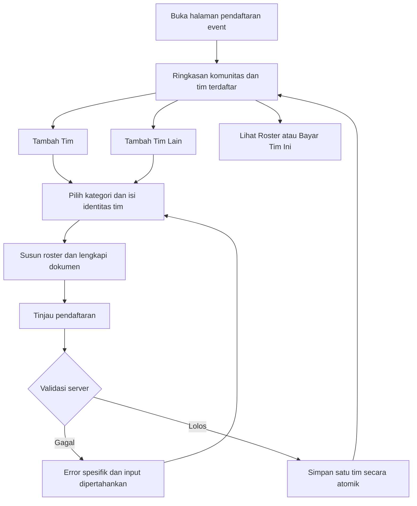

# PRD — Flow Pendaftaran Event Multi-Tim

- **Tanggal:** 2026-10-14
- **Status:** spesifikasi; belum implementasi.
- **Rujukan induk:** [PRD_EXTERNAL.md §4.6.1](PRD_EXTERNAL.md#461-prd--pendaftaran-multi-tim-komunitas-dalam-satu-event).
- **Target:** Web Panel Komunitas, Blade/Falcon.
- **URL:** `/panel/events/{slug}/register`.
- **Event contoh:** `http://localhost:7000/panel/events/piala-kemerdekaan-basket-jabar-2026/register`.

Dokumen mandiri ini menjabarkan flow, aturan, dan kriteria penerimaan dari PRD eksternal. Perubahan keputusan produk berikutnya harus menyelaraskan kedua dokumen; tidak menganggap fitur sudah tersedia hanya karena tercantum di PRD.

## 1. Masalah

Pengurus perlu mendaftarkan beberapa tim dari satu komunitas pada event yang sama, misalnya **1 tim putra + 1 tim putri**. Form saat ini berorientasi satu pendaftaran: pilih kategori, isi tim, susun roster, lalu diarahkan ke checkout atau halaman roster. Belum ada ringkasan tim event dan aksi lanjutan yang jelas untuk menambah tim kedua.

Batas kode saat ini adalah **satu tim komunitas per kategori**, bukan satu tim per event. `RegistrationGuard::validate()` memeriksa komunitas pada kategori, dan migrasi participant mendefinisikan unique index `(event_category_id, community_id)`. Putra dan putri berbeda kategori tidak membutuhkan pelepasan pembatasan tersebut.

## 2. Sasaran dan scope

### Sasaran

- Satu komunitas mengirim beberapa tim pada event sama tanpa membuat akun/komunitas baru.
- Semua tim komunitas pada event terlihat dalam satu ringkasan.
- Pengurus dapat menambah tim berikutnya sebelum membayar atau menunggu hasil kurasi tim pertama.
- Identitas komunitas serta dokumen bersama digunakan ulang; roster, mandat, status, dan tagihan terpisah per tim.
- Alur berlaku multi-cabor; nama, format pertandingan, gender, umur, dan syarat mengikuti kategori.

### Keputusan scope

**Satu submit menyimpan satu tim.** Sesudah sukses, pengurus memilih **Tambah Tim Lain**. Tidak ada submit massal atau keranjang pembayaran gabungan.

Tetap **satu tim komunitas per kategori**. Dua tim putra A/B pada kategori yang sama memerlukan keputusan produk tersendiri dan tidak dibuka oleh spesifikasi ini. Jumlah tim dalam event tidak dibatasi dua; mengikuti jumlah kategori eligible dan kuota yang berlaku. Jangan membuat kategori duplikat untuk mengakali batas.

Tidak menambah master tim permanen, draft lintas perangkat, API batch, perubahan refund, atau perubahan aturan kelayakan atlet.

## 3. Aktor dan prasyarat

**Aktor utama:** pengurus aktif komunitas terautentikasi. Organizer mengatur kategori serta melakukan kurasi; bukan syarat pengguna harus memiliki role organizer untuk mendaftarkan tim.

Prasyarat submit:

- Komunitas aktif dan terverifikasi; pengurus berwenang atas komunitas tersebut.
- Event published, pendaftaran dibuka, tenggat dan jendela kategori masih berlaku.
- Kategori milik event dan menerima sumber/subtipe/jenjang komunitas.
- Undangan sah tersedia bila kategori mensyaratkannya.
- Roster dan dokumen memenuhi ketentuan kategori; kuota mengikuti mode pendaftaran.

Prasyarat tidak terpenuhi harus menghasilkan alasan dan tindakan yang relevan, bukan form kosong atau error SQL.

## 4. Flow utama

### 4.1 Ringkasan event

Header menampilkan event, komunitas aktif, jadwal dan tenggat efektif. Pesan utama:

> Komunitas Anda dapat mendaftarkan beberapa tim pada kategori berbeda, misalnya putra dan putri.

Setiap tim menampilkan nama, kategori, jumlah pemain, status registrasi, status invoice jika ada, tenggat pembayaran, serta aksi yang diizinkan.

- Belum ada tim: **Tambah Tim**.
- Sudah ada tim: **Tambah Tim Lain**.
- Semua kategori eligible sudah dipakai: tampilkan alasan dan akses tim existing, bukan submit baru.
- Pendaftaran tutup: tambah tim dinonaktifkan; riwayat dan akses pembayaran tetap mengikuti aturan masing-masing.
- Tim butuh revisi: tampilkan catatan panitia dan akses detail existing; jangan menjanjikan endpoint edit baru.

### 4.2 Langkah 1 — Kategori & Identitas Tim

Pilih kategori sebelum roster. Setiap kategori menampilkan gender, rentang umur pada tanggal mulai event, min/max pemain, biaya, mode, jadwal pendaftaran, dan keterangan kuota/antrean.

- Kategori terpakai: **Sudah didaftarkan — Lihat Tim**.
- Tidak memenuhi syarat: tampilkan alasan, tidak dapat dipilih.
- Screening: gunakan label **Kuota Lolos**, bukan sisa slot pendaftaran.
- Query `event_category_id` dari halaman publik tetap dipertahankan. Pilihan tidak valid/tidak tersedia tidak diganti diam-diam.
- Usulan nama tim: `{nama komunitas} — {nama kategori}`, dapat diedit sesuai batas field.
- PIC awal dari pengguna aktif. Tim berikutnya boleh memakai PIC pendaftaran terakhir milik komunitas pada event yang sama, tetap dapat diedit.
- Token undangan hanya diperlukan pada kategori undangan; tidak disalin otomatis ke tim berikutnya.

### 4.3 Langkah 2 — Roster & Dokumen

Hanya roster kategori terpilih aktif dan terkirim. Sediakan pencarian nama, penghitung pemain, nomor punggung, kapten, serta checklist berkas.

- Pilihan atlet mengikuti keanggotaan aktif, verifikasi, gender, umur dan aturan kategori.
- Umur dihitung serta ditampilkan pada tanggal mulai event, bukan tanggal hari ini.
- Min/max pemain, tepat satu kapten, nomor punggung unik, dan larangan atlet pada dua tim kategori sama tetap berlaku.
- Kategori berbeda memvalidasi kelayakan masing-masing; tidak memperkenalkan larangan satu atlet per seluruh event.
- Legalitas komunitas dan vault atlet digunakan ulang berdasarkan scope serta verifikasi. Dokumen ditolak/tidak tersedia harus diperbaiki.
- Mandat/SPTJM tim terikat participant. Dokumen tim pertama tidak otomatis menjadi dokumen sah tim kedua.
- Ganti kategori setelah mengisi roster/berkas meminta konfirmasi pengosongan data khusus kategori. PIC dan catatan umum dipertahankan.

### 4.4 Langkah 3 — Tinjau & Kirim

Ringkasan menampilkan kategori, nama tim, PIC, pemain/kapten, kelengkapan dokumen, biaya, serta waktu penerbitan invoice. Tombol final: **Daftarkan Tim Ini**.

Navigasi antarlangkah tidak menghapus input. Error server mempertahankan nilai teks, kategori, roster, nomor punggung, dan kapten. File input yang harus dipilih ulang diberi pesan **Pilih ulang berkas**, bukan ditampilkan seolah sudah tersimpan.

### 4.5 Setelah sukses

POST sukses melakukan redirect GET kembali ke ringkasan event pada URL register. Tim baru terlihat beserta pesan sukses spesifik nama tim/kategori. Tidak otomatis memaksa checkout.

- **Tambah Tim Lain:** event dan komunitas tetap; roster, kapten, nomor punggung, dokumen tim, dan token undangan direset.
- **Lihat Roster:** menuju participant yang dipilih.
- **Bayar Tim Ini:** hanya tersedia ketika invoice ada dan waktu/status mengizinkan.
- `/panel/events` tetap daftar lintas-event. Halaman roster/checkout menyediakan tautan kembali ke ringkasan event dengan konteks tim/kategori jelas.

## 5. Status dan pembayaran per tim

| Kondisi | Informasi dan tindakan |
|---|---|
| Screening belum eligible | Menunggu kurasi; tidak menerbitkan invoice atau menawarkan bayar sebelum waktunya. |
| Payment-first / undangan berbayar | Invoice per participant sesuai aturan kategori; pembayaran menunggu jendela yang sah. |
| Kategori gratis | Tidak ada invoice; verifikasi roster/berkas tetap berlaku. |
| Waiting list | Tampilkan posisi antrean; jangan menjanjikan slot atau meminta pembayaran sebelum aturan mengizinkan. |
| Invoice belum masuk jendela bayar | Tampilkan waktu mulai; bayar belum aktif. |
| Invoice kedaluwarsa | Tampilkan status; tidak membuka ulang pembayaran diam-diam. |
| Revisi / ditolak / dibatalkan | Tampilkan record dan catatan yang tersedia; tidak mengubah tim lain atau membuat participant pengganti otomatis. |

Biaya setiap tim mengikuti kategori dan snapshot invoice masing-masing. Membayar tim putra tidak melunasi tim putri. Kegagalan pendaftaran atau kurasi tim kedua tidak membatalkan tim pertama. Konfirmasi tetap mensyaratkan seluruh pemeriksaan domain, bukan pembayaran saja.

## 6. Model data dan kontrak teknis

- Satu `event_participants` = satu tim dalam satu kategori. Tim putra/putri memiliki participant ID berbeda dengan `community_id` dan `event_id` sama.
- Pertahankan unique index komunitas-kategori serta nama tim-kategori; nama unik case-insensitive setelah trim.
- Pasangan komunitas-kategori yang sudah memiliki participant, termasuk rejected/cancelled, diarahkan ke record lama. Reaktivasi/pendaftaran ulang tidak termasuk perubahan ini.
- Dua tim dihitung sebagai dua pendaftaran untuk kuota, bukan satu komunitas. Kuota kategori/event, screening, waiting list, dan masa berlaku slot tetap mengikuti aturan domain existing.
- Tidak perlu tabel batch/tim induk, kolom gender tim, atau migrasi penghapusan index untuk contoh putra + putri.

| Endpoint | Kontrak |
|---|---|
| `GET /panel/events/{slug}/register` | Ringkasan participant komunitas aktif pada event tersebut serta form satu tim. |
| `POST /panel/events/{slug}/register` | Satu payload kategori, identitas tim, `members`, dan dokumen; bukan array `teams`. Sukses redirect ke ringkasan event; gagal kembali dengan input/error. |
| `GET /panel/registrations/{participant}/roster` | Detail tim dengan otorisasi kepemilikan existing. |
| `GET /panel/registrations/{participant}/checkout` | Invoice participant tertentu, dengan aturan pembayaran existing. |

Validasi input melalui FormRequest; transaksi dan aturan domain di service; controller tipis. Reuse `RegistrationGuard`, `RosterValidator`, kontrak Community/Payment dan vault existing. Jangan menambah import langsung model lintas-modul.

Participant, roster, dokumen tim, penebusan undangan, dan invoice yang waktunya terbit harus konsisten per transaksi tim. Pertahankan lock dan constraint DB. Double-click, refresh, atau dua tab tidak boleh menghasilkan participant/invoice ganda; konflik ditangani ramah dengan akses ke pendaftaran existing.

UI tetap Blade/Falcon. Stepper bukan workflow domain baru atau alasan menambah SPA/dependensi. Mobile satu kolom; seluruh input, langkah dan error mendukung keyboard, label aksesibel, serta informasi status selain warna.

## 7. Keamanan

Session `web`, CSRF, middleware panel, dan pemeriksaan pengurus aktif tetap wajib. Server menentukan komunitas dari pengguna terautentikasi; jangan percaya hidden input untuk kepemilikan.

Validasi kategori harus scoped ke event, atlet ke komunitas/kelayakan, dan participant/dokumen/invoice ke hak akses pengguna. Ringkasan tidak memperlihatkan tim komunitas lain. Berkas tetap privat. Halaman internal tidak mengubah kebijakan publikasi roster event.

## 8. Acceptance criteria

| ID | Skenario | Hasil wajib |
|---|---|---|
| MT-01 | Komunitas eligible mendaftarkan satu tim putra dan satu tim putri pada event sama. | Dua participant, kategori berbeda, komunitas/event sama; keduanya tampil tanpa akun atau komunitas baru. |
| MT-02 | Tim pertama belum dibayar/masih kurasi. | Tim kedua dapat didaftarkan sesuai syaratnya sendiri; status tim pertama tidak berubah. |
| MT-03 | Kategori sudah dipakai; URL langsung, double-click, atau dua tab. | Tidak ada participant/invoice ganda atau error SQL; pengguna diarahkan ke record existing. |
| MT-04 | Roster tim kedua kurang pemain atau tidak eligible. | Error spesifik dan input dipertahankan; tim pertama tetap utuh. |
| MT-05 | Ganti kategori setelah mengisi roster. | Konfirmasi reset; hanya payload kategori terpilih terkirim. |
| MT-06 | Dua tim berbeda biaya/mode. | Snapshot dan waktu penerbitan invoice independen; tidak ada tagihan gabungan/nominal warisan. |
| MT-07 | Gratis, screening belum eligible, waiting list, atau belum waktunya bayar. | Status/aksi tepat; tidak ada bayar atau konfirmasi otomatis yang menyesatkan. |
| MT-08 | Vault dan legalitas komunitas memenuhi syarat. | Tidak meminta unggah ulang berkas bersama; mandat tim kedua tetap diperiksa terpisah. |
| MT-09 | Kuota/tenggat berubah sesudah halaman dibuka. | Server memeriksa ulang; menolak atau mengantre sesuai aturan tanpa mengubah tim lain. |
| MT-10 | Manipulasi komunitas, atlet, kategori lintas-event, atau participant pihak lain. | Ditolak tanpa kebocoran roster, berkas, atau invoice. |
| MT-11 | Participant lama rejected/cancelled. | Record lama terlihat, tidak dibuat baru dalam kategori sama; kategori berbeda tetap tersedia bila eligible. |
| MT-12 | Pengisian via mobile dan keyboard. | Seluruh langkah/aksi/error dapat diakses; pindah langkah tidak menghilangkan input. |

## 9. Verifikasi dan kesiapan implementasi

**Bukti riset:** URL panel tanpa sesi dialihkan ke `/panel/login`. Halaman publik event dapat dibaca dan menampilkan kategori SMA/SMP putra serta putri. Form dan aturan internal diperiksa dari kode; belum ada pengujian submit dua tim terautentikasi pada pekerjaan penulisan PRD ini.

**Risiko data contoh:** SMA Putra saat riset memiliki rentang 16–18 tahun dan sumber SMA/SMK; SMA Putri menampilkan “Semua usia” serta sumber lebih luas. Organizer wajib meninjau konfigurasi sebelum UAT. Nama kategori bukan bukti validasi umur/jenjang. Tidak ada perubahan konfigurasi event otomatis.

**Definisi selesai implementasi:** jalankan MT-01 di browser terautentikasi dengan dua roster valid dan periksa participant, roster, serta invoice masing-masing. Buktikan juga duplikasi, kegagalan tim kedua, perubahan kuota/tenggat dan akses lintas-komunitas. Gunakan lingkungan uji tanpa pembayaran riil. Acceptance criteria di atas adalah target, bukan hasil tes yang sudah lulus.

**Ukuran keberhasilan:** putra + putri selesai dalam satu konteks event, tanpa input ulang legalitas komunitas, tanpa wajib melunasi tim pertama, dan tanpa roster/tagihan tercampur. Tidak memerlukan telemetry baru.

## 10. Referensi kode

- `app/Modules/Event/Http/Controllers/Panel/CommunityEventRegistrationController.php`
- `app/Modules/Event/Services/RegistrationGuard.php`
- `app/Modules/Event/Services/RosterValidator.php`
- `app/Modules/Event/Routes/panel.php`
- `database/migrations/2026_10_09_160000_create_event_tables.php`
- `resources/views/panel/events/register.blade.php`
- `resources/views/panel/events/index.blade.php`
- `resources/views/panel/registrations/roster.blade.php`
- `resources/views/panel/registrations/checkout.blade.php`
- `PRD.md`, bagian Pendaftaran Peserta.
