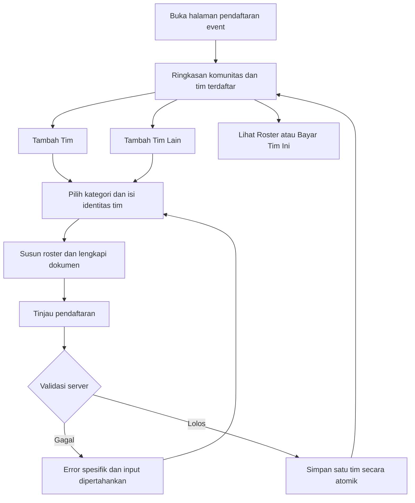

# PRD — Flow Pendaftaran Event Multi-Tim

- **Tanggal:** 2026-10-14
- **Status:** fondasi multi-tim/draft terpasang lokal; remake RF-01 undangan umum terpasang dan focused checks lulus, full-suite/UAT belum sign-off. RF-02–RF-05 belum diimplementasikan (bagian 11). Hasil tes historis bukan bukti acceptance seluruh remake.
- **Rujukan induk:** [PRD_EXTERNAL.md §4.6.1](PRD_EXTERNAL.md#461-prd--pendaftaran-multi-tim-komunitas-dalam-satu-event).
- **Target:** Web Panel Komunitas, Blade/Falcon.
- **URL:** `/panel/events/{slug}/register`.
- **Event contoh:** `http://localhost:7000/panel/events/piala-kemerdekaan-basket-jabar-2026/register`.

Dokumen mandiri ini menjabarkan flow, aturan, dan kriteria penerimaan dari PRD eksternal. Perubahan keputusan produk berikutnya harus menyelaraskan kedua dokumen; tidak menganggap fitur sudah tersedia hanya karena tercantum di PRD.

## 1. Masalah

Pengurus perlu mendaftarkan beberapa tim dari satu komunitas pada event yang sama, misalnya **1 tim putra + 1 tim putri**. Form saat ini berorientasi satu pendaftaran: pilih kategori, isi tim, susun roster, lalu diarahkan ke checkout atau halaman roster. Belum ada ringkasan tim event dan aksi lanjutan yang jelas untuk menambah tim kedua.

Batas kode saat ini adalah **satu tim komunitas per kategori**, bukan satu tim per event. `RegistrationGuard::validate()` memeriksa komunitas pada kategori, dan migrasi participant mendefinisikan unique index `(event_category_id, community_id)`. Putra dan putri berbeda kategori tidak membutuhkan pelepasan pembatasan tersebut.

## 2. Sasaran dan scope

### Sasaran

- Satu komunitas mengirim beberapa tim pada event sama tanpa membuat akun/komunitas baru.
- Semua tim komunitas pada event terlihat dalam satu ringkasan.
- Pengurus dapat menambah tim berikutnya sebelum membayar atau menunggu hasil kurasi tim pertama.
- Identitas komunitas serta dokumen bersama digunakan ulang; roster, mandat, status, dan tagihan terpisah per tim.
- Alur berlaku multi-cabor; nama, format pertandingan, gender, umur, dan syarat mengikuti kategori.

### Keputusan scope

**Satu submit menyimpan satu tim.** Sesudah sukses, pengurus memilih **Tambah Tim Lain**. Tidak ada submit massal atau keranjang pembayaran gabungan.

Keputusan pengguna: organizer/admin menetapkan **Maksimal Tim per Entitas** per kategori (`max_teams_per_entity`, integer positif, default 1). SMA Putra=2 dan SMA Putri=1 mengizinkan Putra A/B serta satu Putri; kuota total kategori dan roster tetap terpisah. Batas berlaku semua entitas eligible. Pending pembayaran aktif, registered, revision_needed, verified, confirmed dan waiting_list memakai batas; rejected/cancelled serta pending payment kedaluwarsa melepaskan slot. Reaktivasi wajib memeriksa batas kembali. Dilarang menurunkan batas di bawah jumlah tim aktif terbesar satu entitas. Nama tim dan proteksi submit ganda tetap wajib.

Tidak menambah master tim permanen, API batch, perubahan refund, atau mengubah kelayakan atlet. Tambahan disetujui: draft server yang dapat dilanjutkan dan cache tab untuk perubahan offline. Draft tidak memakai kuota, tidak membuat participant/invoice/email. File offline belum tersimpan di server dapat hilang saat tab ditutup; tampilkan peringatan pilih ulang, jangan menjanjikan pemulihan binary offline.

## 3. Aktor dan prasyarat

**Aktor utama:** pengurus aktif komunitas terautentikasi. Organizer mengatur kategori serta melakukan kurasi; bukan syarat pengguna harus memiliki role organizer untuk mendaftarkan tim.

Prasyarat submit:

- Komunitas aktif dan terverifikasi; pengurus berwenang atas komunitas tersebut.
- Event published, pendaftaran dibuka, tenggat dan jendela kategori masih berlaku.
- Kategori milik event dan menerima sumber/subtipe/jenjang komunitas.
- Undangan sah tersedia bila kategori mensyaratkannya.
- Roster dan dokumen memenuhi ketentuan kategori; kuota mengikuti mode pendaftaran.

Prasyarat tidak terpenuhi harus menghasilkan alasan dan tindakan yang relevan, bukan form kosong atau error SQL.

## 4. Flow utama

### 4.1 Ringkasan event

Header menampilkan event, komunitas aktif, jadwal dan tenggat efektif. Pesan utama:

> Komunitas Anda dapat mendaftarkan beberapa tim pada kategori berbeda, misalnya putra dan putri.

Setiap tim menampilkan nama, kategori, jumlah pemain, status registrasi, status invoice jika ada, tenggat pembayaran, serta aksi yang diizinkan.

- Belum ada tim: **Tambah Tim**.
- Sudah ada tim: **Tambah Tim Lain**.
- Semua kategori eligible sudah dipakai: tampilkan alasan dan akses tim existing, bukan submit baru.
- Pendaftaran tutup: tambah tim dinonaktifkan; riwayat dan akses pembayaran tetap mengikuti aturan masing-masing.
- Tim butuh revisi: tampilkan catatan panitia; desain remake membuka edit hanya saat `revision_needed` melalui endpoint berwenang dan kirim ulang yang diperiksa lagi. Endpoint/UI revisi harus diimplementasikan dan diuji sebelum dianggap tersedia.

### 4.2 Langkah 1 — Kategori & Identitas Tim

Pilih kategori sebelum roster. Setiap kategori menampilkan gender, rentang umur pada tanggal mulai event, min/max pemain, biaya, mode, jadwal pendaftaran, dan keterangan kuota/antrean.

- Kategori mencapai batas entitas: **Batas tim tercapai — Lihat Tim**. Kategori masih tersedia selama batas entitas dan kuota mengizinkan.
- Tidak memenuhi syarat: tampilkan alasan, tidak dapat dipilih.
- Screening: gunakan label **Kuota Lolos**, bukan sisa slot pendaftaran.
- Query `event_category_id` dari halaman publik tetap dipertahankan. Pilihan tidak valid/tidak tersedia tidak diganti diam-diam.
- Usulan nama tim: `{nama komunitas} — {nama kategori}`, dapat diedit sesuai batas field.
- PIC awal dari pengguna aktif. Tim berikutnya boleh memakai PIC pendaftaran terakhir milik komunitas pada event yang sama, tetap dapat diedit.
- Token undangan hanya diperlukan pada kategori undangan; tidak disalin otomatis ke tim berikutnya.

### 4.3 Langkah 2 — Roster & Dokumen

Setiap collapse tim berisi dua bagian: **Dokumen** (upload sesuai kategori) dan **Roster**. **Tambah Atlet** memilih anggota komunitas aktif yang tersedia dan memenuhi kategori, tampil hanya jika jumlah tersedia **lebih dari 6**; 6 tersembunyi, 7 tampil. **Link Roster Tim** merupakan tautan bersama tanpa input nama, scoped draft tim aktif; tiap tim memiliki link berbeda dan penerimaan otomatis masuk roster draft tujuan. Nomor punggung, kapten, validasi dan pemisahan berkas tetap berlaku. Tombol **Simpan Roster & Dokumen** dihapus; edit langkah 2 disimpan otomatis, tanpa mengubah simpan manual langkah 1. Tunggu ACK sebelum perpindahan/kirim; kegagalan mempertahankan perubahan.

- Link roster stabil per draft tim dan kategori: klik berulang, termasuk setelah memuat ulang halaman, mengembalikan token terenkripsi existing tanpa membuat undangan baru atau mereset kuota. Pembuatan/reuse diserialisasi dengan lock draft dalam transaksi. Undangan revoked/expired eksplisit tidak dihidupkan kembali; link legacy dengan expiry tujuh hari memakai lifecycle draft saat diambil ulang. Saat link diminta, masa simpan draft mengikuti batas terawal registration_end kategori, registration_deadline event, atau starts_at event yang tersedia; tanpa tanggal tetap memakai expiry draft existing. Link ditolak pada kategori/event tutup, deadline lewat, draft expired/deleted/submitted, atau konteks kategori berubah. Link tim lain tetap berbeda; duplikat legacy tetap tunduk kuota bersama. Verifikasi: 79 tes PHP/560 assertions dan 114 tes Node UI lulus, Pint/Blade/build/diff-check lulus. Full suite dicoba tetapi timeout 180 detik; tidak diklaim hijau. Draft runtime pengguna tidak dikirim atau diubah untuk QA.
- Pilihan atlet mengikuti keanggotaan aktif/non-ended, akun aktif, gender, umur dan aturan kategori; status verifikasi wilayah atlet bukan prasyarat. Verifikasi legalitas komunitas dan pemeriksaan dokumen tetap terpisah.
- Umur dihitung serta ditampilkan pada tanggal mulai event, bukan tanggal hari ini.
- Min/max pemain, tepat satu kapten, nomor punggung unik, dan larangan atlet pada dua tim kategori sama tetap berlaku.
- Kategori berbeda memvalidasi kelayakan masing-masing; tidak memperkenalkan larangan satu atlet per seluruh event.
- Legalitas komunitas dan vault atlet digunakan ulang berdasarkan scope serta verifikasi. Dokumen ditolak/tidak tersedia harus diperbaiki.
- Mandat/SPTJM tim terikat participant. Dokumen tim pertama tidak otomatis menjadi dokumen sah tim kedua.
- Ganti kategori setelah mengisi roster/berkas meminta konfirmasi pengosongan data khusus kategori. PIC dan catatan umum dipertahankan.

### 4.4 Langkah 3 — Tinjau & Kirim

Ringkasan menampilkan kategori, nama tim, PIC, pemain/kapten, kelengkapan dokumen, biaya, serta waktu penerbitan invoice. Tombol final: **Daftarkan Tim Ini**.

Navigasi antarlangkah tidak menghapus input. Error server mempertahankan nilai teks, kategori, roster, nomor punggung, dan kapten. File input yang harus dipilih ulang diberi pesan **Pilih ulang berkas**, bukan ditampilkan seolah sudah tersimpan.

### 4.5 Setelah sukses

POST sukses melakukan redirect GET kembali ke ringkasan event pada URL register. Tim baru terlihat beserta pesan sukses spesifik nama tim/kategori. Tidak otomatis memaksa checkout.

- **Tambah Tim Lain:** event dan komunitas tetap; roster, kapten, nomor punggung, dokumen tim, dan token undangan direset.
- **Lihat Roster:** menuju participant yang dipilih.
- **Bayar Tim Ini:** hanya tersedia ketika invoice ada dan waktu/status mengizinkan.
- `/panel/events` tetap daftar lintas-event. Halaman roster/checkout menyediakan tautan kembali ke ringkasan event dengan konteks tim/kategori jelas.

## 5. Status dan pembayaran per tim

| Kondisi | Informasi dan tindakan |
|---|---|
| Screening belum eligible | Menunggu kurasi; tidak menerbitkan invoice atau menawarkan bayar sebelum waktunya. |
| Payment-first / undangan berbayar | Invoice per participant sesuai aturan kategori; pembayaran menunggu jendela yang sah. |
| Kategori gratis | Tidak ada invoice; verifikasi roster/berkas tetap berlaku. |
| Waiting list | Tampilkan posisi antrean; jangan menjanjikan slot atau meminta pembayaran sebelum aturan mengizinkan. |
| Invoice belum masuk jendela bayar | Tampilkan waktu mulai; bayar belum aktif. |
| Invoice kedaluwarsa | Tampilkan status; tidak membuka ulang pembayaran diam-diam. |
| Revisi / ditolak / dibatalkan | Tampilkan record dan catatan yang tersedia; tidak mengubah tim lain atau membuat participant pengganti otomatis. |

Biaya setiap tim mengikuti kategori dan snapshot invoice masing-masing. Membayar tim putra tidak melunasi tim putri. Kegagalan pendaftaran atau kurasi tim kedua tidak membatalkan tim pertama. Konfirmasi tetap mensyaratkan seluruh pemeriksaan domain, bukan pembayaran saja.

## 6. Model data dan kontrak teknis

- Satu `event_participants` = satu tim dalam satu kategori. Tim putra/putri memiliki participant ID berbeda dengan `community_id` dan `event_id` sama.
- Ganti unique index komunitas-kategori dengan batas per entitas yang diperiksa di dalam transaksi terkunci. Pertahankan unique nama tim-kategori; nama unik case-insensitive setelah trim. UUID draft menjadi identitas submit yang idempotent; replay mengembalikan participant/invoice existing, bukan membuat tim baru.
- Record lama termasuk rejected/cancelled tetap terlihat. Tim baru dalam kategori sama boleh dibuat jika batas entitas, kuota dan kelayakan mengizinkan; replay draft lama tidak membuat participant baru. Reaktivasi record lama tidak otomatis dan wajib menguji kapasitas.
- Dua tim dihitung sebagai dua pendaftaran untuk kuota, bukan satu komunitas. Kuota kategori/event, screening, waiting list, dan masa berlaku slot tetap mengikuti aturan domain existing.
- Tidak perlu tabel batch/tim induk atau kolom gender tim. Scope A/B kini memerlukan migrasi terbatas pelepasan unique komunitas-kategori dan kolom batas kategori; draft memakai tabel terpisah dengan UUID, owner/context, payload/files terenkripsi, revision, expiry dan participant_id hasil submit.

| Endpoint | Kontrak |
|---|---|
| `GET /panel/events/{slug}/register` | Ringkasan participant komunitas aktif pada event tersebut serta form satu tim. |
| `POST /panel/events/{slug}/register` | Satu payload kategori, identitas tim, `members`, dan dokumen; bukan array `teams`. Sukses redirect ke ringkasan event; gagal kembali dengan input/error. |
| `GET /panel/registrations/{participant}/roster` | Detail tim dengan otorisasi kepemilikan existing. |
| `GET /panel/registrations/{participant}/checkout` | Invoice participant tertentu, dengan aturan pembayaran existing. |

Validasi input melalui FormRequest; transaksi dan aturan domain di service; controller tipis. Reuse `RegistrationGuard`, `RosterValidator`, kontrak Community/Payment dan vault existing. Jangan menambah import langsung model lintas-modul.

Participant, roster, dokumen tim, penebusan undangan, dan invoice yang waktunya terbit harus konsisten per transaksi tim. Pertahankan lock dan constraint DB. Double-click, refresh, atau dua tab tidak boleh menghasilkan participant/invoice ganda; konflik ditangani ramah dengan akses ke pendaftaran existing.

UI tetap Blade/Falcon. Stepper bukan workflow domain baru atau alasan menambah SPA/dependensi. Mobile satu kolom; seluruh input, langkah dan error mendukung keyboard, label aksesibel, serta informasi status selain warna.

## 7. Keamanan

Session `web`, CSRF, middleware panel, dan pemeriksaan pengurus aktif tetap wajib. Server menentukan komunitas dari pengguna terautentikasi; jangan percaya hidden input untuk kepemilikan.

Validasi kategori harus scoped ke event, atlet ke komunitas/kelayakan, dan participant/dokumen/invoice ke hak akses pengguna. Ringkasan tidak memperlihatkan tim komunitas lain. Berkas tetap privat. Halaman internal tidak mengubah kebijakan publikasi roster event.

## 8. Acceptance criteria

| ID | Skenario | Hasil wajib |
|---|---|---|
| MT-01 | Komunitas eligible mendaftarkan satu tim putra dan satu tim putri pada event sama. | Dua participant, kategori berbeda, komunitas/event sama; keduanya tampil tanpa akun atau komunitas baru. |
| MT-02 | Tim pertama belum dibayar/masih kurasi. | Tim kedua dapat didaftarkan sesuai syaratnya sendiri; status tim pertama tidak berubah. |
| MT-03 | Kategori sudah dipakai; URL langsung, double-click, atau dua tab. | Tidak ada participant/invoice ganda atau error SQL; pengguna diarahkan ke record existing. |
| MT-04 | Roster tim kedua kurang pemain atau tidak eligible. | Error spesifik dan input dipertahankan; tim pertama tetap utuh. |
| MT-05 | Ganti kategori setelah mengisi roster. | Konfirmasi reset; hanya payload kategori terpilih terkirim. |
| MT-06 | Dua tim berbeda biaya/mode. | Snapshot dan waktu penerbitan invoice independen; tidak ada tagihan gabungan/nominal warisan. |
| MT-07 | Gratis, screening belum eligible, waiting list, atau belum waktunya bayar. | Status/aksi tepat; tidak ada bayar atau konfirmasi otomatis yang menyesatkan. |
| MT-08 | Vault dan legalitas komunitas memenuhi syarat. | Tidak meminta unggah ulang berkas bersama; mandat tim kedua tetap diperiksa terpisah. |
| MT-09 | Kuota/tenggat berubah sesudah halaman dibuka. | Server memeriksa ulang; menolak atau mengantre sesuai aturan tanpa mengubah tim lain. |
| MT-10 | Manipulasi komunitas, atlet, kategori lintas-event, atau participant pihak lain. | Ditolak tanpa kebocoran roster, berkas, atau invoice. |
| MT-11 | Participant lama rejected/cancelled. | Record lama terlihat; draft baru boleh submit bila kapasitas dan kelayakan mengizinkan. Replay draft lama tetap menuju record lama. |
| MT-12 | Pengisian via mobile dan keyboard. | Seluruh langkah/aksi/error dapat diakses; pindah langkah tidak menghilangkan input. |

## 9. Verifikasi dan kesiapan implementasi

**Bukti riset:** URL panel tanpa sesi dialihkan ke `/panel/login`. Halaman publik event dapat dibaca dan menampilkan kategori SMA/SMP putra serta putri. Form dan aturan internal diperiksa dari kode; belum ada pengujian submit dua tim terautentikasi pada pekerjaan penulisan PRD ini.

**Risiko data contoh:** SMA Putra saat riset memiliki rentang 16–18 tahun dan sumber SMA/SMK; SMA Putri menampilkan “Semua usia” serta sumber lebih luas. Organizer wajib meninjau konfigurasi sebelum UAT. Nama kategori bukan bukti validasi umur/jenjang. Tidak ada perubahan konfigurasi event otomatis.

**Definisi selesai implementasi:** jalankan MT-01 di browser terautentikasi dengan dua roster valid dan periksa participant, roster, serta invoice masing-masing. Buktikan juga duplikasi, kegagalan tim kedua, perubahan kuota/tenggat dan akses lintas-komunitas. Gunakan lingkungan uji tanpa pembayaran riil. Acceptance criteria di atas adalah target, bukan hasil tes yang sudah lulus.

**Ukuran keberhasilan:** putra + putri selesai dalam satu konteks event, tanpa input ulang legalitas komunitas, tanpa wajib melunasi tim pertama, dan tanpa roster/tagihan tercampur. Tidak memerlukan telemetry baru.

### Fixture uji kirim manual lokal: Cisarua Putri

Draft `19d471e7-0be9-49cb-9f9f-246e86a68d13`, event 1/kategori 5, dilengkapi 5 atlet putri sintetis (akun `.invalid`, nomor jersey 4–8, satu kapten), 25 berkas pribadi dan 1 berkas tim berlabel `CONTOH / UJI COBA`. Seluruh 26 berkas tersimpan privat sebagai staged draft, lolos MIME/ukuran dan tersedia pada detail inspeksi. Tidak menimpa dokumen pribadi existing atau mengirim email. Dengan izin eksplisit pengguna, status komunitas SMAN 1 CISARUA di DB lokal diubah dari `draft` ke `verified` agar guard pendaftaran tidak menghalangi uji kirim; bukan bukti legalitas nyata. Guard registrasi dan validator roster lulus tanpa memanggil endpoint kirim. Read-back: revision 2, participant_id null, isSubmitted false, belum ada participant/invoice/email baru. Form pemilik draft Cindy dirender; kirim manual memakai `/panel/events/piala-kemerdekaan-basket-jabar-2026/register?draft_id=19d471e7-0be9-49cb-9f9f-246e86a68d13`. Pengguna tetap harus menekan Kirim Pendaftaran sendiri; belum mengklaim hasil submit.

## 10. Revisi batas tim dan ketahanan koneksi (disetujui)

Bagian ini mengungguli klausul lama yang masih menyebut satu tim per kategori atau tanpa draft.

- Pengaturan admin dan organizer memakai form kategori bersama, bagian Persyaratan Dokumen & Antrean: Maksimal Tim per Entitas, default1, integer positif. Kuota kategori screening tetap kuota lolos.
- Tiap tim mempunyai draft UUID sendiri; owner creator+komunitas aktif+event, expiry7hari, revision optimistik. Draft tersimpan server dapat dilanjutkan dari perangkat lain oleh creator; perubahan yang belum tersinkron hanya pada tab/perangkat asal. Tidak berpindah owner otomatis saat Panel Aktif berubah.
- Autosave ketika online; status Menyimpan/Tersimpan(waktuACK)/Offline belum tersinkron/Gagal menyimpan/Konflik. Revision409 tidak boleh diam-diam menimpa draft lebih baru.
- Cache sessionStorage scoped user/community/event/draft, expiry serta clear logout/contextswitch; hanya field minimum dan ID roster. Tidak menyimpan NIK, dokumen binary, token undangan, tokenCSRF/password. Data browser bukan encryptedvault dan bukan bukti serverACK.
- Upload draft privat dengan MIME/size/owner/code checks; berkas tersimpan server dapat dipakai submit. Berkas yang belum terunggah tetap memorytab, pilih ulang jika tabditutup. Perubahan kategori meminta konfirmasi dan menghapus data kategori lama secara scoped. Token undangan dimasukkan ulang, tidak disimpan draft.
- Draft tidak reservasi kuota/menebusundangan/membuatemailinvoice/merubahvaultatlet. Final submit memeriksa ulang semua syarat dalam transaksi rowlock kategori+draft, menyimpan participant/roster/invoice/document/participant_iddraft atomik. Email hanya sesudahcommit.
- Jika koneksi putus saat submit, GET draft memeriksa participant_id; ulang request UUID sama mengembalikan pendaftaran existing tanpa invoice/email kedua. Jangan membuat UUID baru otomatis.
- Tambahan acceptance: Putra limit2 menerima A/B menolakC; Putri limit1 independen. Doubletab dan concurrentpengurus tidak melebihi limit; overlaprostercategory ditolak. Autosaveoffline/resume, refresh cache, serverfilesresume, ownership/expired/revisionconflict, rollback dan replayfinal diuji. Parent DBtests serial, tanpa pembayaran/email nyata.
- Implementasi berjalan: writer kategori, backenddraft dan UI `deleg_da2566cc`. Parent test migration dan focused20/81 passed; draft14/65 standalone clean. Runtime migration belum. UIwriter awal interrupted; pengganti deleg_bdb389ef menulis draftUI dan Node8passed. Parent review menemukan refreshcache/ACKinflight/failedsubmit/rawfilenamemarkup belumaman; fixer deleg_067185c6 menangani loss/race/XSS serta payloadJSONclear semantics. Runtime ditahan, belum final. Securityfixer/UI fixer selesai; parent full545 tests /3287 assertions,31 Node UI tests, build/Pint/Blade/diff passed. Parent followup focused35/180 +draftNode18 passed untuk CASoffline, finalidentityretention, activecount dan stale Panel Aktif. Migrasi runtime max_teams_per_entity/drafttable diterapkan dan schema readback benar. UAT MT-01 browser dua roster/invoice nyata belum dilakukan: browser diarahkan panel/login dan vault tidak mempunyai login. Fitur terpasang lokal; sign-off final menunggu UAT, tanpa email/pembayaran nyata.

## 11. Remake keanggotaan, roster dan pemeriksaan (desain disetujui)

**Status:** implementasi sedang berjalan (*implementation in progress*); tidak ada klaim kelulusan tes fiktif (*no invented test claims*). Fondasi dan hasil tes historis di bagian 10 bukan bukti acceptance seluruh remake. Planner `cx/gpt-6-sol` sudah menjalankan riset/rencana; pekerja rutin diprioritaskan `ag/gemini-3.8-flash-high`, tanpa mengubah default profile.

### 11.1 Identitas dan undangan

- Pembedaan tegas alur undangan:
  * **Undangan global komunitas:** hanya untuk bergabung ke bank atlet/anggota komunitas (`/panel/athletes`). Tidak ada input maupun persistensi nomor punggung (`jersey_number`). Pengguna yang sudah memiliki keanggotaan pending/active tanpa `left_at` hanya melihat status sudah terdaftar, bukan form pendaftaran ulang. Link roster memeriksa keikutsertaan pada payload roster draft tujuan, bukan keanggotaan komunitas saja; anggota komunitas tetap bisa menerima undangan tim yang belum diikutinya. POST replay tidak mengubah profil, histori pendidikan, nomor punggung, revision atau kuota. Verifikasi: 70 tes PHP / 482 assertions dan 12 tes UI lulus; render controller read-only kedua tautan pengguna untuk akun yang dilaporkan menampilkan status tanpa form.
  * **Undangan link roster draft event:** membawa konteks event, tim, dan kategori draft. Penerimaan tautan otomatis memasukkan atlet ke roster tim target pada draft terkait (*auto enroll target team*).
  * **Guard kategori saat penerimaan undangan:** guest dan akun existing wajib gender sesuai kategori (mixed menerima male/female, null ditolak). Server memvalidasi sebelum membuat akun/keanggotaan/calon roster atau memakai kuota; POST palsu tidak dapat melewati dropdown. Gender/tanggal lahir existing yang sudah terisi tidak boleh diubah melalui undangan; nilai profil dipakai bila request mengosongkannya. Batas min/max usia dihitung inklusif pada tanggal mulai event; tanpa batas eksplisit, development_level_id diperiksa melalui kontrak DevelopmentLevelLookup sesuai aturan final roster existing. Keanggotaan/dokumen tetap provisional dan diperiksa ulang saat submit; status wilayah atlet informasional, bukan prasyarat. Form guest/login hanya menampilkan opsi gender kategori; Posisi Bermain basket berupa dropdown lima nama lengkap (Point Guard, Shooting Guard, Small Forward, Power Forward, Center), optional, dengan whitelist server; cabor lain tetap teks. Verifikasi 96 tes PHP/729 assertions lulus, Pint/Blade/diff-check lulus; render HTTP 200 link pengguna kategori Pelajar SMA Putri hanya female dan lima posisi, tanpa mutasi draft runtime.
  * **Preview usia undangan:** tampilkan `Usia Anda saat event: N tahun (YYYY-MM-DD)` di bawah syarat kategori, memakai tanggal lahir akun sendiri dan tanggal mulai event. Guest/profil kosong mendapat preview langsung ketika tanggal lahir diisi; akun existing tetap memakai tanggal lahir profil walau input dimanipulasi. Tanggal kosong/invalid tidak menghasilkan usia palsu. Preview bukan approval; server tetap memvalidasi kategori. Verifikasi 40 tes PHP/442 assertions dan satu tes Node preview lulus; link pengguna HTTP 200 memuat preview/script, Blade/Pint/diff-check lulus.
  * **Persyaratan identitas seluruh alur undangan atlet:** seluruh alur undangan atlet (baik undangan komunitas global maupun link roster draft) wajib mengisi tempat lahir (`birth_place`) dan tanggal lahir (`birth_date`). Keputusan arsitektur: riwayat pendidikan (*education history*) melekat pada setiap **USER** (`user_educations`), bukan pada keanggotaan komunitas (*not community membership*). NISN merupakan nomor siswa nasional yang dicatat bersama riwayat sekolah; NIM merupakan nomor mahasiswa pada perguruan tinggi terkait. NIK tetap identitas kependudukan pribadi terpisah dan tidak digantikan oleh NISN/NIM. Alur undangan mencatat snapshot institusi ke dalam riwayat pendidikan milik pengguna secara idempoten (*user-owned idempotent history*), mempertahankan riwayat institusi terdahulu saat berpindah, tanpa mengarang tanggal masuk/kelulusan (*no invented enrollment/graduation dates*) atau membuat klaim akademik terverifikasi (*no verified academic claims*). Form global tanpa nomor punggung, nomor punggung roster disimpan pada draft tujuan. Halaman undangan aktual sudah diverifikasi menampilkan panduan NISN 10 digit dan atribut input yang sesuai.
  * **Otoritas tipe pengenal dan format error:** tipe identitas yang diwajibkan ditentukan secara otoritatif dari kategori event di sisi server (`school` wajib NISN, `university` wajib NIM, selain itu wajib NIK). Dilarang mempercayai tipe identitas kiriman klien (*client identifier type*) atau menimpa akun pengguna lain yang tidak terkait melalui email guest (*guest email*). Format error menampilkan panduan jelas: NISN 10 digit angka, NIM karakter alfanumerik kampus, dan NIK 16 digit angka, disertai pesan error berbahasa Indonesia per tipe pengenal ("NISN harus terdiri dari 10 digit angka", "NIM harus berupa karakter alfanumerik kampus yang valid", "NIK harus terdiri dari 16 digit angka").
  * **Konsistensi akun & status implementasi:** validasi identitas, tanggal/tempat lahir, dan pengecekan duplikasi diterapkan secara konsisten baik untuk akun baru maupun akun existing. Histori user terpasang melalui relasi `User::educations()`, terisolasi per user dan institusi, dengan nomor akademik terenkripsi. Verifikasi parent: 67 tes PHP / 452 assertions, 12 tes UI, Pint, Blade dan diff-check lulus; tabel runtime/test terverifikasi. UAT pengiriman akun asli belum dilakukan.
- Perbaikan roster (terpasang): tombol `Keluarkan dari Tim` tersedia untuk atlet terpilih, tanpa menghapus keanggotaan komunitas atau vault pribadi. Melepas kapten membatalkan penanda kapten; kirim tetap wajib satu kapten dan jumlah roster kategori terpenuhi. Dokumen staged milik atlet yang dilepas tetap tersimpan untuk pemilihan ulang, tetapi tidak disertakan ke submit tim. Basket memakai lima pilihan posisi: Point Guard, Shooting Guard, Small Forward, Power Forward, Center; cabor lain tidak mendapat pilihan basket. Nilai posisi lama dipertahankan sampai pengguna memilih penggantinya. Verifikasi: 113 tes Node UI serta 63 tes PHP/445 assertions lulus; build, Blade cache, Pint dan diff-check lulus. Browser fixture memakai modul publik aktual membuktikan lima posisi, keluarkan atlet, pembatalan kapten, dan pemicu autosave tanpa request mutasi runtime. Ini bukan UAT akun terautentikasi; draft pengguna tidak dikirim atau dihapus untuk QA.
- Sinkronisasi vault calon roster: endpoint kandidat menyertakan ringkasan dokumen persyaratan kategori (kode/nama/exists/status, tanpa path berkas), memakai `AthleteEventWorkspace` dan kontrak vault yang sama dengan Turnamen Saya. Baris dinamis/restored kini menandai `Sudah diunggah — Menunggu pemeriksaan` untuk berkas privat pending yang tersedia; tidak mewajibkan upload ulang. Rejected/hilang tetap wajib perbaikan, staged draft tetap diprioritaskan. Upload bukan approval keanggotaan/wilayah. Halaman roster yang sudah terbuka perlu dimuat ulang untuk membaca unggahan atlet terbaru; belum ada polling lintas akun. Read-only runtime akun persib pada draft `a9e4b0c3-163a-4efd-8cb1-dfb146df602a`: akta pending/exists true; pada checkpoint lama membership masih dianggap belum memenuhi syarat wilayah. Kebijakan terbaru menghapus prasyarat wilayah tersebut, tanpa mengubah status tersimpan. Verifikasi 45 tes PHP/369 assertions dan 114 tes Node lulus, Pint/Blade/build/diff serta sinkronisasi fallback JS lulus. Browser fixture tambahan terhalang izin daemon Windows; tidak mengklaim UAT browser.
- Arah efisiensi upload: setiap atlet memakai akun sendiri untuk mengisi biodata dan melengkapi dokumen pribadi. Pengurus memilih atlet ke roster serta memantau kelengkapan; gunakan ulang vault dan tampilkan dokumen kurang/ditolak. Tidak menyediakan impor biodata Excel/CSV karena menduplikasi pengisian profil milik atlet. Tidak otomatis menebak pemilik dokumen atau menggandakan vault.
- `/panel/athletes` ialah kumpulan anggota komunitas, misalnya anggota ekskul sekolah; bukan tim utama permanen. `CommunityAthlete` dan roster `EventParticipantMember` tetap identitas berbeda. Atlet anggota tidak otomatis menjadi pemain kejuaraan.
- Pengurus memilih anggota existing secara eksplisit. Ada link umum keanggotaan dan link atlet khusus draft yang membawa event, tim, kategori serta komunitas. Link atlet tidak sama dengan undangan tim kategori `by_invitation`.
- Revisi pengguna: pendaftaran lewat link khusus tim/draft membuat pengajuan keanggotaan serta otomatis memasukkan atlet ke **roster draft tim tersebut**. Bukan anggota aktif atau roster resmi; status **Belum memenuhi syarat** tetap tampil hingga persetujuan keanggotaan, kelayakan kategori, dan dokumen terpenuhi; status wilayah bukan prasyarat. Pengurus dapat menghapus calon; submit final tetap memvalidasi seluruh syarat. Perubahan roster menaikkan revision supaya autosave lama tidak menimpa masuknya calon. Link umum keanggotaan tidak memasukkan atlet ke tim.
- Akun baru memakai alur registrasi; akun existing wajib autentikasi sebelum mengajukan keanggotaan. Jangan login hanya karena email/identitas cocok. Reuse person existing tanpa membuat akun ganda, dengan pemeriksaan kepemilikan identitas yang sah.
- Consent, persetujuan pengurus, batas satu klub aktif per cabor dan konflik roster tetap berlaku. Fitur serta riwayat verifikasi wilayah atlet dipertahankan untuk kebutuhan induk cabor, tetapi tidak menjadi syarat pendaftaran, unggahan, submit, revisi atau pemeriksaan; status lama tidak diubah otomatis. Undangan atau pembayaran tidak memberi approval otomatis. Pengguna anak tidak diasumsikan bisa diberi persetujuan pengurus atas namanya; jangan menambah mekanisme wali tanpa scope eksplisit.
- Menghapus calon dari roster, membatalkan pendaftaran, atau menghapus/kedaluwarsa draft tidak menghapus keanggotaan. Status keanggotaan tetap mengikuti prosesnya sendiri.
- Link khusus draft nonaktif setelah kategori berubah, draft dihapus, kedaluwarsa atau finalisasi. Link umum tidak ikut dicabut. Validasi konteks/expiry/revoke/kuota saat GET dan POST; submit/replay serentak tidak boleh melampaui batas atau menggandakan akun, membership atau calon.
- Reuse fondasi `InvitationService` dan kontrak lintas modul existing. Pastikan skema aktual sebelum menentukan tambahan referensi konteks undangan. Tidak menambah master tim permanen, tabel batch, import service lintas modul atau keranjang pembayaran.

### 11.2 Tahap pengguna dan syarat pengiriman

1. **Kategori & Identitas Tim:** tampilkan aturan kategori, asal peserta, umur/gender, roster, biaya, waktu dan urutan proses.
2. **Roster & Kelengkapan:** pilih anggota atau undang atlet; pisahkan daftar calon dari pilihan roster. Tampilkan hasil per atlet dan checklist Per Atlet/Per Tim; reuse vault sesuai owner/scope/applicability. Draft boleh belum lengkap.
3. **Tinjau & Kirim:** pemeriksaan ringkasan sebelum aksi final, bukan pernyataan panitia sudah menyetujui. Submit hanya jika komunitas memenuhi verifikasi legalitas, keanggotaan/akun aktif, kelayakan kategori, roster dan berkas wajib tersedia; tidak mensyaratkan verifikasi wilayah atlet. Ketersediaan berkas berbeda dari pengesahan keabsahan oleh panitia; dokumen ditolak/hilang tidak dianggap tersedia.
4. Sesudah submit, tampilkan progres **Pemeriksaan**, **Pembayaran** dan **Peserta Dikonfirmasi** sesuai mode kategori, bukan nomor tahapan tetap yang memaksa seluruh mode sama. Ringkasan multi-tim tetap tersedia tanpa wajib melunasi tim pertama sebelum menambah tim kedua.

| Mode kategori | Urutan setelah kirim valid |
|---|---|
| `screening_first` berbayar | Pemeriksaan panitia, hasil lolos sesuai kuota, invoice/tenggat, pembayaran sah, peserta dikonfirmasi. |
| `screening_first` gratis | Pemeriksaan panitia dan konfirmasi sesuai kuota; tanpa invoice. |
| `payment_first` | Invoice saat registrasi, pembayaran dalam jendela kategori, pemeriksaan panitia, peserta dikonfirmasi. Pembayaran tidak mengesahkan roster. |
| `instant_free` | Pemeriksaan panitia dan konfirmasi; tanpa invoice atau tahap pembayaran. |
| `by_invitation` | Otorisasi undangan tim wajib; berbayar mengikuti pembayaran sebelum pemeriksaan, gratis tanpa pembayaran; pemeriksaan tetap wajib sebelum konfirmasi. |

Waiting list mempertahankan kebijakan existing, tampil **Menunggu Slot Tersedia**/posisi antrean tanpa janji peserta resmi atau pembayaran prematur. Tenggat, kapasitas, slot, snapshot harga dan invoice independen tetap mengikuti kategori. Tidak mengubah konfigurasi event contoh otomatis.

### 11.3 Hasil, revisi dan privasi

- Ganti kata **Kurasi**/label **eligible** pada antarmuka terdampak dengan bahasa **Pemeriksaan**/**Memenuhi Syarat**. Identifier `registration_flow` dan status internal tidak perlu diganti.
- Per atlet: **Belum Lengkap**, **Menunggu Pemeriksaan**, **Perlu Perbaikan**, **Memenuhi Syarat**, **Tidak Memenuhi Syarat**, disertai alasan terarah. Bedakan pemeriksaan otomatis (umur/gender/keanggotaan/konflik) dari keputusan keabsahan berkas panitia.
- Per tim: kelengkapan tim, hasil seluruh atlet, status pembayaran dan status penerimaan terpisah. Label antara lain **Kelengkapan Tim Belum Terpenuhi**, **Menunggu Pemeriksaan**, **Perlu Perbaikan**, **Lolos Pemeriksaan**, **Menunggu Pembayaran**, **Peserta Dikonfirmasi**. Label pemeriksaan hanya tampil sesuai tahap mode; pembayaran tertunda pada `payment_first` bukan berarti sudah lolos pemeriksaan.
- Tim hanya lolos bila seluruh roster yang dikirim dan berkas tim memenuhi syarat; panitia tidak mencoret atlet diam-diam untuk meloloskan tim. Kekurangan dikembalikan untuk revisi; peserta tidak memenuhi syarat diberi alasan. Konfirmasi tetap memeriksa kapasitas dan pembayaran yang berlaku.
- Roster terkirim menjadi snapshot pemeriksaan. Edit hanya pada `revision_needed` melalui endpoint berwenang; kirim ulang memeriksa syarat terkini dan membatalkan hasil pemeriksaan terdampak agar tidak mewarisi approval roster lama. `confirmed` mengunci roster resmi. Mutasi langsung, pergantian panel, race panitia-pengurus dan pembayaran tidak boleh melewati gate ini.
- Hasil detail/berkas hanya bagi pengurus berwenang, atlet atas datanya sendiri, organizer pemilik event serta internal berizin. Publik hanya status tim bila kebijakan publikasi existing mengizinkan; tidak ada alasan penolakan individu, dokumen, kontak, identitas atau PII anak. `is_roster_public` bukan izin membuka hasil individual/berkas privat.

### 11.4 Tiket vertikal dan acceptance

| Tiket | Blocked by | Hasil dan bukti wajib |
|---|---|---|
| RF-01 Undangan keanggotaan aman | Penetapan kontrak setelah discovery | Akun baru/existing lewat link umum, autentikasi/consent, pending hingga approval; token replay, expiry/revoke, kuota serentak, konflik klub dan akses asing diuji. |
| RF-02 Calon roster dari link draft | RF-01 | Link kontekstual otomatis memilih calon ke roster draft tim terkait; anggota existing tetap dipilih eksplisit oleh pengurus. Kandidat provisional tersimpan/resume; final submit ditolak sampai memenuhi syarat. Invalidasi link pada seluruh perubahan lifecycle diuji tanpa menghapus membership. |
| RF-03 Snapshot dan revisi pendaftaran | RF-02 | Kirim roster/berkas valid atomik, replay tidak menggandakan invoice; mutasi roster di luar revision ditolak, kirim ulang revalidasi, confirmed terkunci; roster/dokumen/hasil lama tidak bocor lintas tim. |
| RF-04 Pemeriksaan, progres kategori dan privasi | RF-03 | Hasil per atlet dan kelengkapan tim; semua cabang empat mode, gratis/berbayar/waitlist, pembayaran tidak menyetujui roster; akses detail lintas peran dan publik negatif diuji; label sederhana, mobile/keyboard, input/draft tidak hilang. |
| RF-05 Integrasi dan UAT | RF-01–RF-04 | Tes DB serial, Node asset aktual, Pint/build; browser terautentikasi dari undangan hingga membership/calon/submit/revisi/pembayaran mock/konfirmasi, serta dua tim independen. Tidak mengirim email atau pembayaran riil. |

Parent memiliki PRD dan integrasi; writer memiliki file eksklusif per slice. Satu pemilik test DB; tidak menjalankan RefreshDatabase paralel. Discovery skema/kontrak mendahului writer, migrasi additive yang disetujui mendahului query runtime baru. Semua email diuji dengan fake dan dikirim hanya setelah commit bisnis yang sah, bukan pada autosave.

**Checkpoint:** desain disetujui dan tercatat. RF-01 sedang diimplementasikan: percobaan backend/frontend `ag/gemini-3.8-flash-high` berhenti pada discovery tanpa perubahan kode (git/source diperiksa parent). Handoff bounded memakai backend `cx/gpt-5.6-sol` dan frontend `cx/gpt-5.6-luna`; backend memiliki service/controller/request/routes undangan dan giliran tes DB tunggal, frontend memiliki view undangan/label anggota. QA melakukan review read-only. RF-01 terpasang dan focused automated checks terverifikasi: parent `php artisan test tests/Feature/CommunityInvitationAcceptanceTest.php tests/Feature/CommunityCoreTest.php tests/Feature/CommunityPanelTest.php --compact` = 47 passed/227 assertions; Node undangan+draft = 22 passed (4 undangan,18 draft); scoped Pint --test, Blade cache/clear, npm build dan git diff --check lulus. Review menemukan dan memperbaiki duplicate-key rejoin rejected, redirect akun tanpa panel access, invalid-state test yang tertutup kondisi inactive community, serta kebocoran private consumed invite kepada anggota lain; regression RED/GREEN dibuktikan. Autentikasi existing memakai login biasa dan intended lokal; join berhasil kembali ke halaman undangan dengan flash, bukan memaksa panel 403. Private consumed replay dibatasi actor/email/registered_user_id; global replay pending/active tidak menggandakan membership/counter. Keanggotaan tetap pending sampai approval dan region verification existing. Tidak ada migrasi atau email/pembayaran/data nyata. RF-02 backend endpoint athlete-invitations.store/candidates.index sudah ditulis dengan kontrak lintas modul; migration `2026_10_14_161642_add_registration_draft_context_to_community_invitations.php` diterapkan runtime/test menurut writer. Parent memverifikasi runtime db_actstation: kolom registration_draft_id, tabel registration_draft_candidates dan query konteks benar (count0), tanpa membuat data nyata. Writer focused48/236 passed; perbaikan kapasitas memakai lock draft-before-invitation sudah ditulis; parent focused49 tests/257 assertions lulus. Tes dua undangan ialah boundary sequential, bukan bukti dua transaksi concurrent nyata. Full-suite/integrasi/UAT belum sign-off. RF-03 worker Gemini menyiapkan revisi/results dengan ownership service/controller/view terpisah, tidak menjalankan DB tests sebelum RF-02 melepaskan slot. Frontend RF-02/RF-04 telah menulis stepper, calon roster eksplisit, review dan label mode; parent Node actual-source 24 passed (18 draft +6 UI), served JS mirror identik. Endpoint backend/integrasi/UAT belum selesai, jadi UI bukan sign-off fitur. QA dipindah ke `ag/gemini-3.8-flash-high` untuk efisiensi GPT dan menyiapkan RegistrationRosterRevisionTest (syntax parent php -l bersih, belum executed). Backend RF-02 satu-satunya pemilik DB tests/migration. RF-03 parent RED15 gagal awal; Gemini menulis service/request/controller/view revisi dan melaporkan15 passed/84 assertions. Parent review menemukan forged athlete-document owner/code upload belum ditolak serta panel-context dan lock-order belum aman. Hardening Gemini berjalan, belum sign-off RF-03. RF-03–RF-05 belum terverifikasi. Full-suite belum terverifikasi: foreground menggantung/timeout tanpa hasil, background/direct Pest ditolak `stdin/stdout is not a tty`; jangan menganggap focused pass sebagai full pass. UAT browser authenticated masih belum dilakukan. RF-01 reuse skema undangan/keanggotaan tanpa migrasi; link login memakai intended URL lokal dan join memakai identitas sesi, consent eksplisit serta CSRF. Parent memiliki PRD dan integrasi. Browser referensi PERBASI berhenti pada login dan vault kosong; alur sampai membership aktif ditelusuri dari kode, bukan UAT akun `xgcbasketball@gmail.com`. Akun/data/config event tidak dimutasi. Pengujian historis tidak dijalankan ulang untuk perubahan dokumen ini.

### 11.5 Revisi UX wizard Falcon (disetujui, implementasi berjalan)

Bug tombol Simpan: perubahan class ikon status menggunakan `className` tidak aman setelah FontAwesome mengganti span menjadi SVG. Regression getter-only SVG RED lalu GREEN; ubah menjadi `setAttribute('class', ...)`. Parent final Node46 dan backend draft23/116 assertions lulus; test manager nyata dengan fetch ACK-fake membuktikan request1, UUID tersimpan, manualDirty false, label berubah dan roster terbuka. Source/public JS identik. Agent QA focused45 lulus; parent menambah test integrasi nyata karena laporan child belum memiliki artifact test tersebut. Browser authenticated masih terhalang vault save_declined; tidak mengetik password dari chat. Belum sign-off UAT.

- Referensi: Falcon v3.23.0 `public/modules/forms/wizard.html`, Progress Tab with Validation.
- Revisi terbaru langkah 2 mengungguli aturan simpan manual di checkpoint berikut: dua bagian Dokumen/Roster, upload sesuai kategori, Tambah Atlet dari anggota aktif tersedia hanya jika >6, link bersama scoped tiap draft tanpa nama, dan autosave hanya untuk perubahan langkah 2. Tunggu ACK sebelum switch/langkah/link/final; gagal simpan tidak membuang input. Langkah 1 tetap manual. Ketentuan lengkap §4.3; verifikasi revisi ini selesai (focused PHP 57 tests / 338 assertions, Node 82 checks lulus; build/view:cache/diff-check passed).
- Checkpoint historis sebelum revisi langkah 2: simpan manual. Langkah 1 tiap tim memiliki **Simpan & Daftarkan Tim** untuk draft baru, menjadi **Simpan & Lengkapi Tim** sesudah ACK. Ini menyimpan draft, bukan participant/invoice. Langkah 2 memerlukan tim berkategori tersimpan dan memakai accordion per tim untuk roster/dokumen/undangan; tombol **Simpan Roster & Dokumen** eksplisit. Edit/pilih file/kategori/reconnect/pindah tim tidak mengirim save otomatis. Pindah tim menahan perubahan belum disimpan. Kirim final memakai draft tersimpan dengan revision terbaru, tidak auto-save diam-diam. Revisi terpasang: `data-autosave=false`, manual dirty/ACK, gate kategori/identitas tersimpan, URL UUID dipertahankan setelah simpan, resume roster `step=roster`, accordion per tim di langkah 1/2, simpan roster eksplisit. Perubahan/pilih file/reconnect/pindah tim/create invitation/final submit tidak autosave dalam mode manual. Final Node73, focused PHP38/259 assertions, build/Blade/diff-check lulus; hasil full595/3562 sebelumnya mendahului perubahan UI manual. UAT browser authenticated belum selesai.
- Tepat tiga langkah: **Kategori & Informasi Tim**, **Roster & Dokumen**, **Tinjau, Kirim & Pemeriksaan**. Dokumen per tim dan per atlet dilengkapi bersama pada langkah 2; gunakan ulang vault dan berkas draft yang sah.
- Revisi UX berikutnya disetujui: langkah 1 memakai accordion per tim, tombol **Tambah Tim**, header nama/kategori/status dan satu tim aktif terbuka. Langkah 2 memiliki undangan atlet scoped tiap tim; acceptance link otomatis menambah roster draft tim itu, tanpa approval atau participant resmi. Enrollment otomatis sudah ditulis parent: append roster draft sesuai invitation, revision naik sekali, replay idempotent, kapasitas menghitung union anggota terpilih/calon. Focused undangan9/96 dan gabungan50/272 lulus; consent view membedakan undangan umum/draft, Node5 lulus. Accordion terpasang: item tim aktif berisi input tunggal; header tim lain melanjutkan UUID draft setelah flush autosave. Header nama/kategori mengikuti input aktif dan validasi membuka accordion yang tertutup. Final parent full595 tests/3562 assertions, Node62, build/Pint/Blade/diff-check lulus; source/public JS identik. UAT authenticated belum selesai; tidak ada email atau pembayaran nyata.
- Langkah 1 memperlihatkan jumlah tim, kategori yang diikuti, draft dan tim terkirim. Pada setiap langkah, nama tim aktif dan kategori tetap jelas. Berpindah tim/tambah tim tidak boleh membuang perubahan yang belum tersimpan atau mencampur roster/dokumen.
- Keputusan pengguna: kirim **tim aktif satu per satu**. Tim lain tetap draft; tidak wajib membayar tim pertama sebelum melanjutkan. Tidak menambah submit massal, invoice gabungan atau tabel baru.
- Perbaikan batas tim per entitas pada draft: sebelumnya penghitungan kuota entitas hanya memeriksa peserta final (`EventParticipant`), sehingga draft aktif di kategori sama tidak terhitung dan mengizinkan pembuatan draft ganda melebihi `max_teams_per_entity`. Kini `RegistrationDraftService::createDraft` & `updateDraft` memvalidasi batas kapasitas entitas (`assertCategoryEntityCapacityNotExceeded`: peserta aktif + draft aktif lain di kategori sama >= `max_teams_per_entity` ditolak 422). Pada tampilan (`register.blade.php`), dropdown kategori dan badge kuota entitas menghitung gabungan pendaftaran resmi dan draft aktif lain, sehingga kategori yang mencapai batas otomatis disabled dengan penanda `[Batas tim tercapai: X/Y]`.
- Penanganan accordion detail tim & Lazy Loading in-place di Seluruh Langkah (Langkah 1, 2, dan 3):
  * Isolasi Identitas Header Accordion Antar Tim: sebelumnya, fungsi `updateActiveTeam()` secara global menimpa seluruh elemen `[data-registration-active-team]` di dalam DOM tanpa mengecek kepemilikan draft. Akibatnya, saat pengguna berada di Tim 2 lalu mengklik Tim 1, judul accordion Tim 2 ikut tertimpa nama Tim 1 (atau sebaliknya). Masalah ini telah diperbaiki secara tuntas: elemen teks nama dan kategori pada setiap header accordion kini menggunakan class terisolasi `.team-header-name` dan `.team-header-category`. Saat data tim aktif berubah atau berganti, `updateActiveTeam()` hanya menargetkan item accordion yang memiliki `data-team-accordion-draft-id` sesuai draft yang sedang aktif. Header tim lain tetap mempertahankan nama dan kategorinya masing-masing tanpa pernah tertimpa.
  * Perbaikan Fundamental Switching Draft Antar Accordion: sebelumnya, item draft aktif (Item 0) tidak memiliki atribut `data-registration-lazy-draft`, sehingga ketika pengguna beralih melihat Item 1 (Tim lain) lalu mengklik kembali Item 0 (Tim sebelumnya), tidak ada handler JavaScript yang dijalankan. Hanya efek collapse CSS Bootstrap yang terbuka, meninggalkan isi body accordion Item 0 kosong melompong (form tertinggal di Item 1) dan state ID draft terdesinkronisasi. Kini seluruh tombol header accordion (baik item awal maupun draft lainnya) secara konsisten diikat dengan atribut `data-registration-lazy-draft` yang menyimpan UUID draft masing-masing di Langkah 1, 2, dan 3. `lazySwitchDraft` secara atomik memindahkan seluruh konten form (`#team-form-body-content`, `#roster-form-body-content`, dan `#review-form-body-content`) bolak-balik tanpa meninggalkan body kosong, menyinkronkan draftId, badge status, serta kategori terpilih.
  * Navigasi Langkah yang Responsif dan Terverifikasi: tombol "Kembali" dan "Lanjut" (baik tombol navigasi wizard bawah maupun tombol pintas atas "Lanjut ke Roster & Dokumen" dan "Kembali ke Kategori") terhubung langsung ke `navigateStep()` dengan validasi yang sinkron. Pengguna dapat berpindah bebas antara Langkah 1 dan Langkah 2 setelah tim disimpan, dengan scroll halus otomatis ke atas (`scrollTo top: 0`). Ditambahkan tombol eksplisit "Kembali ke Kategori" pada header Langkah 2 dan "Kembali ke Roster" pada header Langkah 3.
  * Alur Simpan Manual dengan Feedback Visual Instan: penekanan tombol "Simpan & Daftarkan Tim" / "Simpan & Lengkapi Tim" menampilkan spinner `Menyimpan...`, lalu bertransisi ke state sukses hijau `Tersimpan!` selama 2,5 detik sebelum kembali ke label normal. Muncul banner alert sukses di atas tombol dengan call-to-action langsung "Lanjut ke Roster & Dokumen ->".
  * Proteksi Collapse / Accordion Header Reset Bug: sebelumnya, atribut `data-registration-lazy-draft` yang menempel di tombol header accordion aktif dievaluasi sebagai draftId kosong ketika baru disimpan di sisi klien, memicu fallback ke `this.startNewTeam()` yang mereset dropdown kategori dan menghapus isian form saat header accordion diklik/ditutup/dibuka. Telah diperbaiki secara fundamental: tombol header accordion aktif murni berfungsi sebagai Bootstrap collapse toggle tanpa lazy-draft trigger; handler `data-registration-lazy-draft` hanya mengeksekusi perpindahan jika draftId valid dan berbeda dari draft aktif saat ini. Menutup dan membuka accordion tidak akan pernah mereset data input.
  * Sinkronisasi Roster Kategori saat Masuk Langkah 2: method `showStep('roster')` secara otomatis memanggil `filterAthletesByCategory(catId)` untuk kategori aktif yang tersimpan, memastikan tabel roster dan dokumen kategori yang relevan langsung tampil aktif bagi pemain tim bersangkutan.
  * Visibilitas Tombol Aksi Atas ("+ Tambah Tim" & "Lanjut ke Roster & Dokumen"): kedua tombol ini dibungkus dalam `#step1-top-actions` dan disembunyikan secara default saat belum ada draft yang tersimpan (kondisi awal pendaftaran baru). Begitu tim pertama berhasil disimpan via `saveManually` (atau jika sudah ada draft di database), kedua tombol ini otomatis muncul.
  * Proteksi Tombol "+ Tambah Tim" (`canAddNewTeam`): sebelum menambah tim baru, sistem memeriksa apakah tim saat ini sudah tersimpan (`draftId` ada) dan tidak ada perubahan yang belum disimpan (`manualDirty === false`). Jika draft tim saat ini belum disimpan, sistem memblokir penambahan tim baru dan mengarahkan fokus ke tombol simpan draft.
  * Prioritas Draft Tersimpan saat Masuk Halaman: ketika manajer komunitas masuk ke form registrasi (`/panel/events/{slug}/register`) dari daftar event dan sudah memiliki draft pendaftaran tersimpan di database, form langsung memprioritaskan dan membuka draft pertama yang ada (`$registrationDrafts->first()`). Sistem **tidak** membuat atau menampilkan collapse/accordion tim baru yang kosong secara default. Halaman murni fokus ke draft yang sudah ada. Panel tim baru yang kosong hanya dibuat jika manajer secara eksplisit menekan tombol "+ Tambah Tim" (`?new_team=1`).
  * Masalah sebelumnya: klik header accordion untuk tim/draft lain memicu navigasi link halaman (`<a>` dengan `href`), sehingga halaman selalu me-refresh dan scroll mental ke atas.
  * Solusi: Menerapkan mekanisme Lazy Loading in-place serentak di Langkah 1 (`#registration-teams-accordion`), Langkah 2 (`#registration-roster-teams-accordion`), dan Langkah 3 (`#registration-review-teams-accordion`).
  * Saat user mengklik header accordion draft tim mana pun (`data-registration-lazy-draft`):
    1. Sistem mengecek `manualDirty` (jika ada ketikan belum tersimpan, meminta konfirmasi beralih).
    2. Mengambil data draft secara asynchronous via `GET /registration-drafts/{id}` di latar belakang.
    3. Memindahkan form editor tim secara serentak ke dalam panel accordion target:
       - Langkah 1: `#team-form-body-content` berpindah ke body accordion tim target.
       - Langkah 2: `#roster-form-body-content` berpindah ke body accordion roster target.
       - Langkah 3: `#review-form-body-content` berpindah ke body accordion review target dan ringkasan tim (`updateReview`) diperbarui instan.
    4. Mengisi otomatis input kategori, nama tim, kontak, catatan, serta filter & checklist roster pemain terpilih.
    5. Memperbarui parameter URL address bar via `history.replaceState` tanpa me-refresh halaman atau mengubah posisi scroll.
    6. Memperbarui badge status: tim yang aktif menjadi "Draft Aktif", tim lain menjadi "Draft".
  * Tombol perantara "Lanjutkan Draft" dihapus total; detail tim langsung dapat diedit/ditinjau di accordion yang dibuka.
  * Tombol "+ Tambah Tim" (`data-registration-add-team`) mengatur form kembali ke keadaan kosong (`startNewTeam`) untuk draft baru secara in-place di ketiga langkah.
  * Disediakan tombol "Hapus Tim" di setiap draft untuk menghapus draft langsung dari antarmuka.
  * Seluruh pengujian Node unit test (78 tests) dan Pest (45 tests) lulus.
- Penanganan draft terhapus (404 recovery): jika URL atau input masih membawa `draft_id` yang sudah dihapus dari database, `register.blade.php` tidak lagi mengikat ID mati ke hidden input `draft_id` (hanya diikat jika draft terdaftar di database). Pada JS `RegistrationDraftManager`, respons 404 dari `fetchDraft` atau `saveDraft` otomatis memanggil `handleNotFound404` yang membersihkan `this.draftId`, `draft_revision`, `sessionStorage`, dan menghapus `draft_id` dari URL browser (`history.replaceState`), sehingga penekanan tombol Simpan berikutnya mengirim `POST` untuk membuat draft baru alih-alih `PUT` ke ID yang sudah mati. Pesan error `saveManually` menampilkan pesan error asli server (`statusMessage`). Regression test 404 RED/GREEN lulus.
- Input **Token Undangan Event** hanya tampil/enabled/required untuk kategori `by_invitation`; kategori lain dan belum memilih kategori hidden/disabled sehingga token tidak terkirim. Berlaku initial render, perubahan kategori dan resume draft. Regression Node RED/GREEN serta PHP render6/47, build/Blade/diff lulus.
- Maju/klik tab berikutnya memvalidasi langkah sebelumnya; kembali tidak menghapus input. Draft belum lengkap tetap boleh disimpan. Server tetap otoritas akhir untuk kelayakan/dokumen/kapasitas. Label siap dikirim bukan bukti lolos pemeriksaan panitia.
- Parent sudah mengubah layout Blade menjadi tiga langkah, memindahkan dokumen tim/legalitas dan tautan atlet ke langkah 2, serta menambahkan konteks tim/kategori dan ringkasan draft di langkah 1. Tiga Node checks layout dibuktikan RED kemudian GREEN; enam PHP render checks/47 assertions lulus. Navigasi tiga langkah/validasi maju, kembali tanpa hilang input, penggantian tim setelah ACK serta `new_team=1` sudah ditulis parent sesudah dua writer frontend berhenti pada discovery tanpa edit. Enam Node behavior checks RED/GREEN lulus dan JS source/public identik; npm build lulus dengan warning fontaine opsional. Ringkasan pemeriksaan backend sudah terhubung ke controller roster dengan `inspection`, `viewerId`, `isManager`, `canRevise` eksplisit; role manager komunitas lain tidak membuka detail atlet lain. `team_complete` kini mencakup kelayakan dan ketersediaan dokumen seluruh atlet, tanpa menyamakan pending dengan verified. Dua tes backend tambahan RED/GREEN; focused22/114 dan full594 tests/3543 assertions lulus, scoped Pint diterapkan. Review akhir wizard ditindaklanjuti: field hilang fail-closed, atlet nonaktif dikecualikan validasi/ringkasan dan pesan lama dibersihkan; dua regression RED/GREEN lulus. Final Node58, build, PHP render6/47, Blade dan diff-check lulus; JS source/public identik. Klaim audit status saved, Enter bypass, dan hilangnya staged files tidak sesuai jalur kode (idle ACK, submit capture dan resolveStagedFiles existing). UAT authenticated tetap terbuka; browser masih diarahkan panel/login dan vault kosong. Baseline backend 76 tests/377 assertions lulus pada batch serial.
- Audit parent mengonfirmasi `RegistrationInspectionSummary` belum dipanggil controller roster, sehingga hasil per atlet/kelengkapan belum terhubung. Perbaikan RF-04 dibuka kembali dengan tes integrasi dan konteks privasi yang eksplisit. Temuan lookup official harus mengikuti implementasi `CommunityLookupService::resolveActiveCommunityId` yang sudah memeriksa status active/ended_at; tidak menganggap laporan audit sebagai bukti bypass. Frontend writer memiliki JS dan Node tests; QA audit read-only. Parent memiliki dokumentasi dan seluruh tes DB serial. Status implementasi/acceptance belum final; laporan sebelumnya tentang RF-03/RF-04 selesai belum membuktikan seluruh acceptance. Hasil focused historis tidak menggantikan integration/UAT setelah perubahan wizard.

### 11.6 Keputusan Athlete Workspace & Navigasi Personal

- Entry sidebar personal ("Turnamen Saya", "Komunitas Saya") dapat diakses langsung oleh pengguna perorangan (`athlete` / `member`) tanpa memerlukan role resmi (`organizer` atau `community_manager`).
- Penghitungan event mendatang (*upcoming*) dari draft roster pengguna dihitung sebagai pendaftaran berjalan (*ongoing registration*), BUKAN peserta terkonfirmasi (*confirmed participant*).
- **Turnamen Saya**: Mendaftar keikutsertaan draft pendaftaran milik user sendiri (*own draft memberships*) dan partisipasi resmi (*official participations*). Menyediakan checklist dokumen wajib per kategori yang diikuti dengan unggah berkas privat terbatas hanya untuk data diri sendiri (*private uploads only self*).
- **Komunitas Saya**: Akses *read-only* daftar keanggotaan komunitas sendiri yang berstatus pending atau aktif tanpa tanggal berakhir (`left_at is null`), tanpa hak akses manajer/pengurus.
- Workspace terpasang di `/my-events` dan `/panel/my-communities`. Upload PDF/PNG/JPEG maksimal 5 MB, private local, status pending; server memeriksa keikutsertaan, kategori, scope dan lifecycle. 65 tes PHP / 462 assertions, tes menu Node, Pint, build, Blade dan diff-check lulus. Render read-only akun yang dilaporkan menunjukkan 1 draft dan 5 tugas dokumen. Bukan UAT unggah akun asli; tidak ada data akun diubah. Digital Athlete Pass tidak termasuk perubahan ini.

## 12. Referensi kode

- `app/Modules/Event/Http/Controllers/Panel/CommunityEventRegistrationController.php`
- `app/Modules/Event/Services/RegistrationGuard.php`
- `app/Modules/Event/Services/RosterValidator.php`
- `app/Modules/Event/Routes/panel.php`
- `database/migrations/2026_10_09_160000_create_event_tables.php`
- `resources/views/panel/events/register.blade.php`
- `resources/views/panel/events/index.blade.php`
- `resources/views/panel/registrations/roster.blade.php`
- `resources/views/panel/registrations/checkout.blade.php`
- `PRD.md`, bagian Pendaftaran Peserta.
